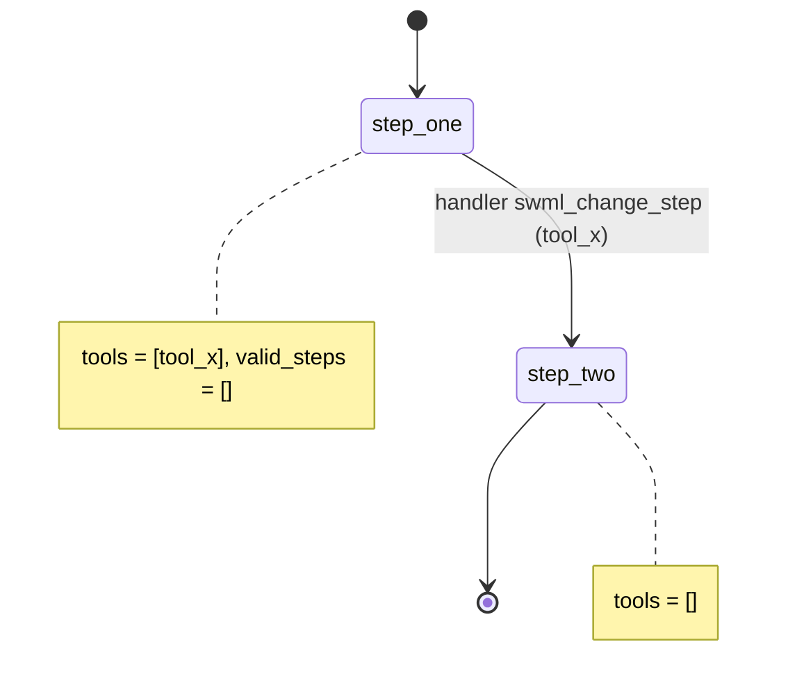

# README template for a recipe

Every `recipes/<nn-slug>/README.md` has exactly these 7 `##` sections, in this order, with
these exact headings. CI checks the headings. Replace everything in angle brackets. Keep
the whole README to about one screen per section.

````markdown
# <Recipe title>

<One sentence: what a caller experiences.>

## What it does

<2-4 sentences from the caller's point of view. What they call, what happens, how it ends.>

## What it demonstrates

<The governance point in one or two sentences: which tool is scoped to which step, which
handler moves the call, or which data the model never sees. A prompt-only recipe fails review.>



| Primitive | Where |
|---|---|
| <set_functions> | <app.py, step `step_one`> |

## Prerequisites

- Python 3.12 and a SignalWire Space (project ID, API token, Space URL)
- A phone number on the Space (<role from NUMBERS.md, if you are using the demo pool>)
- A public URL for your machine (ngrok or similar)
- <Anything recipe-specific. Third-party accounts are optional and off by default.>

## Setup

```bash
git clone https://github.com/signalwire-demos/ai-recipes
cd ai-recipes/recipes/<nn-slug>
python3.12 -m venv .venv && source .venv/bin/activate
pip install -r requirements.txt
cp .env.example .env    # fill in the SIGNALWIRE_* keys, PUBLIC_URL and basic auth
```

<Recipe-specific setup steps, e.g. building an index or seeding data.>

## Run locally

```bash
python app.py                      # serves SWML on :3000
ngrok http 3000                    # in another terminal; put the URL in PUBLIC_URL
```

In the SignalWire Dashboard, set the phone number's call handler to
`https://USER:PASS@<your-tunnel>/` (USER/PASS = SWML_BASIC_AUTH_USER/PASSWORD), then call it.

Without a phone:

```bash
pytest -q
swaig-test app.py --list-tools
swaig-test app.py --dump-swml --raw | jq '.sections.main[-1].ai.prompt.contexts'
swaig-test app.py --exec <tool> --<arg> <value>
```

<What to say on the call: test inputs, mock account numbers, card numbers, etc.>

## Deploy

```bash
docker compose up --build          # reads .env, serves on :3000
```

Put it behind any HTTPS host and point the number at `https://USER:PASS@<host>/`.
Serverless: <one note, e.g. "agent.run() detects AWS Lambda; see the SDK's lambda_agent.py
example" or "not suited to serverless because it keeps local state in data/">.

## What to change first

Open `config.py`: <the one or two knobs a developer changes to make this theirs>.
````

## Rules

- Section headings exactly as above. No extra `##` sections. Use `###` inside a section if you must.
- The mermaid diagram shows steps, the transitions, and who triggers each one (handler or model).
- "What to change first" names `config.py`.
- Phone numbers in examples use the 555-01xx range. No real PII, PHI or card data.
- Anything blocked: write `TODO(blocked: <reason>)` in the README section where it applies.
