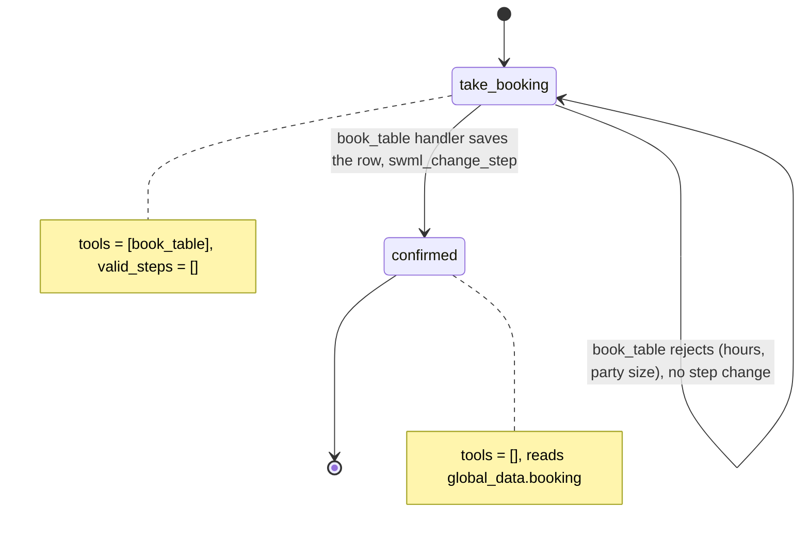

# AI Restaurant Reservation Line

A caller books a table by phone and hears a confirmation code read back.

## What it does

The agent answers for the restaurant and asks for a name, party size, date, time and a
callback number. It books the table, or explains why it can't (closed that day, outside
seating hours, party too large) and asks for something that works. Once the booking is
saved, it reads the details and a confirmation code back and says goodbye.

## What it demonstrates

The model can't confirm a booking that the code hasn't made. The `take_booking` step exposes
exactly one tool, `book_table`, and declares `valid_steps=[]`, so the model has no
`next_step` tool and can't leave the step on its own. The `book_table` handler checks the
opening hours and the party size in Python, appends the row to the reservation sink, and only
then calls `swml_change_step("confirmed")`. A rejected request returns no actions, so the call
stays in `take_booking`. `confirmed` declares `set_functions([])` and reads the booking from
`global_data`, which the handler wrote. It doesn't use anything the model said.



| Primitive | Where |
|---|---|
| `define_contexts` / `add_step` | `app.py`, `ReservationAgent.__init__` |
| `set_functions(["book_table"])`, `set_valid_steps([])` | `app.py`, step `take_booking` |
| `set_functions([])` | `app.py`, step `confirmed` |
| `update_global_data` + `swml_change_step` | `app.py`, `book_table` handler |
| `${global_data.booking.*}` in step text | `app.py`, step `confirmed` |
| `set_dynamic_config_callback` (today's date for the model) | `app.py`, `add_today` |

## Prerequisites

- Python 3.12 and a SignalWire Space (project ID, API token, Space URL)
- A phone number on the Space (in the demo pool, the `TEST_INBOUND` role from NUMBERS.md)
- A public URL for your machine (ngrok or similar)
- No third-party accounts

## Setup

```bash
git clone https://github.com/signalwire-demos/ai-recipes
cd ai-recipes/recipes/01-restaurant-reservation-line
python3.12 -m venv .venv && source .venv/bin/activate
pip install -r requirements.txt
cp .env.example .env    # fill in the SIGNALWIRE_* keys, PUBLIC_URL and basic auth
```

Nothing else to set up. Bookings are appended to `data/runtime/reservations.json`, which is
created on the first booking (the folder is gitignored).

## Run locally

```bash
python app.py                      # serves SWML on :3000
ngrok http 3000                    # in another terminal; put the URL in PUBLIC_URL
```

In the SignalWire Dashboard, set the phone number's call handler to
`https://USER:PASS@<your-tunnel>/` (USER/PASS = SWML_BASIC_AUTH_USER/PASSWORD), then call it.

Without a phone:

```bash
pytest -q
swaig-test app.py --list-tools
swaig-test app.py --dump-swml --raw | jq '.sections.main[-1].ai.prompt.contexts'
swaig-test app.py --exec book_table --name "Dana Example" --party_size 4 \
    --date 2026-11-06 --time 19:30 --phone 5555550142
```

What to try on the call (with the default hours in `config.py`):

- "A table for four this Friday at 7:30, name Dana, my number is 555-555-0142." Booked, and you
  hear a code like `R-0421`.
- "A table for ten on Saturday." Rejected: the limit is 8 (`MAX_PARTY`).
- "Monday at 7." Rejected: closed on Mondays.
- "Friday at 10:30 at night." Rejected: the last seating is an hour before close.

## Deploy

```bash
docker compose up --build          # reads .env, serves on :3000
```

Put it behind any HTTPS host and point the number at `https://USER:PASS@<host>/`.
Serverless: not suited as shipped, because the sink is a local file. Point `save_booking()`
at a database or your booking system's API first, then `agent.run()` detects AWS Lambda and
Google Cloud Functions unchanged.

## What to change first

Open `config.py`: set `RESTAURANT_NAME`, your `OPENING_HOURS` and `LAST_SEATING_MINUTES`, and
`MAX_PARTY`. `RESERVATIONS_FILE` is the reservation sink. To write to a real booking system,
replace `save_booking()` in `app.py`.
