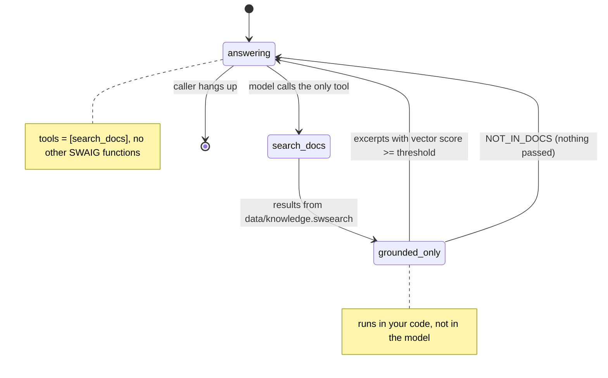

# AI Product Docs Hotline

A caller asks how the product works and hears an answer taken from your docs, or "That's not in the docs."

## What it does

The caller asks a question, such as "How do I point a phone number at my agent?". The agent
searches a local index of the docs in `docs/`, then answers in two or three sentences using
only what the search returned. If nothing in the docs matches ("What's the capital of
France?"), it says "That's not in the docs." and offers to help with something else. The
index is built with `sw-search` and committed, so a clean clone answers on its first call.

The 15 files in `docs/` are short sample pages about SignalWire, written for this recipe.
They are paraphrased, not copied from the official docs (which live at
https://signalwire.com/docs). Replace them with your own.

## What it demonstrates

Grounding is enforced by the tool, not requested by the prompt. The agent has exactly one
tool, `search_docs` (the `native_vector_search` skill), and it can only read
`data/knowledge.swsearch`. Before the model sees any result, `grounded_only()` in `app.py`
drops every chunk whose vector similarity is under `SIMILARITY_THRESHOLD`. When nothing
passes, the model gets the fixed marker `NOT_IN_DOCS` instead of weak matches it could
stretch into an answer, and the prompt maps that marker to the refusal line.



| Primitive | Where |
|---|---|
| `add_skill("native_vector_search", ...)` | `app.py`, `DocsHotline.__init__` |
| `response_format_callback` (the threshold gate) | `app.py`, `grounded_only()` |
| `sw-search` index build | `Makefile`, target `index` |
| `add_language` with function fillers | `app.py`, `DocsHotline.__init__` |

Two 3.7.5 details the code works around, both commented in `app.py`:

- The skill's own `similarity_threshold` drops weak vector hits but lets keyword-only hits
  through, so "What states do you serve?" matched the 10DLC page on the word "states".
  The gate checks each chunk's `vector_score` instead.
- `skip_prompt` doesn't stop the skill adding a prompt section that says "try another
  knowledge source". The app creates the `Knowledge Search` section first, with its own
  rules, so the skill only appends one line to it.

## Prerequisites

- Python 3.12 and a SignalWire Space (project ID, API token, Space URL)
- A phone number on the Space (in the demo pool, the `TEST_INBOUND` role from NUMBERS.md)
- A public URL for your machine (ngrok or similar)
- About 1 GB of disk for the search dependencies (PyTorch CPU, sentence-transformers). No
  third-party accounts.

## Setup

```bash
git clone https://github.com/signalwire-demos/ai-recipes
cd ai-recipes/recipes/02-product-docs-hotline
python3.12 -m venv .venv && source .venv/bin/activate
pip install -r requirements.txt
cp .env.example .env    # fill in the SIGNALWIRE_* keys, PUBLIC_URL and basic auth
```

The index is already in `data/knowledge.swsearch`. Rebuild it after you change `docs/`:

```bash
make index              # sw-search ./docs --output data/knowledge.swsearch --chunking-strategy markdown ...
sw-search search data/knowledge.swsearch "how do I record a call"
```

The first search (or build) downloads the `all-MiniLM-L6-v2` embedding model, about 90 MB.
`python app.py` runs one warm-up search at start-up so that download doesn't happen during a
call. A warning about missing NLTK data is harmless; to silence it, run
`python -m nltk.downloader averaged_perceptron_tagger_eng punkt_tab`.

## Run locally

```bash
python app.py                      # serves SWML on :3000
ngrok http 3000                    # in another terminal; put the URL in PUBLIC_URL
```

In the SignalWire Dashboard, set the phone number's call handler to
`https://USER:PASS@<your-tunnel>/` (USER/PASS = SWML_BASIC_AUTH_USER/PASSWORD), then call it.
Try "How do I point a phone number at my agent?", "What is 10DLC?", "Can I run SWML without a
server?", and then something off-topic, such as "Who won the World Series?".

Without a phone:

```bash
pytest -q
swaig-test app.py --list-tools
swaig-test app.py --dump-swml --raw | jq '.sections.main[-1].ai.SWAIG.functions'
swaig-test app.py --exec search_docs --query "how do I record a call"
swaig-test app.py --exec search_docs --query "what is the capital of France"   # NOT_IN_DOCS
```

## Deploy

```bash
docker compose up --build          # reads .env, serves on :3000
```

The image bakes in the embedding model and NLTK data, so the container needs no internet
access at call time. Put it behind any HTTPS host and point the number at
`https://USER:PASS@<host>/`.
Serverless: not a good fit. PyTorch and the model make a large package with a slow cold
start. For serverless, run `sw-search` as a remote search server and set the skill's
`remote_url` instead of `index_file`.

## What to change first

Open `config.py`: set `PRODUCT_NAME`, point `DOCS_DIR` at your own docs folder, then run
`make index` to rebuild `INDEX_FILE`. If good questions come back as "not in the docs",
lower `SIMILARITY_THRESHOLD`. If off-topic questions get answers, raise it. Use
`swaig-test --exec search_docs` to check.
