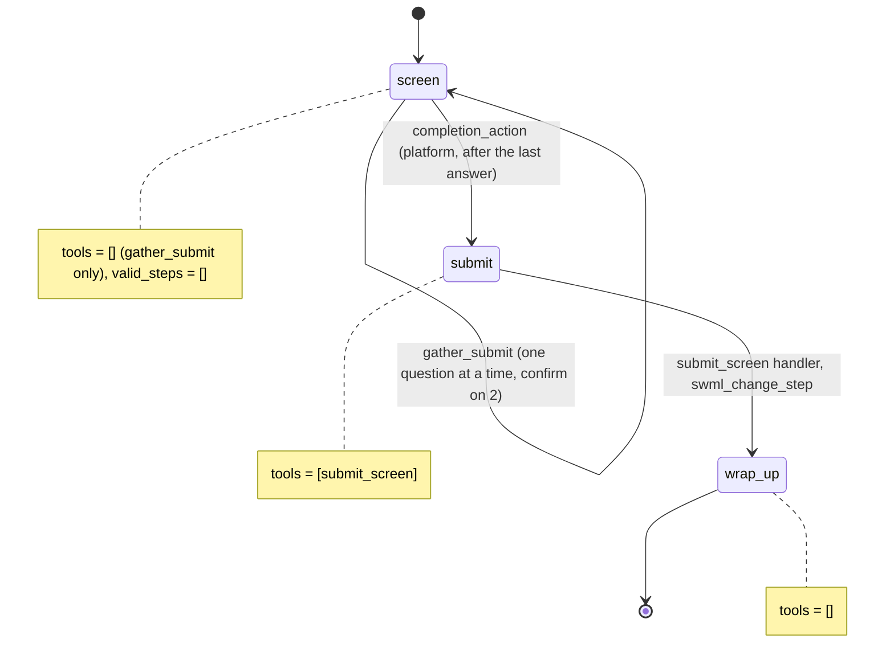

# AI Hiring Phone Screen

A candidate gets a call (or calls in) and answers five screening questions, in a fixed order, before anything else can happen.

## What it does

The agent introduces itself and runs a short screen for a warehouse shift lead role: work
authorization, years of experience, earliest start date, pay range, and one open question.
It reads the work-authorization and start-date answers back and waits for a yes before it moves
on. When the last answer is in, it saves the screen to `data/candidates/<candidate_id>.json`,
says a recruiter will follow up, and says goodbye. `call_candidate.py` starts the screen as an
outbound call; calling the number inbound runs the same screen for testing.

## What it demonstrates

A voice form the caller cannot reorder or skip. The `screen` step is a gather
(`set_gather_info` + `add_gather_question`): the platform injects one question at a time, in
the order of `config.QUESTIONS`, and while it gathers the only callable tool is the platform's
`gather_submit`. The step declares `set_functions([])` and `valid_steps=[]`, so there is no
`next_step` and no user tool to wander into. `confirm=True` on the error-prone questions makes the
submit schema require a confirmed read-back. `completion_action="submit"` moves the call to the
`submit` step, whose only tool reads the answers from `global_data` and writes the file. The
candidate id comes from the dial URL through the dynamic config callback, so the model never
picks the file name.



| Primitive | Where |
|---|---|
| `set_gather_info(output_key, completion_action)` | `app.py`, step `screen` |
| `add_gather_question(..., confirm=True)` | `app.py`, one per entry in `config.QUESTIONS` |
| `set_functions([])`, `set_valid_steps([])` | `app.py`, steps `screen` and `wrap_up` |
| `raw_data["global_data"][OUTPUT_KEY]` + `swml_change_step` | `app.py`, `submit_screen` handler |
| `set_dynamic_config_callback` | `app.py`, `per_call` puts `?candidate=` into `global_data` |
| REST `calling.dial(from_, to, url)` | `call_candidate.py` |

## Prerequisites

- Python 3.12 and a SignalWire Space (project ID, API token, Space URL)
- A phone number on the Space that can place outbound calls (in the demo pool, `OUTBOUND_1` from
  NUMBERS.md is the caller ID; `TEST_INBOUND` works for inbound testing)
- A phone to screen: your own mobile, set as `CANDIDATE_NUMBER`
- A public URL for your machine (ngrok or similar)
- No third-party accounts

## Setup

```bash
git clone https://github.com/signalwire-demos/ai-recipes
cd ai-recipes/recipes/04-hiring-phone-screen
python3.12 -m venv .venv && source .venv/bin/activate
pip install -r requirements.txt
cp .env.example .env    # fill in the SIGNALWIRE_* keys, PUBLIC_URL and basic auth
```

In `.env`, also set `CANDIDATE_NUMBER` (the phone to call) and `FROM_NUMBER` (a number on your
Space). If `FROM_NUMBER` is empty, the `OUTBOUND_1` value from the monorepo `.env` is used.

## Run locally

```bash
python app.py                      # serves SWML on :3000
ngrok http 3000                    # in another terminal; put the URL in PUBLIC_URL
python call_candidate.py C-0101 --dry-run   # check the plan (password masked)
python call_candidate.py C-0101             # the candidate's phone rings
```

Answer and go through the questions. Afterwards, `data/candidates/C-0101.json` holds the screen.
For an inbound test, set the phone number's call handler to `https://USER:PASS@<your-tunnel>/`
(USER/PASS = SWML_BASIC_AUTH_USER/PASSWORD) and call it. Without `?candidate=`, the file is named
`call-<first 8 chars of the call id>.json`.

Live-tested 2026-10-30, outbound call `ae670461-701b-4cc9-bd5c-23adbccd40c6` (121 s).
`call_candidate.py C-L1-a1` dialed `OUTBOUND_1` -> `TEST_INBOUND`, where a scripted answerer
replied. The platform log shows `gather_start` (5 questions), then `gather_question` 0 to 4 in
config order. `work_authorized` and `earliest_start` had `requires_confirm: true` and were
submitted with `confirmed_by_user` only after the read-back. Then `gather_complete` moved the
call `screen -> submit (gather_complete)`, and `submit_screen` moved it
`submit -> wrap_up (webhook_action)`. The handler wrote `data/candidates/C-L1-a1.json`
(`complete: true`, `work_authorized: true`, `years_experience: 6`, `earliest_start: "Monday,
November 9"`, and the pay range and reason verbatim). The file name came from the dial URL.

Without a phone:

```bash
pytest -q
swaig-test app.py --list-tools
swaig-test app.py --dump-swml --raw --query-params '{"candidate":"C-0101"}' \
  | jq '.sections.main[-1].ai.prompt.contexts.default.steps[0].gather_info'
swaig-test app.py --custom-data '{"global_data": {"candidate_id": "C-0101", "screen": {"work_authorized": true}}}' \
  --exec submit_screen
```

## Deploy

```bash
docker compose up --build          # reads .env, serves on :3000
```

Put it behind any HTTPS host, set `PUBLIC_URL` to it, and run `call_candidate.py` from anywhere
that has the same `.env`. Serverless: not suited as-is, because screens are written to local
files in `data/candidates/`. Point `CANDIDATES_DIR` (or the `submit_screen` write) at your ATS or
object storage first.

## What to change first

Open `config.py`: edit `QUESTIONS` (order, wording, `type`, and which ones need `confirm=True`),
then `COMPANY_NAME` and `ROLE_TITLE`. Swap `CANDIDATES_DIR` for your applicant tracking system
when you're ready.
