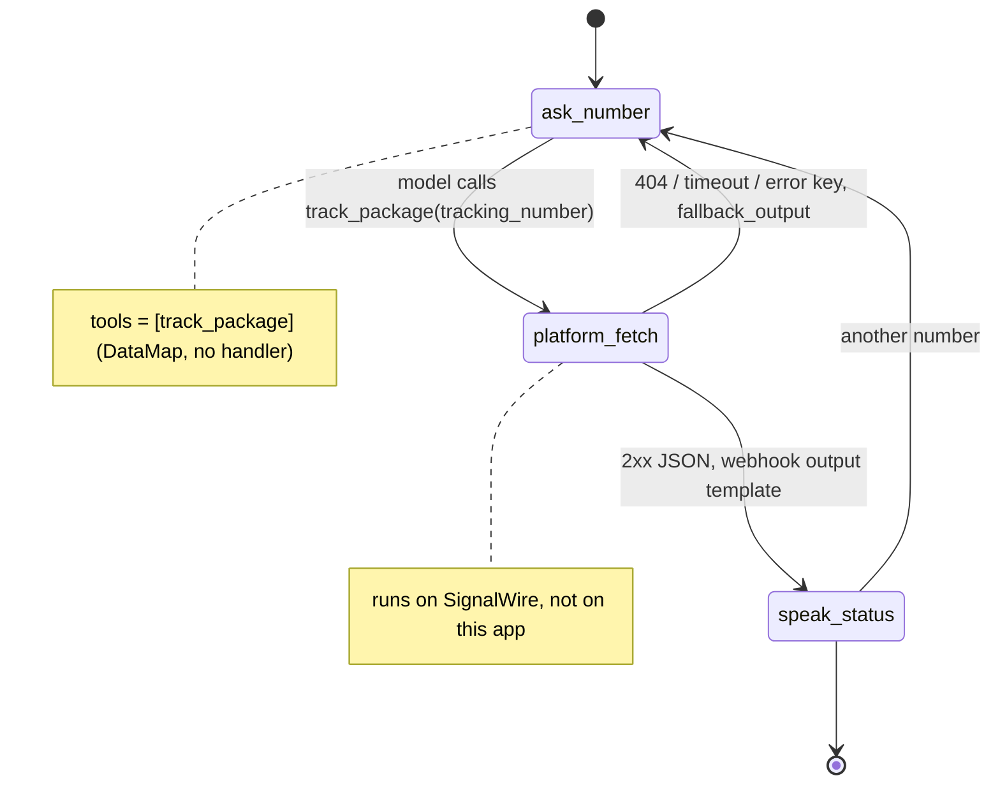

# AI Package Tracking Line

A caller reads out a tracking number and hears where the package is.

## What it does

The agent asks for a tracking number, reads it back to confirm, and looks it up. The caller
hears the status (in transit, delivered, or a delivery exception), the details, and where and
when the package was last scanned. If the number isn't found, the agent asks the caller to
read it again. It offers to look up another number, then says goodbye.

## What it demonstrates

You can call an external API without running a backend for it. `track_package` is a
**DataMap** tool. The HTTP GET, the template that turns the JSON into a sentence, and the
not-found fallback are all declared in `app.py` and shipped inside the SWML. SignalWire's
servers run them during the call. There is no Python handler and no `/swaig` webhook for this
tool, so nothing on this server runs during the call. The model sees the finished sentence and
never sees the raw API response or the API key. The tests prove this from the dumped SWML: the
function carries a `data_map` and no `web_hook_url`, no handler is registered, and the SDK
refuses to run it locally.



| Primitive | Where |
|---|---|
| `DataMap(...).webhook("GET", url)` | `app.py`, `build_track_package` |
| `.output(...)` / `.fallback_output(...)` / `.error_keys(...)` | `app.py`, `build_track_package`; templates in `config.py` |
| `register_swaig_function(datamap.to_swaig_function())` | `app.py`, `TrackingAgent.__init__` |

This is the tool exactly as it ships in the SWML (`swaig-test app.py --dump-swml --raw | jq
'.sections.main[-1].ai.SWAIG.functions'`). Paste the same block into any SWML script's `ai`
verb and it works with no server at all:

```yaml
SWAIG:
  functions:
    - function: track_package
      description: Get the delivery status for one tracking number.
      parameters:
        type: object
        properties:
          tracking_number: {type: string, description: "The tracking number, digits only, no spaces or dashes"}
        required: [tracking_number]
      data_map:
        webhooks:
          - method: GET
            url: "https://raw.githubusercontent.com/signalwire-demos/ai-recipes/main/recipes/05-package-tracking-line/data/mock-api/${enc:args.tracking_number}.json"
            headers: {Accept: application/json}
            error_keys: [error]
            output:
              response: "Package ${input.args.tracking_number} is ${status}. ${detail} The last scan was in ${last_location} on ${last_scan}."
        output:
          response: "I couldn't find tracking number ${args.tracking_number}. Ask the caller to read it again, one digit at a time."
```

Template rule: in a webhook's `output`, the platform reads the JSON response from the root
(`${status}`, not `${response.status}`), and the arguments are `${input.args.x}`. In the URL
and the top-level fallback `output`, the arguments are `${args.x}`.

## Prerequisites

- Python 3.12 and a SignalWire Space (project ID, API token, Space URL)
- A phone number on the Space (in the demo pool, the `TEST_INBOUND` role from NUMBERS.md)
- A public URL for your machine (ngrok or similar)
- No third-party accounts. The default carrier is a static mock feed: the JSON files in
  `data/mock-api/`, fetched from GitHub raw. Optional: a real carrier API through
  `TRACKING_API_URL` and `TRACKING_API_KEY`.

## Setup

```bash
git clone https://github.com/signalwire-demos/ai-recipes
cd ai-recipes/recipes/05-package-tracking-line
python3.12 -m venv .venv && source .venv/bin/activate
pip install -r requirements.txt
cp .env.example .env    # fill in the SIGNALWIRE_* keys, PUBLIC_URL and basic auth
```

The mock feed URL only answers once this recipe is on `main` in the public repo, because
SignalWire fetches it from `raw.githubusercontent.com`. TODO(blocked: the live lookup returns
the "couldn't find" fallback until this recipe is merged to main). The tests don't need it:
they serve `data/mock-api/` locally.

## Run locally

```bash
python app.py                      # serves SWML on :3000
ngrok http 3000                    # in another terminal; put the URL in PUBLIC_URL
```

In the SignalWire Dashboard, set the phone number's call handler to
`https://USER:PASS@<your-tunnel>/` (USER/PASS = SWML_BASIC_AUTH_USER/PASSWORD), then call it.
Your app serves the SWML once at the start of the call. After that the tracking lookups go
from SignalWire straight to the feed.

Without a phone:

```bash
pytest -q
swaig-test app.py --list-tools
swaig-test app.py --dump-swml --raw | jq '.sections.main[-1].ai.SWAIG.functions'
swaig-test app.py --exec track_package --tracking_number 40010001 --verbose   # real GET to the feed
```

Tracking numbers to say on the call:

| Number | Status |
|---|---|
| `40010001` | In transit, due Tuesday |
| `40010002` | Delivered |
| `40010003` | Delivery exception (damaged label) |
| anything else | Not found, so the agent asks again |

## Deploy

```bash
docker compose up --build          # reads .env, serves on :3000
```

Put it behind any HTTPS host and point the number at `https://USER:PASS@<host>/`.
Serverless: the app only serves SWML and keeps no state, so `agent.run()` deploys unchanged to
AWS Lambda or Google Cloud Functions. Or skip the app completely: put the SWML above in a
Dashboard SWML script.

## What to change first

Open `config.py`: point `TRACKING_URL` at your carrier (or set `TRACKING_API_URL` and
`TRACKING_API_KEY` in `.env`; the key goes in the webhook's `Authorization` header in the SWML, which is behind basic auth, and never in
the prompt or `global_data`), then rewrite `OUTPUT_TEMPLATE` with the field names your
carrier's JSON uses. `COMPANY_NAME` and `VOICE` set the greeting.
