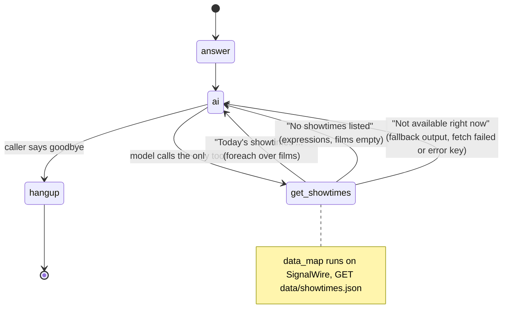

# AI Movie Showtimes Hotline

A caller asks what's playing tonight and hears the films and showtimes from your feed. There's no server and nothing to install.

## What it does

The caller rings the theater's number and asks, for example, "When is Orbit of Nine
playing?". The AI agent calls one tool, `get_showtimes`, and SignalWire's servers fetch
`data/showtimes.json` and turn it into one sentence per film. The agent reads back the
times for that film, or the whole list if asked, and says goodbye. All of it is one file,
`showtimes.swml.yaml`, which you paste into the Dashboard.

## What it demonstrates

This is the zero-install path, for teams that don't write Python. Even without code you
still govern the agent. Its only tool is a `data_map` that runs on SignalWire. It fetches
your feed, builds the sentence the model reads (`foreach` over `films`), and swaps in fixed
lines when the feed is empty (`expressions`) or unreachable (the top-level `output`, used as
the fallback). The model never sees the raw feed, can't call any URL you didn't list, and has
no other tool. Nothing in the file points at a server you run.



| Primitive | Where |
|---|---|
| `ai` verb with an inline prompt | `showtimes.swml.yaml`, `sections.main[1]` |
| `data_map.webhooks` (GET the feed) | `showtimes.swml.yaml`, function `get_showtimes` |
| `foreach` (one sentence per film) | the webhook's `foreach` |
| `expressions` (empty feed) | the webhook's `expressions` |
| top-level `output` (fallback) | `get_showtimes.data_map.output` |

One template detail, checked against the SDK's DataMap simulator: inside a webhook's
`foreach`, `expressions` and `output`, the response's fields are read from the root
(`${films}`, `${listing}`), not as `${response.films}`.

## Prerequisites

- A SignalWire Space and a phone number on it (in the demo pool, the `TEST_INBOUND` role
  from NUMBERS.md)
- A place to host a JSON feed at a public HTTPS URL. The default is this repo's
  `data/showtimes.json` on GitHub raw.
- For the REST method only: `curl`, `jq`, and your project ID, API token and Space URL
- No Python, no server, no third-party accounts. (Python is only needed to run the tests.)

## Setup

### Dashboard (paste)

1. In the Dashboard, open **Resources → SWML Scripts** and create a new script.
2. Paste the contents of [`showtimes.swml.yaml`](showtimes.swml.yaml), name it
   `movie-showtimes`, and save it.
3. Open **Phone Numbers**, pick your number, and set its call handler to the
   `movie-showtimes` SWML script. Save.

### REST (scripted)

```bash
cd ai-recipes/recipes/06-movie-showtimes-hotline
cp .env.example .env && $EDITOR .env       # SIGNALWIRE_PROJECT_ID, _API_TOKEN, _SPACE
set -a; . ./.env; set +a
jq -n --arg name movie-showtimes --rawfile contents showtimes.swml.yaml \
    '{name: $name, contents: $contents}' |
  curl -sS -u "$SIGNALWIRE_PROJECT_ID:$SIGNALWIRE_API_TOKEN" \
    -H 'Content-Type: application/json' -d @- \
    "https://$SIGNALWIRE_SPACE/api/fabric/resources/swml_scripts"
```

The same call in the Python SDK is
`client.fabric.swml_scripts.create(name="movie-showtimes", contents=open("showtimes.swml.yaml").read())`.
To update the script later, send `PUT .../swml_scripts/<id>` with new `contents`. Then
assign the script to your number in the Dashboard (step 3 above). The 3.7.5 SDK has no
typed helper that binds a number to a stored SWML script, so this recipe doesn't script
that step.

## Run locally

There's nothing to run: the script runs on SignalWire. Call your number and try "What's
playing today?", "When is Paper Kites showing?", or "How much are tickets?". The agent should
say it doesn't have prices on this line.

To check the file without a phone (Python 3.12, test-only dependencies):

```bash
python3.12 -m venv .venv && source .venv/bin/activate
pip install -r requirements.txt
pytest -q                                       # schema + data_map on 3 feed fixtures
python ../../scripts/validate_swml.py showtimes.swml.yaml
```

The tests run `get_showtimes` through the SDK's DataMap simulator, the engine behind
`swaig-test --exec`, against a local copy of the feed and the fixtures in `tests/fixtures/`.

### Troubleshooting: see the lookup run on a live call (optional)

The `data_map` runs on SignalWire, so nothing reaches a server of yours and the call logs
don't show the fetch. To watch it, add a debug webhook to the `ai` verb **for one test call
only**, pointing at any HTTPS endpoint that accepts POSTs (a request bin, or a small local
server behind a tunnel):

```yaml
    - ai:
        params:
          debug_webhook_url: https://your-receiver.example.com/debug
          debug_webhook_level: 2        # 0-2; 1 is the default when a URL is set
        # ...the rest of the ai verb unchanged
```

SignalWire then POSTs one JSON event per step. For this tool, look for `swaig_call` with
`command_name: get_showtimes`, `webhook_log.request_url` (the feed URL it fetched),
`webhook_reply` (the feed it got back) and `function_call.duration_ms`. The `conversation_add`
events show what the agent then said. Remove the `params` block before you save the script for
real callers: the debug payloads include the caller's number and the whole conversation.

Verified on a live call (2026-10-30, inbound call `074a6a96-1ddc-425c-b2f2-09badf4310a5`):
the platform fetched the feed from GitHub raw in 281 ms, built "Today's showtimes: The
Lighthouse at Gull Point, rated PG, 104 minutes, ..." with `foreach`, and the agent read back
all three films and then only Paper Kites' times when asked.

## Deploy

It's already deployed once the script is saved in your Space. To change showtimes, edit
your feed. Callers get the new times on the next call, with no redeploy. To change the
prompt, edit the script in the Dashboard or re-run the REST call. Serverless: this recipe
has no server at all. The feed can be any static host (GitHub raw or Pages, S3, a CDN) or
an API that returns the same JSON shape.

## What to change first

This recipe has no `config.py`: the knobs are in `showtimes.swml.yaml`.

- **The theater name** in the prompt (`Starlight Cinema`).
- **The feed URL** in `get_showtimes.data_map.webhooks[0].url`. Point it at your own feed.
  Each film needs `title`, `rating`, `runtime` and `times`, as in `data/showtimes.json`.
