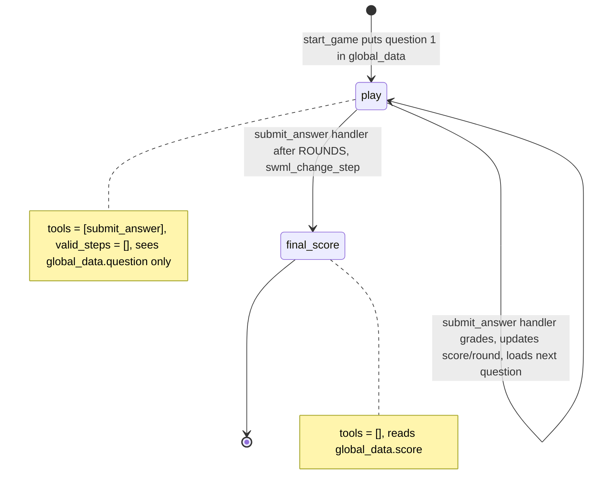

# AI Trivia Hotline

A caller plays a five-question trivia game and hears their final score.

## What it does

The host greets the caller and asks a question. Whatever the caller says is graded on the
server, and the host says whether it was right (and, on a miss, what the answer was), gives the
running score, and asks the next question. After five rounds the host reads the final score and
says goodbye. Each call gets its own random set of questions from `data/questions.json`.

## What it demonstrates

The model keeps no game state and never sees the answer key. It sees the current question
through `${global_data.question}`. It doesn't see the answers. The `submit_answer` handler
reads the question id from `global_data`, grades the caller's words in Python (with fuzzy
matching), writes the new round, score and next question back into `global_data`, and after
`ROUNDS` questions calls `swml_change_step("final_score")`. Every call to `submit_answer`
moves on a round, so the model can't retry or probe for an answer. `play` has
`valid_steps=[]`, so only the handler can end the game, and `final_score` has
`set_functions([])`. The tests check that no accepted answer appears anywhere in the dumped
SWML (prompt, steps, `global_data`) or in any `global_data` the handler writes.



| Primitive | Where |
|---|---|
| `define_contexts` / `add_step` | `app.py`, `TriviaAgent.__init__` |
| `set_functions(["submit_answer"])`, `set_valid_steps([])` | `app.py`, step `play` |
| `set_functions([])` | `app.py`, step `final_score` |
| `${global_data.question}`, `${global_data.score}` in step text | `app.py`, steps `play` and `final_score` |
| `update_global_data` + `swml_change_step` | `app.py`, `submit_answer` handler |
| `set_dynamic_config_callback` (per-call question order) | `app.py`, `start_game` |

## Prerequisites

- Python 3.12 and a SignalWire Space (project ID, API token, Space URL)
- A phone number on the Space (in the demo pool, the `TEST_INBOUND` role from NUMBERS.md)
- A public URL for your machine (ngrok or similar)
- No third-party accounts

## Setup

```bash
git clone https://github.com/signalwire-demos/ai-recipes
cd ai-recipes/recipes/07-trivia-hotline
python3.12 -m venv .venv && source .venv/bin/activate
pip install -r requirements.txt
cp .env.example .env    # fill in the SIGNALWIRE_* keys, PUBLIC_URL and basic auth
```

Nothing else to set up. The ten sample questions are in `data/questions.json`.

## Run locally

```bash
python app.py                      # serves SWML on :3000
ngrok http 3000                    # in another terminal; put the URL in PUBLIC_URL
```

In the SignalWire Dashboard, set the phone number's call handler to
`https://USER:PASS@<your-tunnel>/` (USER/PASS = SWML_BASIC_AUTH_USER/PASSWORD), then call it.

Without a phone:

```bash
pytest -q
swaig-test app.py --list-tools
swaig-test app.py --dump-swml --raw | jq '.sections.main[-1].ai.global_data'   # a question, no answer
swaig-test app.py \
    --custom-data '{"global_data": {"round": 1, "score": 0, "question_id": "q01", "question": "Which planet is known as the Red Planet?", "queue": ["q02"]}}' \
    --exec submit_answer --answer "I think it's Mars"
```

On the call, play it straight. Then try to break it: ask the host for the answer (it doesn't
have it), answer with a typo or extra words ("I think it's Shakespear"), or say "I don't know"
(that counts as a miss and the game moves on).

## Deploy

```bash
docker compose up --build          # reads .env, serves on :3000
```

Put it behind any HTTPS host and point the number at `https://USER:PASS@<host>/`.
Serverless: the game state lives in `global_data` on the call, not on this server, so the agent
is stateless and `agent.run()` deploys unchanged to AWS Lambda or Google Cloud Functions (see the
SDK's `lambda_agent.py` example).

## What to change first

Open `config.py`: point `QUESTIONS_FILE` at your own question file (same shape as
`data/questions.json`, with every accepted spelling in `answers`), set `ROUNDS`, and tune
`FUZZY_TOLERANCE` (lower accepts sloppier answers). `SHOW_NAME` and `VOICE` set the host.
