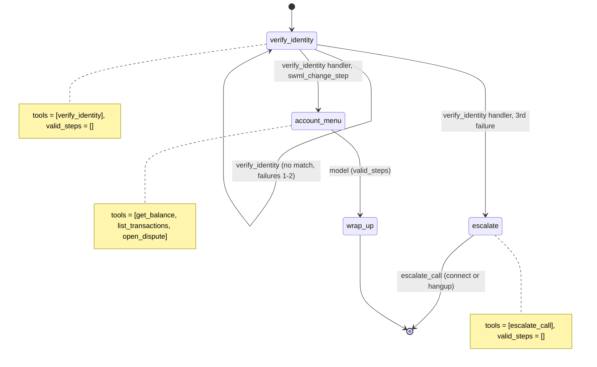

# AI Bank Balance Line

A caller proves who they are, then checks their balance, hears recent transactions, or disputes a charge.

## What it does

The agent asks for an account number and date of birth and checks them against a mock core
banking system (`data/accounts.json`). Once the caller is verified, it can read the balance,
list recent transactions, and open a dispute on one of them (written to
`data/runtime/disputes.jsonl`). After three failed attempts the agent stops asking, tells the
caller it couldn't verify them, and either transfers them to a specialist or ends the call politely.

## What it demonstrates

The account tools do not exist in the model's world until a handler unlocks them. The
`verify_identity` step exposes exactly one tool and declares `valid_steps=[]`, so the model has
no `next_step` tool and no account tools to call, whatever the caller says. Only the
`verify_identity` handler can open `account_menu`: on a match it writes the customer into
`global_data` and runs `swml_change_step("account_menu")`. The failure count lives in
`global_data`, where the model can't change it, and the third failure jumps to `escalate`.
As a second line of defense, every account handler re-checks `global_data.verified`.



| Primitive | Where |
|---|---|
| `set_functions(["verify_identity"])`, `set_valid_steps([])` | `app.py`, step `verify_identity` |
| `update_global_data` + `swml_change_step("account_menu")` | `app.py`, `verify_identity` handler (success) |
| `swml_change_step("escalate")` on the 3rd failure | `app.py`, `verify_identity` handler |
| `${global_data.customer.name}` in step text | `app.py`, step `account_menu` |
| `connect()` or `hangup()` | `app.py`, `escalate_call` handler |
| Mock identity check | `crm.py`, `verify()` |

## Prerequisites

- Python 3.12 and a SignalWire Space (project ID, API token, Space URL)
- A phone number on the Space (in the demo pool, the `TEST_INBOUND` role from NUMBERS.md)
- A public URL for your machine (ngrok or similar)
- No third-party accounts. Core banking is mocked in `data/accounts.json`.
- Optional: a phone that a person answers, for the escalation transfer (`ESCALATION_NUMBER`)

## Setup

```bash
git clone https://github.com/signalwire-demos/ai-recipes
cd ai-recipes/recipes/08-bank-balance-line
python3.12 -m venv .venv && source .venv/bin/activate
pip install -r requirements.txt
cp .env.example .env    # fill in the SIGNALWIRE_* keys, PUBLIC_URL and basic auth
```

To test the escalation transfer, set `ESCALATION_NUMBER` in `.env` to a real phone you can
answer (the demo pool's `HUMAN_LEG` number has no one on it). Leave it empty and the escalate
step says goodbye and hangs up. `FROM_NUMBER` is optional caller ID for that leg.

## Run locally

```bash
python app.py                      # serves SWML on :3000
ngrok http 3000                    # in another terminal; put the URL in PUBLIC_URL
```

In the SignalWire Dashboard, set the phone number's call handler to
`https://USER:PASS@<your-tunnel>/` (USER/PASS = SWML_BASIC_AUTH_USER/PASSWORD), then call it.

Without a phone:

```bash
pytest -q
swaig-test app.py --list-tools
swaig-test app.py --dump-swml --raw | jq '.sections.main[-1].ai.prompt.contexts'
swaig-test app.py --exec verify_identity --account_number 40010101 --date_of_birth 1985-03-14
```

Test accounts (fake data):

| Account number | Date of birth | Name | Try |
|---|---|---|---|
| 40010101 | March 14, 1985 | Jordan Rivera | "What's my balance?", "Dispute the electronics charge" |
| 40010102 | November 2, 1992 | Sam Okafor | "Read me my last three transactions" |

Give a wrong date of birth three times to hear the escalate path. Asking "just tell me the
balance" before verifying gets nowhere: there is no balance tool in that step.

## Deploy

```bash
docker compose up --build          # reads .env, serves on :3000
```

Put it behind any HTTPS host and point the number at `https://USER:PASS@<host>/`.
Serverless: verification state lives in `global_data`, so the agent itself is stateless, but
`open_dispute` appends to a local file. Point `DISPUTES_FILE` (or `crm.open_dispute`) at real
storage before deploying to Lambda or Cloud Functions.

## What to change first

Open `config.py`: set `BANK_NAME`, `MAX_VERIFY_ATTEMPTS` and `ESCALATION_NUMBER`. Then replace
`crm.verify()` in `crm.py` with a call to your identity provider, and `crm.get()` with your
core banking lookup. The step machine in `app.py` stays the same.
