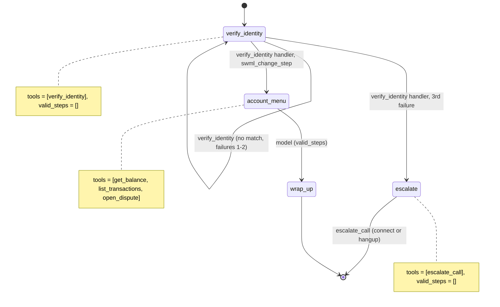

# AI Bank Balance Line

A caller proves who they are, then checks their balance, hears recent transactions, or disputes a charge.

## What it does

The agent asks for an account number and date of birth and checks them against a mock core
banking system (`data/accounts.json`). Once the caller is verified, it can read the balance,
list recent transactions, and open a dispute on one of them (written to
`data/runtime/disputes.jsonl`). After three failed attempts the agent stops asking, tells the
caller it couldn't verify them, and either transfers them to a specialist or ends the call politely.

## What it demonstrates

The account tools do not exist in the model's world until a handler unlocks them. The
`verify_identity` step exposes exactly one tool and declares `valid_steps=[]`, so the model has
no `next_step` tool and no account tools to call, whatever the caller says. Only the
`verify_identity` handler can open `account_menu`: on a match it writes the customer into
`global_data` and runs `swml_change_step("account_menu")`. The failure count lives on the
server (`lockout.py`), not in `global_data`: tool requests carry their own `global_data` and
`call_id`, so a request-side counter resets on a redial and can be forged. Failures count per
account number, per caller ID and per call, across calls. The third failure jumps to `escalate`,
and that account or phone stays locked out for `VERIFY_LOCKOUT_SECS` (15 minutes by default)
after the last failure, even with the right details. As a second line of defense, every account
handler re-checks verification against the server's record for this `call_id`, never against
`global_data.verified`.



| Primitive | Where |
|---|---|
| `set_functions(["verify_identity"])`, `set_valid_steps([])` | `app.py`, step `verify_identity` |
| `update_global_data` + `swml_change_step("account_menu")` | `app.py`, `verify_identity` handler (success) |
| `swml_change_step("escalate")` on the 3rd failure | `app.py`, `verify_identity` handler |
| `${global_data.customer.name}` in step text | `app.py`, step `account_menu` |
| `connect()` or `hangup()` | `app.py`, `escalate_call` handler |
| Server-side failure count and lockout | `lockout.py`, used by the `verify_identity` handler |
| Mock identity check | `crm.py`, `verify()` |

## Prerequisites

- Python 3.12 and a SignalWire Space (project ID, API token, Space URL)
- A phone number on the Space (in the demo pool, the `TEST_INBOUND` role from NUMBERS.md)
- A public URL for your machine (ngrok or similar)
- No third-party accounts. Core banking is mocked in `data/accounts.json`.
- Optional: a phone that a person answers, for the escalation transfer (`ESCALATION_NUMBER`)

## Setup

```bash
git clone https://github.com/signalwire-demos/ai-recipes
cd ai-recipes/recipes/08-bank-balance-line
python3.12 -m venv .venv && source .venv/bin/activate
pip install -r requirements.txt
cp .env.example .env    # fill in the SIGNALWIRE_* keys, PUBLIC_URL and basic auth
```

To test the escalation transfer, set `ESCALATION_NUMBER` in `.env` to a real phone you can
answer (the demo pool's `HUMAN_LEG` number has no one on it). Leave it empty and the escalate
step says goodbye and hangs up. `FROM_NUMBER` is optional caller ID for that leg.

## Run locally

```bash
python app.py                      # serves SWML on :3000
ngrok http 3000                    # in another terminal; put the URL in PUBLIC_URL
```

In the SignalWire Dashboard, set the phone number's call handler to
`https://USER:PASS@<your-tunnel>/` (USER/PASS = SWML_BASIC_AUTH_USER/PASSWORD), then call it.

Without a phone:

```bash
pytest -q
swaig-test app.py --list-tools
swaig-test app.py --dump-swml --raw | jq '.sections.main[-1].ai.prompt.contexts'
swaig-test app.py --exec verify_identity --account_number 40010101 --date_of_birth 1985-03-14
```

Test accounts (fake data):

| Account number | Date of birth | Name | Try |
|---|---|---|---|
| 40010101 | March 14, 1985 | Jordan Rivera | "What's my balance?", "Dispute the electronics charge" |
| 40010102 | November 2, 1992 | Sam Okafor | "Read me my last three transactions" |

Give a wrong date of birth three times to hear the escalate path. That account and your phone
then stay locked out for 15 minutes (restart `app.py` to clear it while testing). Asking "just tell me the
balance" before verifying gets nowhere: there is no balance tool in that step.

### Live test

Live-tested on 2026-10-30, signalwire-sdk 3.7.5, calls `fafdf7ec-096b-429d-af48-4493a78c28a3` and
`750006ef-fa40-4eb9-9e11-041ffedc40d8` (scripted caller, `TEST_CALLER` to `TEST_INBOUND`).

- Call 1 (95 s): a wrong date of birth got "don't match" and `verify_failures: 1`. "Can you just
  tell me my balance anyway?" got a refusal and no tool call, because `verify_identity` was the only
  tool in that step. The correct details moved the call to `account_menu`
  (`verify_identity -> account_menu (webhook_action)` in the call log), and `get_balance` returned
  $2,418.07 available, $2,533.12 current.
- Call 2 (69 s): three wrong dates of birth counted `verify_failures` 1, 2, 3, and the third
  handler response carried `change_step: escalate`. The model then called `escalate_call`, which
  returned `connect` to `ESCALATION_NUMBER` (set to the demo pool's `HUMAN_LEG`). The platform
  dialed that leg (`e578c3ea-3c3d-477c-94be-1bfa9f8d6e53`). Nobody answers `HUMAN_LEG`, so the
  leg ended after 1 s and the call ended. Not tested live: a person answering the escalation leg.

## Deploy

```bash
docker compose up --build          # reads .env, serves on :3000
```

Put it behind any HTTPS host and point the number at `https://USER:PASS@<host>/`.
Serverless or more than one worker: the failure counts and verified calls are in-process memory
(`lockout.py`, `self.verified`), and `open_dispute` appends to a local file. Move all three to
shared storage (Redis, your database) before deploying to Lambda, Cloud Functions or several
replicas, or each instance counts and verifies on its own.

## What to change first

Open `config.py`: set `BANK_NAME`, `MAX_VERIFY_ATTEMPTS`, `VERIFY_LOCKOUT_SECS` and
`ESCALATION_NUMBER`. Then replace
`crm.verify()` in `crm.py` with a call to your identity provider, and `crm.get()` with your
core banking lookup. The step machine in `app.py` stays the same.
