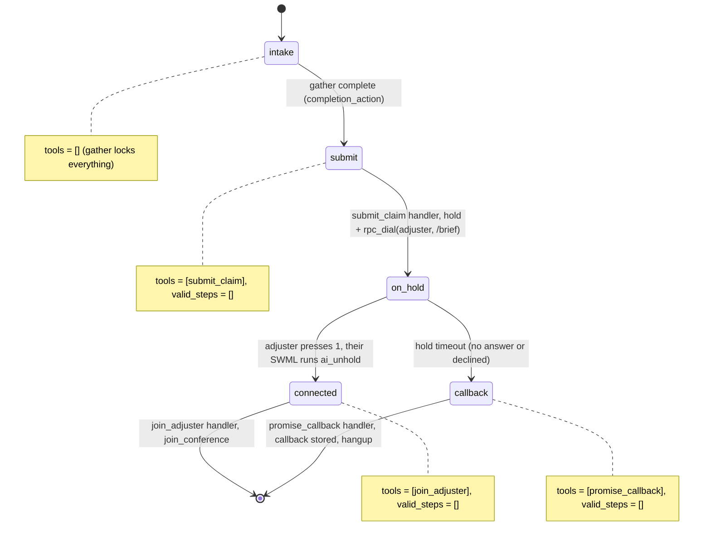

# AI Insurance Claim Intake

A caller reports an accident, and an adjuster hears a briefing and accepts before the call is bridged.

## What it does

The agent takes a first notice of loss: policy number, date, location, what happened, and
whether anyone was hurt (the policy number and the injuries answer are read back to confirm).
It files a claim record, puts the caller on hold and phones an adjuster. The adjuster hears a
spoken summary of the claim and presses 1 to take the call, which joins the caller and the
adjuster. If nobody accepts before the hold times out, the agent asks when to call back,
stores that callback promise on the claim and says goodbye.

## What it demonstrates

A screened handoff where the human is briefed before the bridge completes, and the model
never drives the handoff. The `submit` step exposes one tool, `submit_claim`. Its handler
writes the claim record, then returns `hold(step="connected", timeout_step="callback")` and
`rpc_dial(to_number, from_number, dest_swml)`. The `dest_swml` is this app's `/brief` route,
which turns the claim record into the SWML the adjuster's leg runs: speak the briefing, wait
for a keypress, and on `1` run `execute_rpc ai_unhold` on the caller and join the claim's
conference. So the platform, not the model, decides which step the caller lands in. The
`join_adjuster` tool only exists in `connected`, and `promise_callback` only exists in `callback`.
The adjuster number, the conference name and the claim record never enter the model's context.
It sees only `global_data.claim_id`.



| Primitive | Where |
|---|---|
| `set_gather_info` / `add_gather_question(confirm=True)` | `app.py`, step `intake` |
| `set_functions`, `set_valid_steps([])` | `app.py`, every step |
| `hold(step=, timeout_step=)` + `rpc_dial` | `app.py`, `submit_claim` handler |
| dest_swml: briefing, `prompt`, `switch`, `execute_rpc ai_unhold`, `join_conference` | `claims.py`, `adjuster_swml()`; served at `/brief` in `app.py` |
| `join_conference` | `app.py`, `join_adjuster` handler |
| Claim record validated against `data/claim.schema.json` | `claims.py`, `save()` |

## Prerequisites

- Python 3.12 and a SignalWire Space (project ID, API token, Space URL)
- A phone number on the Space for callers (in the demo pool, `TEST_INBOUND` from NUMBERS.md)
- An outbound-capable number for the adjuster leg's caller ID (`FROM_NUMBER`; demo pool `OUTBOUND_2`)
- A second phone that acts as the adjuster (`ADJUSTER_NUMBER`). In the demo pool it defaults
  to `HUMAN_LEG`, which nobody answers, so every call ends on the callback path. **For a live
  test, set `ADJUSTER_NUMBER` to a real phone you can pick up.**
- A public URL for your machine (ngrok or similar)
- No third-party accounts

## Setup

```bash
git clone https://github.com/signalwire-demos/ai-recipes
cd ai-recipes/recipes/09-insurance-claim-intake
python3.12 -m venv .venv && source .venv/bin/activate
pip install -r requirements.txt
cp .env.example .env    # fill in the SIGNALWIRE_* keys, PUBLIC_URL and basic auth
```

In `.env`, set `ADJUSTER_NUMBER` (the phone that gets the briefing) and `FROM_NUMBER` (an
outbound-capable number on your Space). Claims are written to `data/runtime/claims.json`,
which is created on the first call and is git-ignored.

## Run locally

```bash
python app.py                      # serves SWML on :3000
ngrok http 3000                    # in another terminal; put the URL in PUBLIC_URL
```

In the SignalWire Dashboard, set the phone number's call handler to
`https://USER:PASS@<your-tunnel>/` (USER/PASS = SWML_BASIC_AUTH_USER/PASSWORD), then call it.
Say something like: "I was rear-ended at Main and 3rd on October 28, policy POL-0101, nobody
was hurt." When the adjuster phone rings you hear the claim summary. Press 1 to be joined to
the caller, or let it ring out (or press any other key) to see the callback path.

Without a phone:

```bash
pytest -q
swaig-test app.py --list-tools
swaig-test app.py --dump-swml --raw | jq '.sections.main[-1].ai.prompt.contexts'
swaig-test app.py --custom-data '{"global_data": {"fnol": {"policy_number": "POL-0101",
  "incident_date": "October 28", "location": "Main and 3rd",
  "description": "Rear-ended at a red light", "injuries": false}}}' --exec submit_claim
curl -u USER:PASS "http://localhost:3000/brief?claim=CL-0001&call=test"   # the adjuster's SWML
```

With `ADJUSTER_NUMBER` or `FROM_NUMBER` unset, `submit_claim` goes straight to `callback`.
Set both to see the `hold` and `rpc_dial` actions in the `--exec` output.

## Deploy

```bash
docker compose up --build          # reads .env, serves on :3000
```

Put it behind any HTTPS host and point the number at `https://USER:PASS@<host>/`.
Serverless: not suited as-is, because claims live in a local JSON file. Point `claims.py` at a
database first.

## What to change first

Open `config.py`: edit `pick_adjuster()` to route by claim type (for example, injuries to a
bodily-injury desk) instead of one `ADJUSTER_NUMBER`, and tune `HOLD_TIMEOUT`. To change the
claim fields, edit the gather questions in `app.py`, `FIELDS` and `briefing()` in `claims.py`,
and `data/claim.schema.json` together.
