# AI Utility Bill Payment Line

A caller verifies their account, hears the balance, and pays it by card on the keypad while the recording is paused.

## What it does

The agent asks for the account number and service ZIP code. Once they match, recording starts
and the agent reads the balance due. If the caller wants to pay, the agent pauses the recording
and hands the call to the SWML `pay` verb, which prompts for the card number, expiry, security
code and ZIP code by keypad. The card goes straight to the payment connector. Here that's a
mock served by this same app at `/pay`, which approves or declines fixed test cards. Then the
call comes back to the agent, recording resumes, the agent tells the caller whether the payment
went through, and says goodbye.

## What it demonstrates

Payment isolation (PCI pattern 5). Card digits never reach the model, the recording, or this
app's logs:

- `take_payment` has **no parameters**. Its handler reads the amount from
  `global_data.account.balance_due`, which `verify_account` wrote from the billing record.
  Whatever amount the model or caller says is ignored.
- The handler returns `stop_record_call()` **then** a transfer SWML that runs `pay` and transfers
  back to this agent at `/?pay_ref=<one-time ref>`. So the recording is paused before the first
  digit is pressed, and the AI isn't listening while the caller types. (`pay` can't run as an
  in-AI action: the platform rejects it with 409 "Wait for ai to finish".)
- The model never hears the pay verb's result. `configure()` turns the one-time `pay_ref` back
  into the account and starts the returning call at `after_payment`, whose one tool,
  `resume_recording`, restarts the recording and says "went through" only on server-side
  evidence: the mock connector approved a charge carrying this call's `pay_ref`, or the
  platform's `status_url` reported `payment-completed` for this call. Anything else is
  reported as not paid.
- `take_payment` exists only in the `bill` step, which only the `verify_account` handler opens.
- The mock connector logs only the transaction id, amount and result. Its `/pay/status`
  callback keeps the event name per call and drops every card field. A test asserts that no
  card data shows up in any log output.

```mermaid
stateDiagram-v2
    [*] --> verify
    verify --> verify: verify_account(no match), no change
    verify --> bill: verify_account handler, record_call + swml_change_step
    bill --> pay: take_payment handler, stop_record_call + transfer SWML [pay, transfer]
    pay --> after_payment: transfer back to /?pay_ref=REF, configure() sets initial_step
    bill --> wrap_up: model (caller declines) or take_payment with nothing due
    after_payment --> wrap_up: resume_recording handler, record_call + swml_change_step
    wrap_up --> [*]
    note right of verify: tools = [verify_account], valid_steps = []
    note right of bill: tools = [take_payment] (no params), amount from global_data
    note right of pay: SWML pay verb, outside the AI; card goes to the connector only
    note right of after_payment: tools = [resume_recording], valid_steps = [], outcome from connector
    note right of wrap_up: tools = []
```



| Primitive | Where |
|---|---|
| `set_functions`, `set_valid_steps` | `app.py`, steps `verify`, `bill`, `after_payment`, `wrap_up` |
| `record_call` + `update_global_data` + `swml_change_step` | `app.py`, `verify_account` handler |
| `stop_record_call`, then `execute_swml([pay, transfer], transfer=True)` (amount from `global_data`) | `app.py`, `take_payment` handler |
| `set_dynamic_config_callback` + `set_initial_step("after_payment")` | `app.py`, `configure()` |
| `record_call` (resume), outcome from connector approvals | `app.py`, `resume_recording` handler |
| Payment connector + `status_url` | `connector.py`, `POST /pay` and `POST /pay/status` |

## Prerequisites

- Python 3.12 and a SignalWire Space (project ID, API token, Space URL)
- A phone number on the Space (in the demo pool, the `TEST_INBOUND` role from NUMBERS.md)
- A public URL for your machine (ngrok or similar). The platform calls both the agent and the
  `/pay` connector through it.
- No third-party accounts and no processor account. The connector is a mock.

## Setup

```bash
git clone https://github.com/signalwire-demos/ai-recipes
cd ai-recipes/recipes/10-utility-bill-payment-line
python3.12 -m venv .venv && source .venv/bin/activate
pip install -r requirements.txt
cp .env.example .env    # fill in the SIGNALWIRE_* keys, PUBLIC_URL and basic auth
```

Leave `PAY_CONNECTOR_URL` empty to use the built-in mock at `PUBLIC_URL/pay`. The app puts its
basic-auth user and password in that URL, and the mock refuses requests without them.

## Run locally

```bash
python app.py                      # serves SWML on :3000, plus the mock connector at /pay
ngrok http 3000                    # in another terminal; put the URL in PUBLIC_URL
```

In the SignalWire Dashboard, set the phone number's call handler to
`https://USER:PASS@<your-tunnel>/` (USER/PASS = SWML_BASIC_AUTH_USER/PASSWORD), then call it.
Say account `100101`, ZIP `74101` (balance $84.17), and "Yes, I'll pay it now." Then enter a
test card on the keypad, pressing `#` after each entry (any future expiry such as `1230`, any
3-digit security code, ZIP `74101`):

| Card number (keypad) | Mock result |
|---|---|
| `4242 4242 4242 4242` | Approved (status `payment-completed`; the agent says it went through) |
| `4000 0000 0000 0002` | Declined: `card_declined` |
| `4000 0000 0000 9995` | Declined: `insufficient_funds` |
| anything else | Declined: `card_not_supported` (the mock never approves a real card) |

Other test accounts: `100102` / `74103` ($212.50) and `100103` / `74105` (nothing due).

Without a phone:

```bash
pytest -q
swaig-test app.py --list-tools
swaig-test app.py --dump-swml --raw | jq '.sections.main[-1].ai.prompt.contexts'
swaig-test app.py --exec verify_account --account_number 100101 --service_zip 74101
swaig-test app.py --custom-data '{"global_data": {"account": {"id": "100101", "balance_due": "84.17"}}}' \
    --exec take_payment --amount 1.00     # the 1.00 is ignored: charge_amount is 84.17
```

### Live test

Live-tested on 2026-10-30 with signalwire-sdk 3.7.5. A scripted caller (`TEST_CALLER` to `TEST_INBOUND`) sent the
test card by DTMF (`send_digits`). Debug webhooks were off, and the only test logging was the
key names of `/pay` traffic.

- `51fc4c83-c36b-4b03-a19b-b879c1a6c457` (the original code): `verify_account` started recording and
  `take_payment` stopped it. Then the `pay` action failed within a second (`pay_result: failed`) and
  `/pay` was never called. The `ai_response` reached the model as "The payment result is ." (empty),
  and the model told the caller the payment **was successful**. Because pay had already ended, the
  keypad digits then went to the AI as speech. Both are fixed: no `${pay_result}` reaches the model,
  and pay runs outside the AI.
- `b3784c89-d347-487c-8c71-2e3a372b4ecf` (diagnosis): the `/pay/status` callback showed why pay failed:
  `calling.error` 409 "Wait for ai to finish". A `pay` returned as an in-AI SWML action (what
  `FunctionResult.pay` emits) can't run while the AI is active.
- `c3722a5e-32bc-4652-ac7f-77edf2bb6199` (after the fix, 123 s): the call left the AI, `pay` prompted, and
  the card went to `POST /pay` **with the Authorization header from the userinfo in
  `payment_connector_url`**, so the basic-auth credentials embedded in the URL work. The mock
  approved it, and `/pay/status` reported `payment-card-number` ... `payment-processing` ...
  `payment-completed`. The call came back at `/?pay_ref=...`, started at `after_payment`, and
  `resume_recording` restarted the recording. On the Space there is one recording before pay
  (8 s) and one after (26 s), and nothing in between. Card digits appear nowhere in the app log or
  in either AI session's transcript. The agent said the payment did *not* go through: the
  connector had keyed the approval on `pay_ref` and only parsed the `{"name","value"}` form of
  `parameters`, but the platform sends `[{"account_id": ...}, {"pay_ref": ...}]`. That's fixed with
  a test using the observed wire shape, and the `payment-completed` status event now also counts
  as evidence. The fix has not been re-run live: all three calls for this recipe are used.

## Deploy

```bash
docker compose up --build          # reads .env, serves on :3000
```

Put it behind any HTTPS host and point the number at `https://USER:PASS@<host>/`.
Serverless: the agent itself works on Lambda, but the `/pay/status` events, the connector's
approvals and the pending `pay_ref`s are kept in memory per process. Move them to a shared
store first.

The platform's post-prompt payload (`/post_prompt`, sent at hangup even with no post_prompt
configured) carries `SWMLVars.pay_payment_results`. That includes the masked card number, the
expiry date and the postal code. This recipe doesn't log it. If you add an `on_summary`, drop
that field before you store anything.

## What to change first

Open `config.py`: set `PAY_CONNECTOR_URL` to your processor's connector URL to replace the
mock (it must speak the same request and response contract, which is described at the top of
`connector.py`), and set `UTILITY_NAME`. Then point `ACCOUNTS_FILE` at your billing system, or
replace `load_accounts()` in `app.py`. The pay prompts are tuned with `PAY_MAX_ATTEMPTS`,
`PAY_SECURITY_CODE`, `PAY_POSTAL_CODE` and `PAY_CARD_TYPES`.
