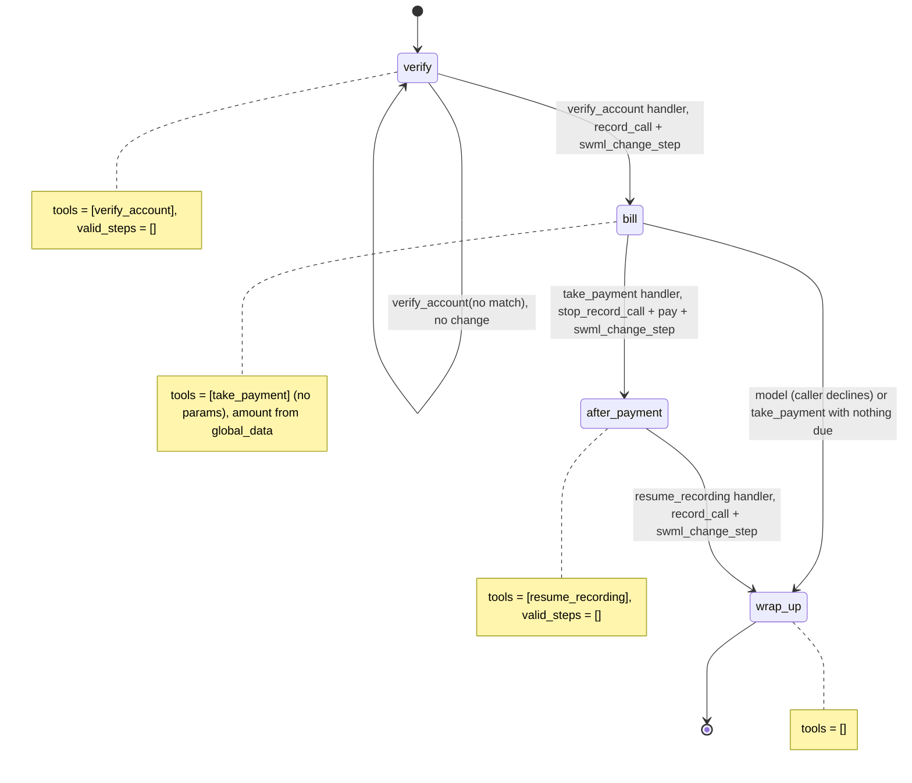

# AI Utility Bill Payment Line

A caller verifies their account, hears the balance, and pays it by card on the keypad while the recording is paused.

## What it does

The agent asks for the account number and service ZIP code. Once they match, recording starts
and the agent reads the balance due. If the caller wants to pay, the agent pauses the recording
and hands the call to the SWML `pay` verb, which prompts for the card number, expiry, security
code and ZIP code by keypad. The card goes straight to the payment connector. Here that's a
mock served by this same app at `/pay`, which approves or declines fixed test cards. Then
recording resumes, the agent tells the caller whether the payment went through, and says goodbye.

## What it demonstrates

Payment isolation (PCI pattern 5). Card digits never reach the model, the recording, or this
app's logs:

- `take_payment` has **no parameters**. Its handler reads the amount from
  `global_data.account.balance_due`, which `verify_account` wrote from the billing record.
  Whatever amount the model or caller says is ignored.
- The handler returns `stop_record_call()` **then** `pay()`, so the recording is paused before
  the first digit is pressed. The model only ever hears `${pay_result}`.
- `take_payment` exists only in the `bill` step, which only the `verify_account` handler opens.
  `after_payment` has one tool, `resume_recording`, whose handler restarts the recording.
- The mock connector logs only the transaction id, amount and result. Its `/pay/status`
  callback keeps the event name per call and drops every card field. A test asserts that no
  card data shows up in any log output.



| Primitive | Where |
|---|---|
| `set_functions`, `set_valid_steps` | `app.py`, steps `verify`, `bill`, `after_payment`, `wrap_up` |
| `record_call` + `update_global_data` + `swml_change_step` | `app.py`, `verify_account` handler |
| `stop_record_call` then `pay` (amount from `global_data`) | `app.py`, `take_payment` handler |
| `record_call` (resume) | `app.py`, `resume_recording` handler |
| Payment connector + `status_url` | `connector.py`, `POST /pay` and `POST /pay/status` |

## Prerequisites

- Python 3.12 and a SignalWire Space (project ID, API token, Space URL)
- A phone number on the Space (in the demo pool, the `TEST_INBOUND` role from NUMBERS.md)
- A public URL for your machine (ngrok or similar). The platform calls both the agent and the
  `/pay` connector through it.
- No third-party accounts and no processor account. The connector is a mock.
- TODO(blocked: unknown whether `pay` must be enabled per Space; confirm before the first live call)

## Setup

```bash
git clone https://github.com/signalwire-demos/ai-recipes
cd ai-recipes/recipes/10-utility-bill-payment-line
python3.12 -m venv .venv && source .venv/bin/activate
pip install -r requirements.txt
cp .env.example .env    # fill in the SIGNALWIRE_* keys, PUBLIC_URL and basic auth
```

Leave `PAY_CONNECTOR_URL` empty to use the built-in mock at `PUBLIC_URL/pay`. The app puts its
basic-auth user and password in that URL, and the mock refuses requests without them.

## Run locally

```bash
python app.py                      # serves SWML on :3000, plus the mock connector at /pay
ngrok http 3000                    # in another terminal; put the URL in PUBLIC_URL
```

In the SignalWire Dashboard, set the phone number's call handler to
`https://USER:PASS@<your-tunnel>/` (USER/PASS = SWML_BASIC_AUTH_USER/PASSWORD), then call it.
Say account `100101`, ZIP `74101` (balance $84.17), and "Yes, I'll pay it now." Then enter a
test card on the keypad, pressing `#` after each entry (any future expiry such as `1230`, any
3-digit security code, ZIP `74101`):

| Card number (keypad) | Mock result |
|---|---|
| `4242 4242 4242 4242` | Approved (`pay_result` = `success`) |
| `4000 0000 0000 0002` | Declined: `card_declined` |
| `4000 0000 0000 9995` | Declined: `insufficient_funds` |
| anything else | Declined: `card_not_supported` (the mock never approves a real card) |

Other test accounts: `100102` / `74103` ($212.50) and `100103` / `74105` (nothing due).

Without a phone:

```bash
pytest -q
swaig-test app.py --list-tools
swaig-test app.py --dump-swml --raw | jq '.sections.main[-1].ai.prompt.contexts'
swaig-test app.py --exec verify_account --account_number 100101 --service_zip 74101
swaig-test app.py --custom-data '{"global_data": {"account": {"id": "100101", "balance_due": "84.17"}}}' \
    --exec take_payment --amount 1.00     # the 1.00 is ignored: charge_amount is 84.17
```

## Deploy

```bash
docker compose up --build          # reads .env, serves on :3000
```

Put it behind any HTTPS host and point the number at `https://USER:PASS@<host>/`.
Serverless: the agent itself works on Lambda, but the `/pay/status` results are kept in memory
per process. Move them to a shared store first, or drop `resume_recording`'s status lookup.

## What to change first

Open `config.py`: set `PAY_CONNECTOR_URL` to your processor's connector URL to replace the
mock (it must speak the same request and response contract, which is described at the top of
`connector.py`), and set `UTILITY_NAME`. Then point `ACCOUNTS_FILE` at your billing system, or
replace `load_accounts()` in `app.py`. The pay prompts are tuned with `PAY_MAX_ATTEMPTS`,
`PAY_SECURITY_CODE`, `PAY_POSTAL_CODE` and `PAY_CARD_TYPES`.
