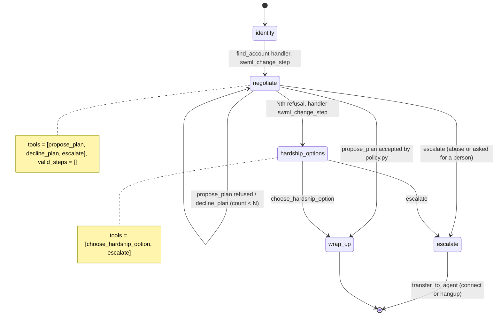

# AI Collections Agent

A caller with an overdue balance works out a payment plan, or is offered hardship options when no plan fits.

## What it does

The caller gives the reference number from their letter and their ZIP code. The agent finds
the account in a mock ledger (`data/debts.json`), states the balance, and asks what the caller
can pay each month and for how long. A plan the policy accepts is recorded and read back. A
plan it refuses gets a polite "no" and a nudge in the right direction. After enough refusals,
the agent stops negotiating and offers hardship options instead. A caller who asks for a
person, or turns abusive, is handed to a human agent (or told someone will call back).

## What it demonstrates

A business outcome overrides whatever the model or the caller wants next (cookbook pattern 2,
authority inversion). `propose_plan` sends the caller's offer to `policy.py`, which checks the
minimum payment, maximum term and refusal count from `config.py`. Those numbers never appear in
the prompt, the step text, the tool schemas or `global_data`, so the model can't reveal or
bargain over a floor it has never seen. The refusal count lives in `global_data`, where only
handlers write it. On the Nth refusal the handler runs `swml_change_step("hardship_options")`,
whatever arguments the model sent, and every step has `valid_steps=[]`, so the model can't
navigate back to `negotiate`.



| Primitive | Where |
|---|---|
| Thresholds read only server side | `config.py` (values), `policy.py` (`evaluate`, `refusals_exhausted`) |
| `swml_change_step("hardship_options")` on the Nth refusal | `app.py`, `to_hardship()`, called from `propose_plan` / `decline_plan` |
| Refusal wording that hides the numbers | `app.py`, `REFUSAL_HINTS` |
| `set_functions` + `set_valid_steps([])` on every step | `app.py`, `CollectionsAgent.__init__` |
| `swml_change_step("escalate")`, then `connect()` or `hangup()` | `app.py`, `escalate` and `transfer_to_agent` handlers |
| Outcome log | `ledger.py`, `record()` |

## Prerequisites

- Python 3.12 and a SignalWire Space (project ID, API token, Space URL)
- A phone number on the Space (in the demo pool, the `TEST_INBOUND` role from NUMBERS.md)
- A public URL for your machine (ngrok or similar)
- No third-party accounts. The ledger is mocked in `data/debts.json`.
- Optional: a phone that a person answers, for the escalation transfer (`AGENT_NUMBER`)

## Setup

```bash
git clone https://github.com/signalwire-demos/ai-recipes
cd ai-recipes/recipes/11-collections-agent
python3.12 -m venv .venv && source .venv/bin/activate
pip install -r requirements.txt
cp .env.example .env    # fill in the SIGNALWIRE_* keys, PUBLIC_URL and basic auth
```

To test the transfer, set `AGENT_NUMBER` in `.env` to a real phone you can answer (the demo
pool's `HUMAN_LEG` number has no one on it). Leave it empty and the escalate step promises a
callback and hangs up. `FROM_NUMBER` is optional caller ID for that leg. Plans, hardship picks
and escalations append to `data/runtime/outcomes.jsonl`.

## Run locally

```bash
python app.py                      # serves SWML on :3000
ngrok http 3000                    # in another terminal; put the URL in PUBLIC_URL
```

In the SignalWire Dashboard, set the phone number's call handler to
`https://USER:PASS@<your-tunnel>/` (USER/PASS = SWML_BASIC_AUTH_USER/PASSWORD), then call it.

Without a phone:

```bash
pytest -q
swaig-test app.py --list-tools
swaig-test app.py --dump-swml --raw | jq '.sections.main[-1].ai.prompt.contexts'
swaig-test app.py --custom-data '{"global_data": {"account": {"id": "DEBT-0101", "balance": 1240.0}, "refusals": 0}}' \
    --exec propose_plan --monthly_amount 20 --months 62
```

Test accounts (fake data):

| Reference | ZIP | Name | Balance |
|---|---|---|---|
| CA20417 | 74101 | Alex Moreno | $1,240.00 |
| CA20418 | 74012 | Priya Shah | $560.00 |

On the call, try "I can do twenty dollars a month" a few times: the agent declines without
naming a minimum, then moves to hardship options. "$125 a month for ten months" is accepted.
"Let me talk to a real person" goes to escalate.

## Deploy

```bash
docker compose up --build          # reads .env, serves on :3000
```

Put it behind any HTTPS host and point the number at `https://USER:PASS@<host>/`.
Serverless: call state lives in `global_data`, but `ledger.record()` appends to a local file.
Point `OUTCOMES_FILE` (or `ledger.record`) at real storage before deploying to Lambda or Cloud Functions.

## What to change first

Open `config.py`: set the policy thresholds (`MIN_MONTHLY_PAYMENT`, `MAX_TERM_MONTHS`,
`MAX_REFUSALS`) and the `HARDSHIP_OFFERS` your business can make. Keep numbers out of the
offer text, since that text goes into the prompt. Then replace `ledger.find()` with your
collections system.
