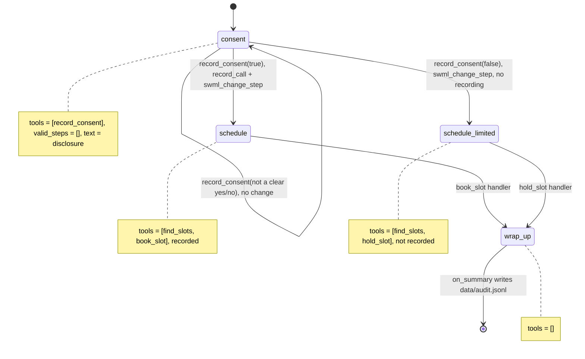

# AI Medical Appointment Line

A caller hears a recording disclosure, says yes or no, and books (or holds) a clinic appointment.

> **Pattern demo, not a HIPAA-certified build.** This recipe shows how to make consent and
> recording rules structural. It is not a compliant medical system: no BAA, no access
> controls, no encryption at rest, no retention policy. It uses no PHI. The schedule in
> `data/slots.json` is made up, the agent never asks for symptoms, dates of birth or
> insurance, and the audit log stores no caller identifiers.

## What it does

The agent greets the caller and reads the recording disclosure from `config.py` word for word,
then asks whether the caller agrees. On a yes, recording starts and the caller can book any
open slot. On a no, the call stays unrecorded and the caller can only place a tentative hold,
which the front desk confirms with a call back. After the call, one audit line per call lands in
`data/audit.jsonl` with the consent answer, its time, and the disclosure version the caller heard.

## What it demonstrates

Compliance as a state machine rather than a promise. The `consent` step's text carries the
disclosure, its only tool is `record_consent`, and `valid_steps=[]` gives the model no way
out. The scheduling tools don't exist in that step. Recording starts in exactly one place: the
`record_consent` handler, on `granted=true`, before it moves the call to `schedule`. A refusal
moves to `schedule_limited`, where `book_slot` isn't defined (and `book_slot` also re-checks
`global_data.consent` itself). `on_summary` builds the audit record from the `global_data` the
handlers wrote, not from the transcript or the model's summary.



| Primitive | Where |
|---|---|
| `set_functions`, `set_valid_steps([])` | `app.py`, steps `consent`, `schedule`, `schedule_limited`, `wrap_up` |
| Disclosure in step text | `app.py`, step `consent` (text from `config.DISCLOSURE_TEXT`) |
| `record_call` + `update_global_data` + `swml_change_step` | `app.py`, `record_consent` handler |
| Handler-side consent check | `app.py`, `book_slot` handler |
| `set_post_prompt` + `on_summary` | `app.py`, audit record from `global_data` |

## Prerequisites

- Python 3.12 and a SignalWire Space (project ID, API token, Space URL)
- A phone number on the Space (in the demo pool, the `TEST_INBOUND` role from NUMBERS.md)
- A public URL for your machine (ngrok or similar), so the platform can reach the tools and `/post_prompt`
- No third-party accounts. The schedule is the mock in `data/slots.json`.

## Setup

```bash
git clone https://github.com/signalwire-demos/ai-recipes
cd ai-recipes/recipes/12-medical-appointment-line
python3.12 -m venv .venv && source .venv/bin/activate
pip install -r requirements.txt
cp .env.example .env    # fill in the SIGNALWIRE_* keys, PUBLIC_URL and basic auth
```

`AUDIT_FILE` in `.env` is optional; it defaults to `data/audit.jsonl` (git-ignored).

## Run locally

```bash
python app.py                      # serves SWML on :3000
ngrok http 3000                    # in another terminal; put the URL in PUBLIC_URL
```

In the SignalWire Dashboard, set the phone number's call handler to
`https://USER:PASS@<your-tunnel>/` (USER/PASS = SWML_BASIC_AUTH_USER/PASSWORD), then call it.
Say "Yes, that's fine" to the disclosure, then "Do you have anything on Monday?" and "The 9 AM
one, please." Call again and say "No" to the disclosure: the agent offers a hold instead of a
booking. After each call, check `tail -n1 data/audit.jsonl`. Recordings appear in the
Dashboard under the call's logs, and only for calls where the caller said yes.

Without a phone:

```bash
pytest -q
swaig-test app.py --list-tools
swaig-test app.py --dump-swml --raw | jq '.sections.main[-1].ai.prompt.contexts'
swaig-test app.py --exec record_consent --granted true
swaig-test app.py --exec find_slots --day monday
```

## Deploy

```bash
docker compose up --build          # reads .env, serves on :3000
```

Put it behind any HTTPS host and point the number at `https://USER:PASS@<host>/`.
Serverless: not suited as is, because the audit log and the taken-slot list are local state.
Point `AUDIT_FILE` at durable storage (or replace `on_summary` with a write to your system of
record) and move the schedule to a real backend first.

## What to change first

Open `config.py`: set `CLINIC_NAME`, rewrite `DISCLOSURE_TEXT` with your counsel's wording, and
bump `DISCLOSURE_VERSION` every time the wording changes, so each audit record proves which
version the caller heard. Then swap the scheduling backend: point `SLOTS_FILE` at your own data,
or replace `load_slots()` and the `find_slots` / `book_slot` / `hold_slot` handlers in `app.py`
with calls to your practice-management system.
