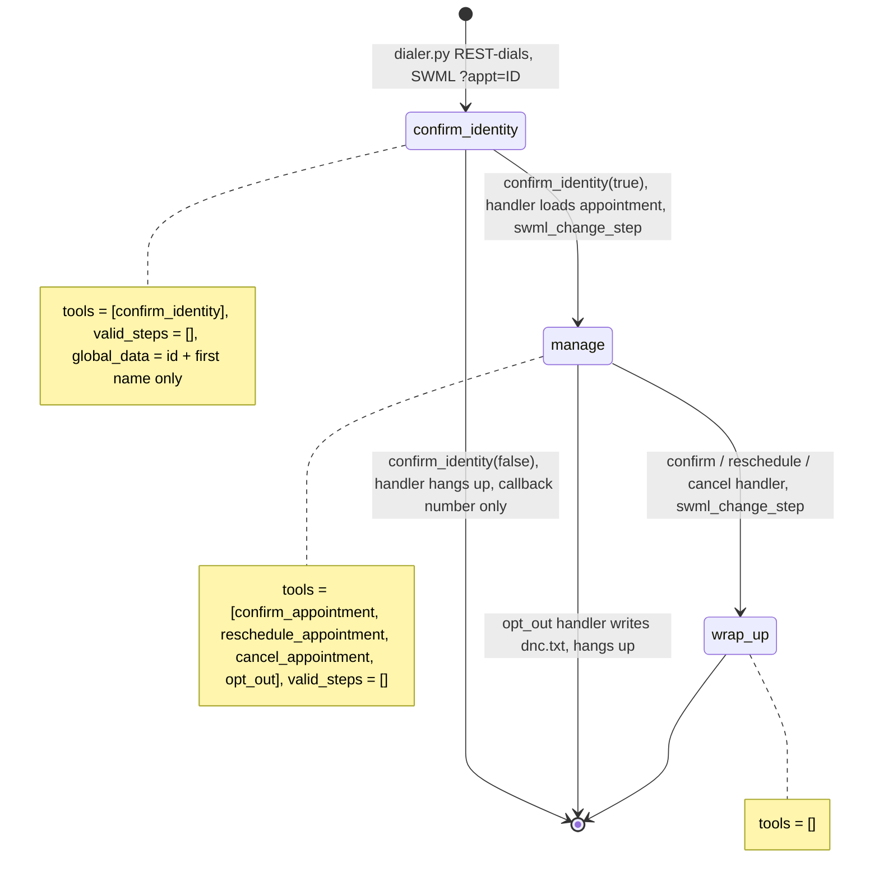

# AI Appointment Reminder Caller

A patient's phone rings, the agent checks it's really them, then reminds them of their
appointment and lets them confirm, reschedule, cancel, or opt out of future calls.

## What it does

`dialer.py` reads `data/appointments.csv` and calls each contact who has given consent, isn't
on the do-not-call list, and is inside calling hours in their own time zone. When someone
answers, the agent asks for the contact by first name without saying why it's calling. If it's
them, it reminds them of the appointment and they can confirm, move it to another open slot,
or cancel it, and the change lands in `data/calendar.ics`. If they ask not to be called again,
their number goes on `data/dnc.txt` and the call ends. Anyone else gets only a callback number.

## What it demonstrates

Outbound dialing with consent handling built in, in code rather than in the prompt:

- **Consent before the dial.** `dialer.py` skips anyone without `consent=yes`, anyone on
  `data/dnc.txt`, and anyone outside `CALL_WINDOW` (default `08:00-21:00`) in the contact's
  `timezone`. `--dry-run` prints each decision.
- **No details before identity.** The SWML for a call carries only `appointment_id` and
  `first_name` in `global_data`. The appointment itself is loaded by the `confirm_identity`
  handler, and only when the person says they're the contact. A wrong person gets a callback
  number and the handler hangs up. The model never had the details, so it can't leak them.
- **The model can't pick the appointment.** The manage tools take no appointment id. They act
  on the id the dialer put in the SWML URL (`?appt=A-0101`), read back from `global_data`.
- **Opt-out is enforced.** `opt_out` writes the do-not-call list that the dialer checks before
  every dial, then ends the call.



| Primitive | Where |
|---|---|
| REST `client.calling.dial` | `dialer.py`, `dial()` |
| Consent, do-not-call and local calling-hours filter | `dialer.py`, `skip_reason()` |
| `set_dynamic_config_callback` (per-call `global_data`) | `app.py`, `configure()` |
| `set_functions`, `set_valid_steps([])` | `app.py`, steps `confirm_identity`, `manage`, `wrap_up` |
| `update_global_data` + `swml_change_step`, `hangup` | `app.py`, `confirm_identity` and the manage handlers |
| Calendar backend (.ics) | `calendar_ics.py` |

## Prerequisites

- Python 3.12 and a SignalWire Space (project ID, API token, Space URL)
- An outbound-capable number on the Space for caller ID (in the demo pool, `OUTBOUND_1` from
  NUMBERS.md), and a phone you can answer to play the patient
- A public URL for your machine (ngrok or similar)
- No third-party accounts. The calendar is a local `.ics` file.
- TODO(blocked: no Google service account): `CALENDAR_BACKEND=google` is not built. The app
  refuses to start with it. To add it, give `calendar_ics.py`'s `get_event`, `set_status` and
  `reschedule` a Google Calendar twin.
- TODO(blocked: voicemail/answering-machine detection is not documented in the SDK fact sheet
  for 3.7.5): if a machine answers, the agent talks to it like a wrong person (callback number,
  no details), which is safe but not ideal.

## Setup

```bash
git clone https://github.com/signalwire-demos/ai-recipes
cd ai-recipes/recipes/14-appointment-reminder-caller
python3.12 -m venv .venv && source .venv/bin/activate
pip install -r requirements.txt
cp .env.example .env    # fill in the SIGNALWIRE_* keys, PUBLIC_URL and basic auth
```

In `.env`, set `FROM_NUMBER` to your outbound number (the demo pool's `OUTBOUND_1` from the repo
root `.env` is used if it's blank). Then put your own phone in `data/appointments.csv`: change
the `phone` of row `A-0101` to your number in E.164 (`+1...`), set its `timezone`, and keep
`consent` as `yes`. `CALL_WINDOW` and `CALENDAR_BACKEND` can stay at their defaults.

## Run locally

```bash
python app.py                      # serves SWML on :3000
ngrok http 3000                    # in another terminal; put the URL in PUBLIC_URL
python dialer.py --dry-run         # in a third terminal: who would be called, and why not the rest
python dialer.py                   # dials everyone who passes; prints each call id
```

No number configuration is needed: the dialer passes `https://USER:PASS@<PUBLIC_URL>/?appt=ID`
to the call, so the agent's SWML is fetched when you answer. Answer and say "Yes, this is
Jordan", then try "Can I move it to January 14th at 3:30 PM?" and check `data/calendar.ics`.
Or say "No, wrong number" and listen: you only hear a callback number. Or say "Please don't call
me again" and check `data/dnc.txt`. A dry run on the bundled data skips `A-0102` (no consent)
and `A-0103` (do-not-call), and skips anyone whose local time is outside `CALL_WINDOW`.

Without a phone:

```bash
pytest -q
swaig-test app.py --list-tools
swaig-test app.py --dump-swml --raw --query-params '{"appt":"A-0101"}' | jq '.sections.main[-1].ai.prompt.contexts'
swaig-test app.py --custom-data '{"global_data": {"appointment_id": "A-0101"}}' --exec confirm_identity --is_contact true
```

## Deploy

```bash
docker compose up --build          # reads .env, serves the agent on :3000
docker compose run --rm app python dialer.py --dry-run
```

Run `dialer.py` on a schedule (cron, or a scheduled container) during the hours you want reminders
to go out; it re-checks consent, the do-not-call list and each contact's local time on every run.
The agent writes `data/calendar.ics` and `data/dnc.txt`, so mount `data/` as a volume.
Serverless: not suited as-is, because the calendar and do-not-call list are local files.

## What to change first

Open `config.py`: point `APPOINTMENTS_FILE`, `DNC_FILE` and `CALENDAR_FILE` at your own sources
(or replace `contacts.py` and `calendar_ics.py` with adapters for your scheduling system and
calendar, keeping their function names), set `BUSINESS_NAME` and `CALLBACK_NUMBER`, and check
`CALL_WINDOW`, `OPEN_WEEKDAYS` and `OPEN_HOURS` against your rules.
