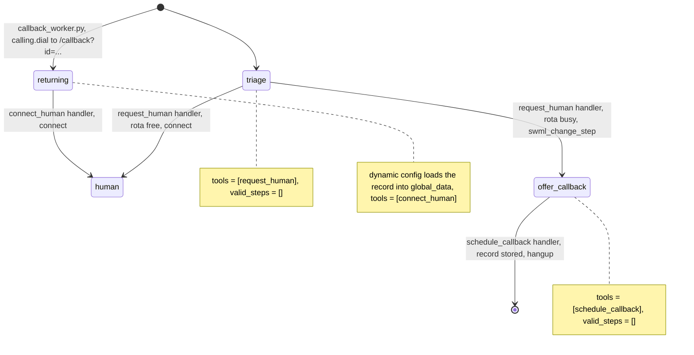

# AI Support Line With Callback

A caller describes a problem, then reaches a human now or gets called back with their issue already on file.

## What it does

The agent asks what's wrong and boils it down to a one-line issue and a short summary. If a
specialist is free on the rota, the caller is transferred straight away. If not, the agent
offers a callback to the number they're calling from and asks when suits them, then says
goodbye. A worker process calls the customer back. The return call opens with "I'm returning
your call about your router dropping wifi", confirms they still need help, and connects
them to a human.

## What it demonstrates

Context survives the queue and the return call without the model carrying it. `triage`
exposes one tool, `request_human`. Its handler stores the triage in `global_data` and checks
availability in code (`rota.py`). It then either `connect`s to the human or moves the call to
`offer_callback` with `swml_change_step`. `schedule_callback` writes the callback record from
the caller's real number (call data, not a model argument) and the triage the handler stored.
The worker REST-dials the customer into `/callback?id=CB-0001`. On that route, a dynamic
config callback looks the record up and sets `global_data` before the model says a word.
The return call has exactly one tool, `connect_human`, and the phone number never enters its
context.



| Primitive | Where |
|---|---|
| `set_functions`, `set_valid_steps([])` | `app.py`, steps `triage`, `offer_callback`, `returning` |
| Availability check in code | `rota.py`, `human_available()` |
| `update_global_data` + `swml_change_step` / `connect` | `app.py`, `request_human` handler |
| `set_dynamic_config_callback` | `app.py`, `CallbackAgent.load_context` |
| REST `client.calling.dial` | `callback_worker.py`, `sweep()` |
| `AgentServer` (two agents, one port) | `app.py`, `/` and `/callback` |

## Prerequisites

- Python 3.12 and a SignalWire Space (project ID, API token, Space URL)
- A phone number on the Space for callers (in the demo pool, `TEST_INBOUND` from NUMBERS.md)
- An outbound-capable number for caller ID on the human transfer and on the return call
  (`FROM_NUMBER`; demo pool `OUTBOUND_2`)
- A second phone that acts as the human specialist (`HUMAN_NUMBER`). In the demo pool it
  defaults to `HUMAN_LEG`, which nobody answers. **For a live test, set `HUMAN_NUMBER` to a
  real phone you can pick up.**
- A public URL for your machine (ngrok or similar)
- No third-party accounts

## Setup

```bash
git clone https://github.com/signalwire-demos/ai-recipes
cd ai-recipes/recipes/15-support-line-with-callback
python3.12 -m venv .venv && source .venv/bin/activate
pip install -r requirements.txt
cp .env.example .env    # fill in the SIGNALWIRE_* keys, PUBLIC_URL and basic auth
```

In `.env`, set `HUMAN_NUMBER` and `FROM_NUMBER`. Availability comes from the mock rota in
`data/rota.json` (US Central weekdays 9 to 5). To force a path while testing, set
`AVAILABILITY=busy` (always offer a callback) or `AVAILABILITY=free` (always transfer).
Callback records go to `data/runtime/callbacks.json`, which is created on first use and is
git-ignored.

## Run locally

```bash
python app.py                      # serves / (inbound) and /callback (return call) on :3000
python callback_worker.py          # in another terminal; dials pending callbacks every 30 s
ngrok http 3000                    # in a third terminal; put the URL in PUBLIC_URL
```

In the SignalWire Dashboard, set the phone number's call handler to
`https://USER:PASS@<your-tunnel>/` (USER/PASS = SWML_BASIC_AUTH_USER/PASSWORD), then call it.
With `AVAILABILITY=busy`, say "My router drops the wifi every night", accept the callback and
say "any time today". Hang up. Within one worker sweep, your phone rings, and the agent says
it's returning your call about the router and connects you to `HUMAN_NUMBER`.
`python callback_worker.py --once` runs a single sweep instead of looping.

Without a phone:

```bash
pytest -q
swaig-test app.py --agent-class SupportAgent --list-tools
swaig-test app.py --agent-class SupportAgent --dump-swml --raw | jq '.sections.main[-1].ai.prompt.contexts'
swaig-test app.py --agent-class SupportAgent --exec request_human --issue "no dial tone" --summary "Since noon."
swaig-test app.py --agent-class CallbackAgent --query-params '{"id": "CB-0001"}' \
  --dump-swml --raw | jq '.sections.main[-1].ai.global_data'
```

## Deploy

```bash
docker compose up --build          # reads .env; runs the app on :3000 and the worker beside it
```

The two services share `data/runtime/` through a named volume. Put the app behind any HTTPS
host, set `PUBLIC_URL` to it, and point the number at `https://USER:PASS@<host>/`.
Serverless: not suited as-is, because the callback queue is a local JSON file and the worker
is a long-running loop. Move the store to a database and run the sweep on a scheduler first.

## What to change first

Open `config.py`: set `HUMAN_NUMBER` and `FROM_NUMBER`, and point the availability check at
your ACD or rota. `AVAILABILITY` and `ROTA_FILE` are the knobs, and `rota.human_available()`
is the function to replace. The worker calls back every pending record on each sweep. To
honor `preferred_time`, filter by it in `store.pending()`.
