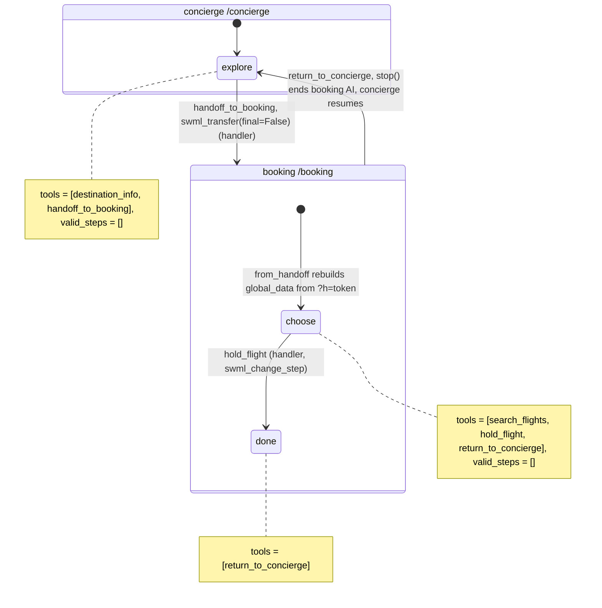

# AI Travel Concierge

A caller chats with a travel concierge about where to go, gets handed to a booking specialist
who already knows the trip, holds seats, and is handed back to the concierge.

## What it does

Two agents run on one server. The concierge at `/concierge` answers questions about the
destinations in `data/destinations.json` (best time to go, tips). When the caller wants to book,
it confirms the destination, number of travelers and month, then transfers the call to the
booking desk at `/booking`. The booking desk greets the caller with the trip already known,
reads flights with enough seats, and holds the one the caller picks (written to
`data/runtime/bookings.jsonl`). Then it hands the caller back to the concierge, who picks up
where they left off.

## What it demonstrates

The handoff carries context, but no transcript. `handoff_to_booking` validates the trip,
writes the summary itself from those validated fields, and saves `{summary, trip, call_id}` to
a short-lived store (`handoff.py`, 30-minute TTL). Only an opaque token goes into the transfer
URL (`/booking?h=<token>`), and the transfer is `swml_transfer(..., final=False)`, so the caller
can come back. The booking agent's dynamic config callback (`from_handoff`) loads the record and
rebuilds `global_data` from it. The booking tools take no destination or party-size arguments:
`search_flights` and `hold_flight` read them from `global_data.trip`, so the model can't book
a different trip. Each agent has only its own tools. The concierge can't book, and the
booking desk can't hand off.

Why a token-keyed store and not something else (checked against signalwire-sdk 3.7.5 and the
SDK guide):

- **Full state in URL params.** It works, but it puts trip data and anything else into
  platform and proxy logs, and the URL already carries basic auth. Only the token goes in the
  URL.
- **`global_data` alone.** It's per AI session: the booking agent's `ai` verb starts from the
  `global_data` its own SWML seeds. Carrying it over across `swml_transfer` isn't documented, so
  the recipe doesn't rely on it. The SDK's own pattern is "identify once, propagate via URLs,
  reconstruct per request" in a dynamic config callback.
- **A store keyed by `call_id`.** The record keeps `call_id` for audit, but the key is a random
  token. That makes the lookup explicit and testable offline, and a guessed call ID can't read
  someone else's trip.



| Primitive | Where |
|---|---|
| `AgentServer` with two agents | `app.py`, bottom (`/concierge`, `/booking`) |
| `swml_transfer(dest, ai_response, final=False)` | `app.py`, `ConciergeDesk.handoff_to_booking` |
| Handler-written handoff record + token | `handoff.py` (`save`, `load`, `update`) |
| `set_dynamic_config_callback` rebuilds `global_data` | `app.py`, `BookingDesk.from_handoff` |
| Tools read trip from `global_data`, not args | `app.py`, `search_flights` and `hold_flight` |
| `set_functions` / `set_valid_steps([])` / `swml_change_step` | `app.py`, both agents' steps |

## Prerequisites

- Python 3.12 and a SignalWire Space (project ID, API token, Space URL)
- A phone number on the Space (in the demo pool, the `TEST_INBOUND` role from NUMBERS.md)
- A public URL for your machine (ngrok or similar). It must be set in `PUBLIC_URL`, because the
  transfer URL to `/booking` is built from it.
- No third-party accounts. Flights are mock inventory in `data/destinations.json`.
- TODO(blocked: confirm on a live call that `stop()` in `return_to_concierge` ends the booking
  AI and returns control to the concierge. The `final=False` return path isn't spelled out in
  the 3.7.5 docs. Ask the SDK maintainers for the preferred way to end a transferred agent.)

## Setup

```bash
git clone https://github.com/signalwire-demos/ai-recipes
cd ai-recipes/recipes/16-travel-concierge
python3.12 -m venv .venv && source .venv/bin/activate
pip install -r requirements.txt
cp .env.example .env    # fill in the SIGNALWIRE_* keys, PUBLIC_URL and basic auth
```

Set `SWML_BASIC_AUTH_USER` and `SWML_BASIC_AUTH_PASSWORD`. Both agents share them, and the
transfer URL carries them so the platform can fetch the booking agent's SWML.

## Run locally

```bash
python app.py                      # serves /concierge and /booking on :3000
ngrok http 3000                    # in another terminal; put the URL in PUBLIC_URL
```

In the SignalWire Dashboard, set the phone number's call handler to
`https://USER:PASS@<your-tunnel>/concierge` (USER/PASS = SWML_BASIC_AUTH_USER/PASSWORD), then
call it. Try: "When's a good time to visit Lisbon?", then "Book it for two of us in December."
At the booking desk: "The evening flight on the 11th, please", then "That's all, thanks."

Without a phone:

```bash
pytest -q
swaig-test app.py --list-tools                       # the concierge (default agent)
swaig-test app.py --route /booking --list-tools
swaig-test app.py --dump-swml --raw | jq '.sections.main[-1].ai.prompt.contexts'
swaig-test app.py --exec handoff_to_booking --destination lisbon --travelers 2 --month december
swaig-test app.py --route /booking --dump-swml --raw --query-params '{"h": "<token from data/runtime/handoffs.json>"}' \
  | jq '.sections.main[-1].ai.global_data'
```

## Deploy

```bash
docker compose up --build          # reads .env, serves on :3000
```

Put it behind any HTTPS host, set `PUBLIC_URL` to it, and point the number at
`https://USER:PASS@<host>/concierge`.
Serverless: not as is. The handoff store is a local JSON file, so both routes must share a disk.
Move `handoff.py` to Redis or your database (keep the TTL) before running more than one
instance or deploying to Lambda.

## What to change first

Open `config.py`: set `AGENCY_NAME`, the two voices, `MAX_TRAVELERS`, and point
`DESTINATIONS_FILE` at your inventory. `HANDOFF_FILE` and `HANDOFF_TTL_SECS` control the handoff
store. To add another specialist (hotels, cars), copy `BookingDesk`, give it its own route and
tools, and register it with `server.register(...)`.
