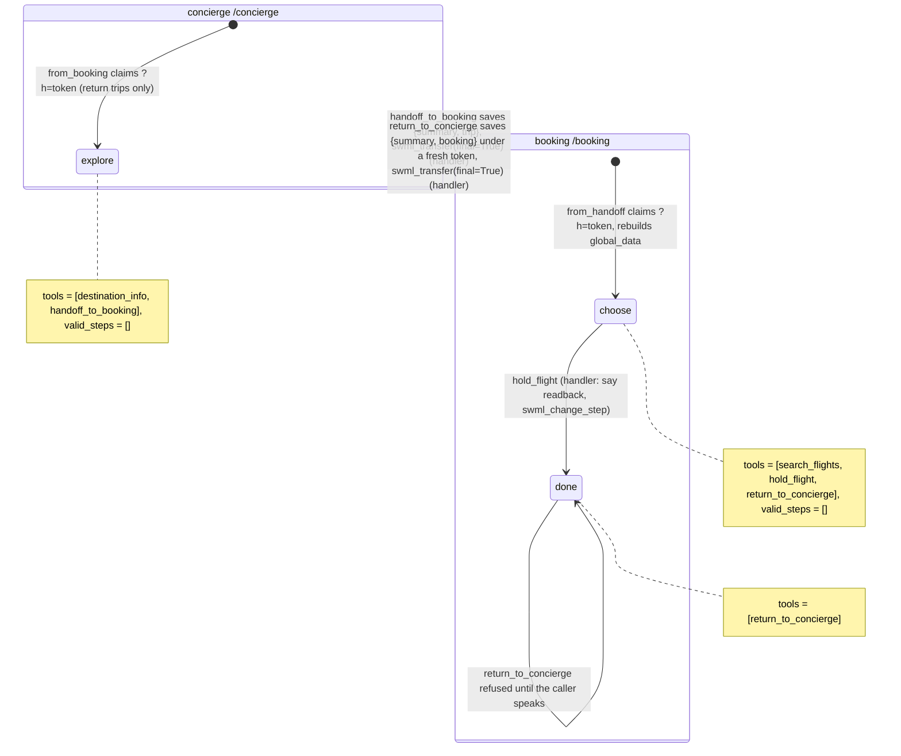

# AI Travel Concierge

A caller chats with a travel concierge about where to go, gets handed to a booking specialist
who already knows the trip, holds seats, and is handed back to the concierge.

## What it does

Two agents run on one server. The concierge at `/concierge` answers questions about the
destinations in `data/destinations.json` (best time to go, tips). When the caller wants to book,
it confirms the destination, number of travelers and month, then transfers the call to the
booking desk at `/booking`. The booking desk greets the caller with the trip already known,
reads flights with enough seats, and holds the one the caller picks (written to
`data/runtime/bookings.jsonl`). Then it hands the caller back to the concierge, who already
knows what was held and picks up from there.

## What it demonstrates

The handoff carries context, but no transcript, in both directions. `handoff_to_booking`
validates the trip, writes the summary itself from those validated fields, and saves
`{summary, trip, looked_up, call_id}` to a short-lived store (`handoff.py`, 30-minute TTL).
Only an opaque, one-time token goes into the transfer URL (`/booking?h=<token>`). The booking
agent's dynamic config callback (`from_handoff`) claims the record (read once, then deleted)
and rebuilds `global_data` from it. The booking tools take no destination or party-size
arguments: `search_flights` and `hold_flight` read them from `global_data.trip`, so the model
can't book a different trip. The model can't hold a flight
that isn't in the results either. `search_flights` numbers the matching flights, stores them in
`global_data.options` (`"1"`, `"2"`, ...), and returns only "Option 1: departing ..." lines with
no flight IDs.

The options are spoken by the platform, not paraphrased by the model. The destination and party
size are known from the handoff, so `from_handoff` numbers the options before the AI starts and
sets them as the booking agent's `static_greeting` ("Hi, this is the booking desk. I have 2
travelers to Lisbon. Option 1: ... Which option would you like?"). If the caller asks again,
`search_flights` speaks them with `say()`. The step text carries the same lines
(`${global_data.options_read}`), so the model can match "the one on the 11th" to option 2. On
earlier live calls (`28cdbb5a-991c-42ea-ab1f-d1d81e59d1b7`) the model was asked to read the
options itself, never did, and asked for a departure city instead. `hold_flight` takes an option number, and code maps it to the stored flight
(re-checked against the inventory). Any other number is refused. The booking agent runs on
`gpt-4.1-mini` (`config.BOOKING_MODEL`). On earlier test calls, the default model read back
flights that didn't exist.

`hold_flight` speaks the readback and "Is there anything else you need for this booking?" with
`say()`, then moves to the `done` step, whose only tool is `return_to_concierge`. The booking
agent sets `swaig_post_conversation`, so each tool call carries the conversation, and
`return_to_concierge` refuses to hand back after a hold until the log shows the caller has spoken
since `hold_flight` (`caller_spoke_after()` in `app.py`). On call `28cdbb5a-...` the model called
`return_to_concierge` one second after the hold, without waiting for the caller.

The way back works the same way. `return_to_concierge` writes a new record with a fresh token:
the original summary plus the booking result (`ref`, flight, readback), or none if nothing was
held. Then it transfers to `/concierge?h=<token>`. The concierge's callback (`from_booking`)
claims it and adds a "Returning caller" prompt section that its own code writes from those
fields. The concierge's `static_greeting` is "Welcome back. The booking desk held ..., reference ...
Is there anything else I can help with?", written in code from those fields. Each agent has only
its own tools. The concierge can't book, and the booking desk can't hand off anywhere else.

Both transfers are `swml_transfer(..., final=True)`: each agent's AI session ends and the other
agent's SWML takes the call. A non-final transfer (`final=False`, "come back when done") does
not work when the target is another AI agent. On call `94171698-68af-4373-bac8-48ee31fbf981`
(2026-10-30) the platform fetched `/booking?h=<token>` (200) and ran its `ai` verb, then
rejected it with `calling.error` code `409` and the message "Wait for ai to finish": the
concierge's AI was still active on the call, because a non-final transfer runs while that AI
waits to resume. The call then ended. That leaves a question for the SDK and platform teams:
whether `swml_transfer(final=False)` is meant to support a second AI agent as the target. For
now, the return trip is an explicit, handler-written transfer back.

Why a token-keyed store and not something else (checked against signalwire-sdk 3.7.5 and the
SDK guide):

- **Full state in URL params.** It works, but it puts trip data and anything else into
  platform and proxy logs, and the URL already carries basic auth. Only the token goes in the
  URL.
- **`global_data` alone.** It's per AI session: each agent's `ai` verb starts from the
  `global_data` its own SWML seeds, and a final transfer starts a new session. The SDK's own
  pattern is "identify once, propagate via URLs, reconstruct per request" in a dynamic config
  callback.
- **A store keyed by `call_id`.** The record keeps `call_id` for audit, but the key is a random
  one-time token. That makes the lookup explicit and testable offline, a guessed call ID can't
  read someone else's trip, and a replayed URL gets nothing.



| Primitive | Where |
|---|---|
| `AgentServer` with two agents | `app.py`, bottom (`/concierge`, `/booking`) |
| `swml_transfer(dest, ai_response, final=True)`, both ways | `app.py`, `handoff_to_booking` and `return_to_concierge` |
| Handler-written handoff record + one-time token | `handoff.py` (`save`, `claim`) |
| `set_dynamic_config_callback` rebuilds context | `app.py`, `BookingDesk.from_handoff`, `ConciergeDesk.from_booking` |
| Tools read trip from `global_data`, not args | `app.py`, `search_flights` and `hold_flight` |
| Numbered options in `global_data`, mapped back by code | `app.py`, `search_flights` and `hold_flight` |
| `set_prompt_llm_params(model=...)` | `app.py`, `BookingDesk.__init__` (`config.BOOKING_MODEL`) |
| `set_functions` / `set_valid_steps([])` / `swml_change_step` | `app.py`, both agents' steps |
| `static_greeting` set per call in the dynamic config callback | `app.py`, `from_handoff`, `from_booking` |
| `FunctionResult.say()` for options and the hold readback | `app.py`, `search_flights`, `hold_flight` |
| `swaig_post_conversation` + a handler gate on the hand-back | `app.py`, `caller_spoke_after`, `return_to_concierge` |

## Live result

Live-tested on 2026-10-30, call `f067dcc6-5328-4347-ace6-bc503ae880bb` (also
`bdd7c5e2-a22a-441a-b76d-f1f7a5095fb4` and `9d0ebc18-d627-495b-a35c-e65282a40326`): a scripted
caller asked the concierge to book Lisbon for two in December. The booking desk opened by
reading both options, the caller picked option 2, `hold_flight` held FL-103 (1180 dollars, written
to `bookings.jsonl`) and the platform read it back with "anything else?". The caller answered
"No", and only then did `return_to_concierge` run. The concierge welcomed the caller back with
the held flight and reference. The live tool-call payload carried `raw_call_log`, and
`caller_spoke_after` returned `True` on it (`False` on the same log cut at the hold). The refusal
branch didn't fire live: on all three calls the model waited for the caller on its own.

One platform oddity, still open: when a tool result also carries a `say` action (and on one
earlier call, a long `search_flights` result), the platform's call log shows the tool result
content as empty. The tool responses are kept short and the facts the model needs are in the
step text.

## Prerequisites

- Python 3.12 and a SignalWire Space (project ID, API token, Space URL)
- A phone number on the Space (in the demo pool, the `TEST_INBOUND` role from NUMBERS.md)
- A public URL for your machine (ngrok or similar). It must be set in `PUBLIC_URL`, because the
  transfer URLs to `/booking` and back to `/concierge` are built from it.
- No third-party accounts. Flights are mock inventory in `data/destinations.json`.

## Setup

```bash
git clone https://github.com/signalwire-demos/ai-recipes
cd ai-recipes/recipes/16-travel-concierge
python3.12 -m venv .venv && source .venv/bin/activate
pip install -r requirements.txt
cp .env.example .env    # fill in the SIGNALWIRE_* keys, PUBLIC_URL and basic auth
```

Set `SWML_BASIC_AUTH_USER` and `SWML_BASIC_AUTH_PASSWORD`. Both agents share them, and the
transfer URL carries them so the platform can fetch the booking agent's SWML.

## Run locally

```bash
python app.py                      # serves /concierge and /booking on :3000
ngrok http 3000                    # in another terminal; put the URL in PUBLIC_URL
```

In the SignalWire Dashboard, set the phone number's call handler to
`https://USER:PASS@<your-tunnel>/concierge` (USER/PASS = SWML_BASIC_AUTH_USER/PASSWORD), then
call it. Try: "When's a good time to visit Lisbon?", then "Book it for two of us in December."
At the booking desk: "Option two, the one on the 11th, please", then "That's all, thanks."

Without a phone:

```bash
pytest -q
swaig-test app.py --list-tools                       # the concierge (default agent)
swaig-test app.py --route /booking --list-tools
swaig-test app.py --dump-swml --raw | jq '.sections.main[-1].ai.prompt.contexts'
swaig-test app.py --exec handoff_to_booking --destination lisbon --travelers 2 --month december
swaig-test app.py --route /booking --dump-swml --raw --query-params '{"h": "<token from data/runtime/handoffs.json>"}' \
  | jq '.sections.main[-1].ai.global_data'          # tokens are one-time: the dump claims it
```

## Deploy

```bash
docker compose up --build          # reads .env, serves on :3000
```

Put it behind any HTTPS host, set `PUBLIC_URL` to it, and point the number at
`https://USER:PASS@<host>/concierge`.
Serverless: not as is. The handoff store is a local JSON file, so both routes must share a disk.
Move `handoff.py` to Redis or your database (keep the TTL) before running more than one
instance or deploying to Lambda.

## What to change first

Open `config.py`: set `AGENCY_NAME`, the two voices, `BOOKING_MODEL`, `MAX_TRAVELERS`, and point
`DESTINATIONS_FILE` at your inventory. `HANDOFF_FILE` and `HANDOFF_TTL_SECS` control the handoff
store. To add another specialist (hotels, cars), copy `BookingDesk`, give it its own route and
tools, and register it with `server.register(...)`.
