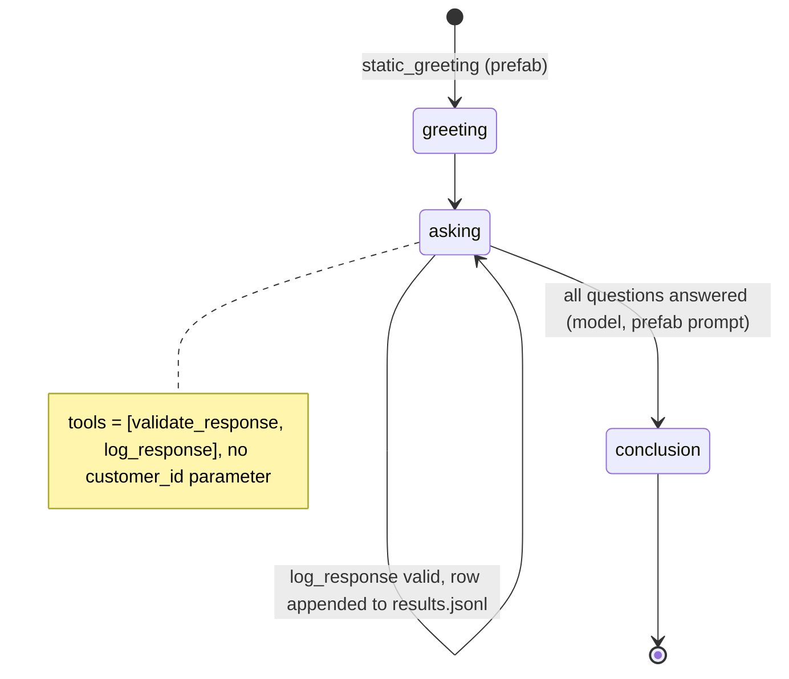

# AI Customer Survey Caller

A customer gets a short follow-up call after a visit, answers four questions, and the answers land in a file you can score.

## What it does

The agent calls (or answers) and runs a four-question patient survey: a 1 to 10 "how likely are
you to recommend us", a multiple-choice "what did you like most", a yes/no "was your issue taken
care of", and an optional open comment. Each answer is checked and appended to
`data/results.jsonl`. `score_results.py` turns that file into an NPS-style report.
`call_customer.py` starts the survey as an outbound call; calling the number inbound runs the
same survey for testing.

## What it demonstrates

Building a known archetype from a prefab in an afternoon. `SurveyAgent` from
`signalwire.prefabs` brings the survey prompt, speech hints, a static greeting, a post-prompt
summary and two tools (`validate_response`, `log_response`). The whole survey is configuration in
`config.py`. The recipe adds governance in two places. It overrides `log_response` so the handler,
not the model, decides what gets recorded: a rating out of range, an option that isn't on the
list or a "maybe" to a yes/no is refused, and nothing is written. And the customer id comes from
the dial URL through the dynamic config callback, so the model never picks whose row an answer
belongs to. The report is computed from the handler-validated rows, not from the model's summary.



| Primitive | Where |
|---|---|
| `SurveyAgent(survey_name, questions, ...)` | `app.py`, `SurveyCaller.__init__`, questions from `config.QUESTIONS` |
| Overridden `log_response` tool | `app.py`, normalizes and validates before writing |
| `set_dynamic_config_callback` + `update_global_data` | `app.py`, `per_call` puts `?customer=` into `global_data` |
| REST `calling.dial(from_, to, url)` | `call_customer.py` |
| NPS scoring rule | `score_results.py`, thresholds in `config.py` |

## Prerequisites

- Python 3.12 and a SignalWire Space (project ID, API token, Space URL)
- A phone number on the Space. Outbound is optional: in the demo pool, `OUTBOUND_1` from
  NUMBERS.md is the caller ID, and `TEST_INBOUND` works for inbound testing
- A phone to survey (your own mobile, set as `CUSTOMER_NUMBER`) if you test outbound
- A public URL for your machine (ngrok or similar)
- No third-party accounts

## Setup

```bash
git clone https://github.com/signalwire-demos/ai-recipes
cd ai-recipes/recipes/17-customer-survey-caller
python3.12 -m venv .venv && source .venv/bin/activate
pip install -r requirements.txt
cp .env.example .env    # fill in the SIGNALWIRE_* keys, PUBLIC_URL and basic auth
```

For outbound, also set `CUSTOMER_NUMBER` and `FROM_NUMBER` in `.env`. If `FROM_NUMBER` is
empty, the `OUTBOUND_1` value from the monorepo `.env` is used.

## Run locally

```bash
python app.py                      # serves SWML on :3000
ngrok http 3000                    # in another terminal; put the URL in PUBLIC_URL
python call_customer.py P-0101 --dry-run   # check the plan (password masked)
python call_customer.py P-0101             # the customer's phone rings
python score_results.py                    # after one or more calls
```

For inbound, set the phone number's call handler to `https://USER:PASS@<your-tunnel>/`
(USER/PASS = SWML_BASIC_AUTH_USER/PASSWORD) and call it. Try answering "eleven" to the rating
question: the agent is told the answer wasn't recorded and asks again.

Without a phone:

```bash
pytest -q
python score_results.py tests/fixtures/results.jsonl     # sample report: NPS 25
swaig-test app.py --list-tools
swaig-test app.py --dump-swml --raw | jq '.sections.main[-1].ai.prompt.pom[] | select(.title=="Survey Questions")'
swaig-test app.py --exec log_response --question_id likely_to_recommend --response 11
swaig-test app.py --exec log_response --question_id likely_to_recommend --response 9
```

## Deploy

```bash
docker compose up --build          # reads .env, serves on :3000
```

Put it behind any HTTPS host, set `PUBLIC_URL` to it, and run `call_customer.py` from anywhere
that has the same `.env` (for a list of customers, loop over it in a shell script or cron job).
Serverless: not suited as-is, because answers are appended to a local `data/results.jsonl`.
Point `RESULTS_FILE` (or the write in `log_response`) at a database first.

## What to change first

Open `config.py`: edit `QUESTIONS` (wording, type, options, scale) and `BRAND_NAME`,
`INTRODUCTION` and `CONCLUSION`. Then set the scoring rule: `NPS_QUESTION`, `PROMOTER_MIN` and
`DETRACTOR_MAX`.
