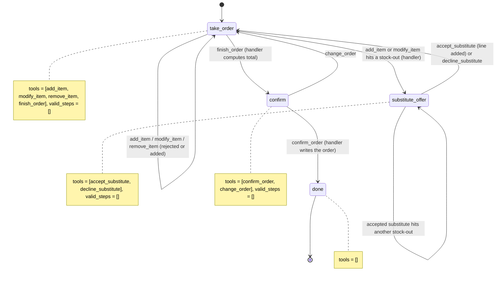

# AI Drive-Thru Order Taker

A caller orders burgers, fries and combos by voice, hears a correct total with tax, and is told
to pull forward.

## What it does

The agent takes the order one item at a time. Every item, size, modifier and combo pick is
checked against `data/menu.json`; anything not on the menu is refused with the real options.
If something is out of stock (`data/stock.json`), the agent offers only the substitutes the
code allows. When the caller is done, it reads the order back with a subtotal, tax and total
that the code computed, and on "yes" it writes the order to `data/runtime/orders.jsonl` and
gives an order number.

## What it demonstrates

The menu, the stock and the money are enforced in code, not in the prompt. Every line goes
through one rule (`rules.check_line`): unknown items, wrong sizes, invalid modifiers, bad combo
picks and silly quantities never reach the order. A stock-out makes the handler jump the call to
`substitute_offer`, where the only two tools are `accept_substitute` (which accepts only an
option the handler put in `global_data.pending`) and `decline_substitute`. The model never sees
a price list and never adds anything up: `finish_order` computes the total in integer cents with
half-up tax rounding, and the `confirm` step just reads `${global_data.total}`. No step has a
`next_step` tool (`valid_steps=[]`), so only handlers move the call.



| Primitive | Where |
|---|---|
| `set_functions` per step, `set_valid_steps([])` | `app.py`, `DriveThruAgent.__init__` |
| Menu, modifier, combo and stock rules | `rules.py`, `check_line` and `substitutes` |
| `swml_change_step("substitute_offer")` on a stock-out | `app.py`, `_place` |
| Price math in cents, tax half-up | `rules.py`, `unit_cents` and `totals`; used by `finish_order` |
| Order and pending substitute in `global_data` | `app.py`, every handler; `${global_data.*}` in step text |

## Prerequisites

- Python 3.12 and a SignalWire Space (project ID, API token, Space URL)
- A phone number on the Space (in the demo pool, the `TEST_INBOUND` role from NUMBERS.md)
- A public URL for your machine (ngrok or similar)
- No third-party accounts. The menu and stock are JSON files in `data/`.

## Setup

```bash
git clone https://github.com/signalwire-demos/ai-recipes
cd ai-recipes/recipes/18-drive-thru-order-taker
python3.12 -m venv .venv && source .venv/bin/activate
pip install -r requirements.txt
cp .env.example .env    # fill in the SIGNALWIRE_* keys, PUBLIC_URL and basic auth
```

## Run locally

```bash
python app.py                      # serves SWML on :3000
ngrok http 3000                    # in another terminal; put the URL in PUBLIC_URL
```

In the SignalWire Dashboard, set the phone number's call handler to
`https://USER:PASS@<your-tunnel>/` (USER/PASS = SWML_BASIC_AUTH_USER/PASSWORD), then call it.
Try: "A large cheeseburger combo with onion rings and a soda, with bacon." Onion rings and
bacon ship out of stock, so you'll be offered fries and extra cheese. Then "and a small fries
with extra cheese" (refused: not a fries option), "that's all", and "yes".

Without a phone:

```bash
pytest -q
swaig-test app.py --list-tools
swaig-test app.py --dump-swml --raw | jq '.sections.main[-1].ai.prompt.contexts'
swaig-test app.py --exec add_item --item cheeseburger --size double --quantity 2
swaig-test app.py --exec add_item --item onion_rings --size large     # stock-out: change_step
```

To change what's out of stock, edit `data/stock.json`. It's re-read on every tool call, so the
next item checks against it without a restart.

## Deploy

```bash
docker compose up --build          # reads .env, serves on :3000
```

Put it behind any HTTPS host and point the number at `https://USER:PASS@<host>/`.
Serverless: the order lives in `global_data`, so the agent itself is stateless, but
`confirm_order` appends to a local file. Point `ORDERS_FILE` (or `confirm_order`) at your POS
before deploying to Lambda or Cloud Functions.

## What to change first

Open `config.py`: set `BUSINESS_NAME`, `TAX_RATE` and `MAX_QUANTITY`, and point `MENU_FILE` and
`STOCK_FILE` at your own menu and stock (prices are integer cents; combos list their allowed
sides and drinks). To read stock from a live system, replace `load(config.STOCK_FILE)` in
`rules.py` with a call to your inventory API.
