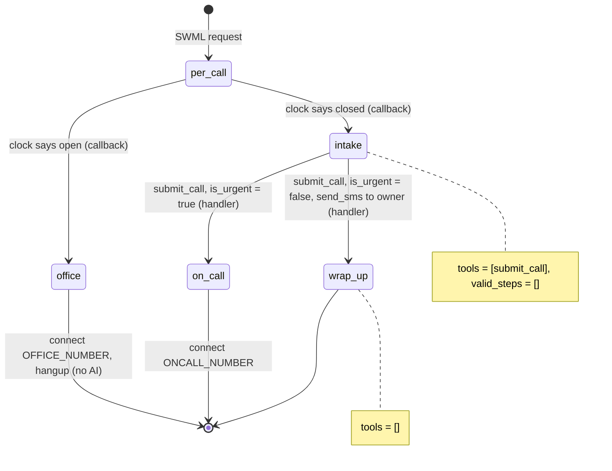

# Answering Service

During business hours, callers ring straight through to the office. After hours, an AI takes a
message for the owner or puts an emergency through to the on-call line.

## What it does

Every call is checked against the office clock (`TZ`, `HOURS`, `data/holidays.json`). If the
office is open, the call rings the office line and no AI is involved. If it's closed, the agent
says so and asks for the caller's name, callback number and what the call is about. A routine
call ("a quote for a new faucet") is texted to the owner, and the caller hears that someone
will call back. An urgent one ("my basement is flooding") is connected to the on-call
technician right away.

## What it demonstrates

Code decides whether the AI is on the call at all. A dynamic config callback (`per_call`) runs
on every call and checks the clock. During hours it renders SWML that is just `connect` and
`hangup`, with no `ai` verb. After hours, the AI has exactly one tool, `submit_call`. Its
handler applies the urgency rule (`is_urgent`, a whole-word keyword list in `config.py`) and
either connects to on-call (`forward_urgent`) or sends the SMS (`take_message`). The model can't
choose a route: there's no connect, forward or SMS tool for it to call. The clock is injected
(`AnsweringService(clock=...)`), so the tests pin it to a weekday, a night, a Sunday and a
holiday.



| Primitive | Where |
|---|---|
| `set_dynamic_config_callback` | `app.py`, `per_call` (with `render_document` returning the office SWML) |
| SWML `connect` with no `ai` verb | `app.py`, `office_swml` |
| `set_functions`, `set_valid_steps([])` | `app.py`, steps `intake` and `wrap_up` |
| `FunctionResult.connect` | `app.py`, `forward_urgent` |
| `FunctionResult.send_sms` + `swml_change_step` | `app.py`, `take_message` |
| Urgency rule | `app.py`, `is_urgent`; keywords in `config.URGENT_KEYWORDS` |

## Prerequisites

- Python 3.12 and a SignalWire Space (project ID, API token, Space URL)
- A phone number on the Space for callers to dial (in the demo pool, `TEST_INBOUND`)
- An office number and an on-call number. In the demo pool these are `HUMAN_LEG` and
  `HUMAN_LEG_2`, which nobody answers: put a real phone in `OFFICE_NUMBER` and `ONCALL_NUMBER`
  to hear the connection.
- A caller-ID number for the connected leg (`FROM_NUMBER`, demo pool `OUTBOUND_2`)
- An SMS-capable sender that's registered for 10DLC or verified toll-free (`SMS_FROM`, demo pool
  `SMS_1`). TODO(blocked: `SMS_1` isn't on the 10DLC campaign yet, so live texts won't deliver.
  The send_sms action is built and covered by the tests.)
- A public URL for your machine (ngrok or similar)

## Setup

```bash
git clone https://github.com/signalwire-demos/ai-recipes
cd ai-recipes/recipes/19-answering-service
python3.12 -m venv .venv && source .venv/bin/activate
pip install -r requirements.txt
cp .env.example .env    # fill in the SIGNALWIRE_* keys, PUBLIC_URL and basic auth
```

In `.env`, set `TZ` (an IANA zone such as `America/New_York`), `HOURS` (for example
`mon-fri 09:00-17:00; sat 10:00-14:00`), `OFFICE_NUMBER`, `ONCALL_NUMBER`, `OWNER_NUMBER` (who
gets the text; defaults to the office number), `FROM_NUMBER` and `SMS_FROM`. Add closed dates
to `data/holidays.json`.

## Run locally

```bash
python app.py                      # serves SWML on :3000
ngrok http 3000                    # in another terminal; put the URL in PUBLIC_URL
```

In the SignalWire Dashboard, set the phone number's call handler to
`https://USER:PASS@<your-tunnel>/` (USER/PASS = SWML_BASIC_AUTH_USER/PASSWORD), then call it.
To try the after-hours path during the day, restart with `HOURS="mon 00:00-00:00" python app.py`
(never open). Then say "This is Pat, 555-0142, I'd like a quote for a faucet" (texted) or
"...my basement is flooding" (forwarded).

Without a phone:

```bash
pytest -q
swaig-test app.py --list-tools
HOURS="mon-sun 00:00-24:00" swaig-test app.py --dump-swml --raw | jq '.sections.main'   # office: no ai
HOURS="mon 00:00-00:00" swaig-test app.py --dump-swml --raw | jq '.sections.main[-1].ai.prompt.contexts'
swaig-test app.py --exec submit_call --name Pat --callback_number 5550142 --message "pipe burst"
```

Set `HOURS` in the shell as shown. `swaig-test --env` applies too late for `config.py` to see it.

## Deploy

```bash
docker compose up --build          # reads .env, serves on :3000
```

Put it behind any HTTPS host and point the number at `https://USER:PASS@<host>/`.
Serverless: the agent keeps no local state (the clock check runs per request), so `agent.run()`
works unchanged on AWS Lambda or Google Cloud Functions. `tzdata` is pinned so the time zone
resolves in slim images.

## What to change first

Open `config.py`: set `BUSINESS_NAME`, the `TZ` and `HOURS` defaults, and `URGENT_KEYWORDS`
(the urgency rule). Put your closed dates in `data/holidays.json`. To use a smarter rule (VIP
callers, an on-call rota), replace `is_urgent` in `app.py`. It's the only thing that picks the
route.
