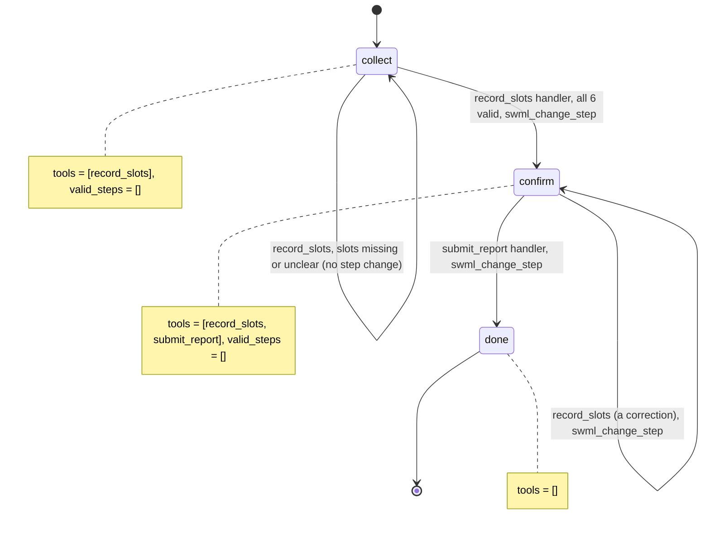

# Absence Reporting Line

A parent or employee calls to report an absence and says the details however they come out:
"Jamie's out Monday and Tuesday with the flu, it's for school."

## What it does

The agent takes an absence report with six details: the absent person's name, their student
or employee ID, whether it's school or work, the reason, and the first and last day. The
caller can give them in any order, several at once or one per turn, and dates as they'd say
them ("Monday", "tomorrow", "the third of November", "11/3"). The agent asks only for what's
still missing or unclear, reads the whole report back, and on a yes saves it and gives the
caller a reference like `AB-3F9C21`.

## What it demonstrates

Grammar filling: the model collects, but code decides when the form is complete. `collect`
has exactly one tool, `record_slots`, whose six parameters are all optional, and
`valid_steps=[]`, so the model has no `next_step` tool. Each call merges that turn's values
into `global_data["absence"]`, validates every value in `slots.py` (dates are parsed from the
caller's exact words, and an ambiguous `11 2` comes back as "November 2 or February 11?"),
and answers with what's still missing. Only when nothing is missing does the handler call
`swml_change_step("confirm")`. `submit_report` exists only in `confirm`, re-checks all six
slots from `global_data`, and is the only thing that writes a report.

**Contrast with #4 (Hiring Phone Screen).** #4 uses the SDK's gather step: questions are asked
in a fixed order, one at a time, and the caller can't skip or reorder them. That's right for a
screening form. Here the order is the caller's: a slot map plus a merge handler accepts any
subset in any order, which is how people report absences. Pick gather when the order matters,
and grammar filling when only completeness matters.



| Primitive | Where |
|---|---|
| `set_functions`, `set_valid_steps([])` | `app.py`, steps `collect`, `confirm`, `done` |
| All-optional tool schema built from `config.SLOTS` | `app.py`, `define_tool("record_slots")` |
| Merge, validation, missing-slot gate | `slots.py`, `fill()`; `app.py`, `record_slots` |
| Date parsing from the caller's words | `slots.py`, `parse_date()` (from `patterns/date-collection`) |
| `update_global_data` + `swml_change_step` | `app.py`, `record_slots` and `submit_report` |
| `${global_data.absence_summary}` in step text | `app.py`, step `confirm` |

`slots.py` is copied from `patterns/grammar-filling` and `patterns/date-collection`, so this
folder works on its own. The changes: dates without a year default to this year, and
"today", "tomorrow" and weekday names ("Monday" means the next Monday) are understood.

## Prerequisites

- Python 3.12 and a SignalWire Space (project ID, API token, Space URL)
- A phone number on the Space (in the demo pool, the `TEST_INBOUND` role from NUMBERS.md)
- A public URL for your machine (ngrok or similar)
- No third-party accounts

## Setup

```bash
git clone https://github.com/signalwire-demos/ai-recipes
cd ai-recipes/recipes/20-absence-reporting
python3.12 -m venv .venv && source .venv/bin/activate
pip install -r requirements.txt
cp .env.example .env    # fill in the SIGNALWIRE_* keys, PUBLIC_URL and basic auth
```

No data to seed. Confirmed reports are written to `data/runtime/reports/<reference>.json`
(git-ignored).

## Run locally

```bash
python app.py                      # serves SWML on :3000
ngrok http 3000                    # in another terminal; put the URL in PUBLIC_URL
```

In the SignalWire Dashboard, set the phone number's call handler to
`https://USER:PASS@<your-tunnel>/` (USER/PASS = SWML_BASIC_AUTH_USER/PASSWORD), then call it.
Try, in pieces and out of order: "It's for school, she'll be out Monday through Tuesday",
then "the flu", then "Jamie Rivera", then "ID S 0 1 4 2". Try "11 2" as a date to hear the
clarifying question, and change the reason during the readback.

Without a phone:

```bash
pytest -q
swaig-test app.py --list-tools
swaig-test app.py --dump-swml --raw | jq '.sections.main[-1].ai.prompt.contexts'
swaig-test app.py --exec record_slots --start_date "11 2" --reason flu
swaig-test app.py --custom-data '{"global_data": {"absence": {"name": "Jamie Rivera"}}}' --exec record_slots --org_type work
```

## Deploy

```bash
docker compose up --build          # reads .env, serves on :3000
```

Put it behind any HTTPS host and point the number at `https://USER:PASS@<host>/`.
Serverless: the agent itself is stateless (the slots live in `global_data`), but
`submit_report` writes to local disk. On Lambda or Cloud Functions, replace the file write in
`submit_report` with your HR or student-information system.

## What to change first

Open `config.py`: edit `SLOTS`, the slot list. For a school-only line, drop `org_type` and
call `id` a student ID; for work, add slots such as `manager` or `shift`, each with a
validator (`matches(...)`, `one_of(...)` or `parse_date`). The tool schema, the missing-slot
gate and the saved report all follow that dict. Then set `ORG_NAME`, and point
`REPORTS_DIR` (or `submit_report` in `app.py`) at the system that should receive the reports.
