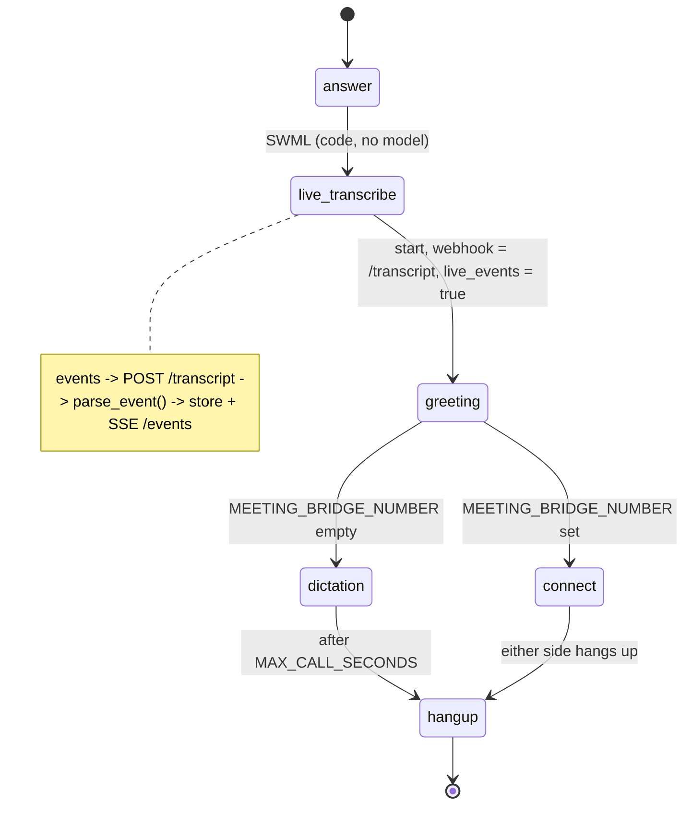

# AI Meeting Transcription Line

A caller dials a number, talks, and every word shows up as a live transcript on a server you own.

## What it does

The caller dials the meeting line and hears one sentence saying the line is transcribed. From that
moment, SignalWire transcribes both legs of the call and POSTs each partial and final result to
`/transcript` on this app. The app stores every event per call in
`data/runtime/transcripts/<call_id>.jsonl`, serves the merged transcript at `/calls/<call_id>`,
and re-broadcasts each segment over Server-Sent Events at `/events` (the live caption display, #22,
and the compliance monitor, #26, build on this stream). By default the line is a dictation line that
stays open for 10 minutes. Set `MEETING_BRIDGE_NUMBER` to connect the caller to a second party
instead; both sides are then transcribed.

## What it demonstrates

The transcript goes to your code first, and the call flow is code, not a prompt. `build_swml()` in
`app.py` starts `live_transcribe` straight after `answer`, before the caller hears anything, and
points its webhook at your own authenticated endpoint. The SWML has no `ai` verb: no model is in
the call path, and nothing reads the transcript before it lands in your storage. Every consumer
route needs the same basic auth as the SWML route. All knowledge of the event payload lives in one
function, `parse_event()` in `adapter.py`. Every raw body is kept next to the parsed segments.



| Primitive | Where |
|---|---|
| `SWMLService` + `add_verb` (no `ai` verb) | `app.py`, `build_swml()` |
| `live_transcribe` `start` with `webhook` + `live_events` | `app.py`, `build_swml()` |
| `connect` to a second party (optional) | `app.py`, `build_swml()` |
| Payload adapter (the one place that knows the event shape) | `adapter.py`, `parse_event()` |
| Partial/final merge, per-call store, SSE fan-out | `consumer.py`, `merge()`, `TranscriptStore`, `Broker` |

### The event payload

The docs don't publish the webhook body. `adapter.py` is written against bodies captured from a
live call on 2026-10-30. Each spoken utterance arrives as one final result:
`{"call_info": {"call_id"}, "channel_data": {"content_disposition": "transcribe.utterance",
"call_answer_date"}, "utterance": {"role", "content", "timestamp", "utterance_id", "confidence"}}`.
Timestamps are in microseconds, and they measured 80 to 300 ms ahead of arrival. At hangup, one
`transcribe.conversation_log` body repeats the whole conversation. It is stored raw and not
re-parsed. The fixtures in `data/fixtures/` use that shape with fake IDs and 555-01xx numbers.
The `play` greeting is transcribed too, as `local-caller`.

- `TODO(blocked: partial events not observed)`. With `live_events: true`, the live call delivered
  only final utterances. `partials-synthetic.jsonl` is a guess (`"is_final": false`, sharing the
  final's `utterance_id`) that keeps the partial merge path tested.
- `TODO(blocked: conference behavior undocumented)`. The plan calls for a conference. No source
  documents `live_transcribe` on a leg inside `join_conference`, so this version is a single-call
  dial-in. The seam is the `connect` branch in `build_swml()`.

## Prerequisites

- Python 3.12 and a SignalWire Space (project ID, API token, Space URL)
- A phone number on the Space (in the demo pool, the `TEST_INBOUND` role from NUMBERS.md)
- A public URL for your machine (ngrok or similar). The platform POSTs transcript events to it.
- Optional: a real phone to bridge to (`MEETING_BRIDGE_NUMBER`). No third-party accounts.

## Setup

```bash
git clone https://github.com/signalwire-demos/ai-recipes
cd ai-recipes/recipes/21-meeting-transcription-line
python3.12 -m venv .venv && source .venv/bin/activate
pip install -r requirements.txt
cp .env.example .env    # fill in the SIGNALWIRE_* keys, PUBLIC_URL and basic auth
```

Leave `TRANSCRIPT_WEBHOOK_URL` blank to use `PUBLIC_URL/transcript` with your basic auth in the URL
(the documented `user:pass@host` form). Set it only if events should go to another host.

## Run locally

```bash
python app.py                      # SWML on POST /, consumer on /transcript, /calls, /events (:3000)
ngrok http 3000                    # in another terminal; put the URL in PUBLIC_URL
```

In the SignalWire Dashboard, set the phone number's call handler to
`https://USER:PASS@<your-tunnel>/` (USER/PASS = SWML_BASIC_AUTH_USER/PASSWORD), then call it and
talk. Watch the transcript arrive:

```bash
curl -N -u USER:PASS http://localhost:3000/events            # live SSE stream, all calls
curl -s -u USER:PASS http://localhost:3000/calls             # call ids with a transcript
curl -s -u USER:PASS http://localhost:3000/calls/<call_id>   # merged transcript
```

Without a phone, replay the fixture call into the running app:

```bash
while read -r body; do
  curl -s -u USER:PASS -H 'Content-Type: application/json' -d "$body" localhost:3000/transcript
done < data/fixtures/meeting-call.jsonl
curl -s -u USER:PASS localhost:3000/calls/c0ffee00-0000-4000-8000-000000000021
```

And the tests:

```bash
pytest -q
swaig-test app.py --list-tools                 # none: this recipe has no SWAIG tools
swaig-test app.py --dump-swml --raw | jq '.sections.main'
```

## Deploy

```bash
docker compose up --build          # reads .env, serves on :3000
```

Put it behind any HTTPS host, set `PUBLIC_URL` to that host, and point the number at
`https://USER:PASS@<host>/`. Serverless: not suited as is, because the store writes to local disk
and SSE needs a long-lived connection. Swap `TranscriptStore` for a database first.

## What to change first

Open `config.py`: `TRANSCRIPT_DIR` and the `TranscriptStore` class it feeds decide where
transcripts are delivered (file, database or queue). Then set `GREETING`, `LANGUAGE_CODE` and
`MAX_CALL_SECONDS`, and `MEETING_BRIDGE_NUMBER` in `.env` if the line should connect to a second
party.
