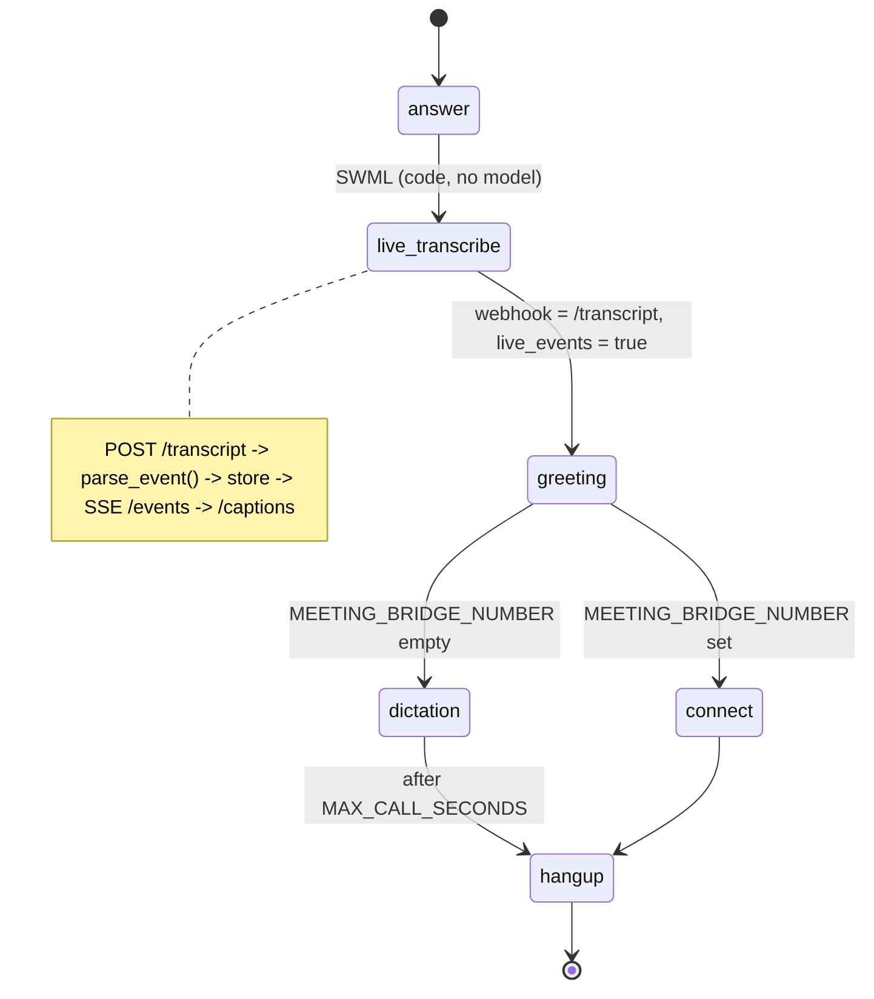

# AI Live Caption Display

Open a web page while a call is running and watch live captions appear, each with its real delay.

## What it does

A caller dials the number and hears one sentence saying the call is captioned. SignalWire
transcribes both legs and POSTs each partial and final result to this app, which stores it and
pushes it over Server-Sent Events. Open `http://localhost:3000/captions` in a browser, using the
same username and password as the SWML route. The page draws partial text in grey italics, swaps
it for solid text when the final result arrives, and shows the measured delay next to every line.
On today's platform only final utterances have been seen, so expect solid lines (see the TODO
below).
The transcript pipeline is recipe #21, copied in so this folder stands alone.

## What it demonstrates

The display is honest about latency, and it can't change what was said. Each segment's
`delay_ms` is computed on the server: the platform's event time (`ts`) against the moment the
consumer received the webhook (`received_at`). The browser's clock is never used, so a slow
laptop can't hide a slow pipeline. The page is read-only. It subscribes to `/events` and has no
write path, and it sits behind the same basic auth as the transcript. The call flow underneath is
code: `live_transcribe` starts right after `answer`, the webhook is your own endpoint, and the SWML
has no `ai` verb, so no model is in the call path.



| Primitive | Where |
|---|---|
| `SWMLService` + `live_transcribe` with `webhook` + `live_events` | `app.py`, `build_swml()` |
| Payload adapter (the one place that knows the event shape) | `adapter.py`, `parse_event()` |
| Server-side delay (`ts` vs `received_at`) | `adapter.py`, `Segment.delay_ms` |
| SSE fan-out, replay on connect | `consumer.py`, `Broker`, `GET /events` |
| Captions page (partial grey, final solid, delay badge) | `static/captions.html`, served at `GET /captions` in `app.py` |

### The event payload and what is not confirmed yet

`adapter.py` reads the payload captured from a live call on 2026-10-30 (see #21). Each final
utterance carries `utterance.timestamp` in microseconds, and the measured delay on that call was
80 to 300 ms. The greeting played by the SWML is transcribed too, labeled with the `local-caller`
leg.

- `TODO(blocked: partial events not observed)`. The live call delivered only final utterances,
  even with `live_events: true`. On a real call today, every line appears solid. The grey partial
  path is driven by `data/fixtures/partials-synthetic.jsonl`, a guess (`"is_final": false`
  sharing the final's `utterance_id`), until the platform is seen sending partials.
- `TODO(blocked: conference behavior undocumented)`. This is a single-call dial-in, like #21.
- The delay is only as good as the clock sync between SignalWire and your server. Run NTP.

## Prerequisites

- Python 3.12 and a SignalWire Space (project ID, API token, Space URL)
- A phone number on the Space (in the demo pool, the `TEST_INBOUND` role from NUMBERS.md)
- A public URL for your machine (ngrok or similar). The platform POSTs transcript events to it.
- A web browser. No third-party accounts.

## Setup

```bash
git clone https://github.com/signalwire-demos/ai-recipes
cd ai-recipes/recipes/22-live-caption-display
python3.12 -m venv .venv && source .venv/bin/activate
pip install -r requirements.txt
cp .env.example .env    # fill in the SIGNALWIRE_* keys, PUBLIC_URL and basic auth
```

## Run locally

```bash
python app.py                      # SWML on POST /, captions on /captions (:3000)
ngrok http 3000                    # in another terminal; put the URL in PUBLIC_URL
```

In the SignalWire Dashboard, set the phone number's call handler to
`https://USER:PASS@<your-tunnel>/` (USER/PASS = SWML_BASIC_AUTH_USER/PASSWORD). Open
`http://localhost:3000/captions` (log in with USER/PASS), call the number, and talk. Add
`?call_id=<id>` to follow one call. The page then also replays what was already said.

Without a phone, replay the fixture call into the running app while the page is open:

```bash
python replay.py                   # the meeting call (final utterances), paced like the original
python replay.py --file data/fixtures/partials-synthetic.jsonl   # grey partials, then a final
```

Open `http://localhost:3000/captions` first (it follows all calls), or the `?call_id=` URL that
`replay.py` prints. `replay.py` moves each event's timestamp to "now minus 0.08 to 0.6 s", so
the delay badges show believable numbers.

```bash
pytest -q
swaig-test app.py --list-tools                 # none: this recipe has no SWAIG tools
swaig-test app.py --dump-swml --raw | jq '.sections.main'
```

## Deploy

```bash
docker compose up --build          # reads .env, serves on :3000
```

Put it behind any HTTPS host, set `PUBLIC_URL` to that host, and point the number at
`https://USER:PASS@<host>/`. If a proxy sits in front, turn off response buffering for `/events`
(the app already sends `X-Accel-Buffering: no` for nginx). Serverless: not suited, because SSE
needs a long-lived connection and the store writes to local disk.

## What to change first

Open `config.py`: `SPEAKER_LABELS` decides which legs are shown and what they are called (set a leg
to `None` to hide it), and `DELAY_SLOW_MS` / `DELAY_LATE_MS` set when the delay badge turns amber
and red. For the look, edit the `<style>` block in `static/captions.html`.
