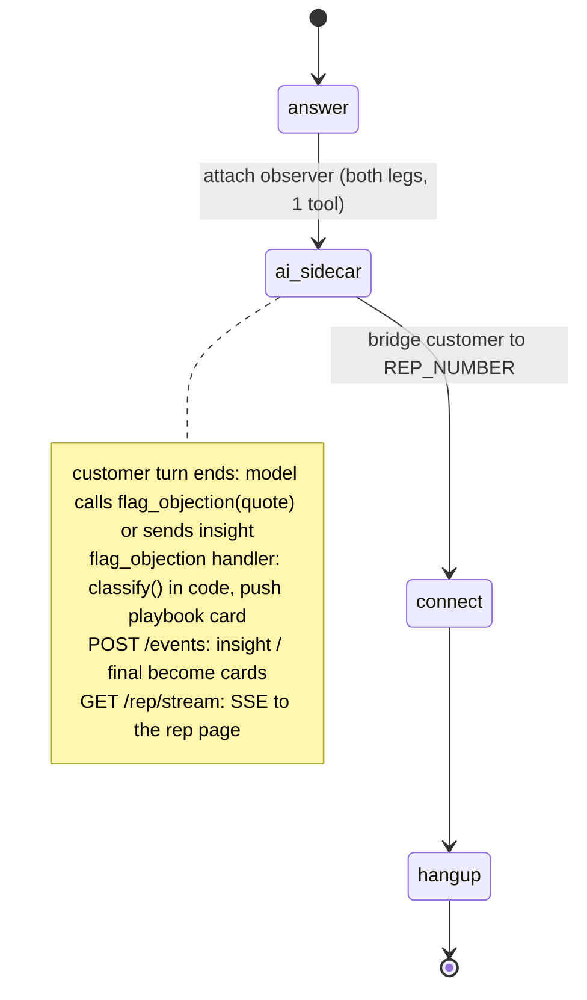

# AI Sales Call Copilot

A customer talks to a human sales rep, and the rep's screen shows a playbook card the moment the customer raises a pricing, timing, competitor or authority objection.

## What it does

A customer calls the sales line. SignalWire attaches an `ai_sidecar` to the call and bridges
the customer to the rep's phone. The sidecar listens to both people and never speaks. When the
customer pushes back ("it's too expensive", "we already use Globex", "I'd have to run it by my
CFO"), a card with that objection's talk track appears on the rep's web page within a turn.
Between objections the sidecar can send one line of advice, which shows up as a "Copilot" card.

## What it demonstrates

The sidecar rides a call it doesn't own. The SWML is `answer → ai_sidecar → connect → hangup`.
There's no `ai` verb, so no agent runs the call. The two people talk, and the sidecar listens to
both legs (`direction: [remote-caller, local-caller]`).

The sidecar's model has one tool, `flag_objection(customer_quote)`. The tool hands the
customer's words to a plain-code classifier (`classify()` in `app.py`). The classifier is a set
of regexes from `config.PLAYBOOK`, and it runs first: the model never decides the category. The
talk tracks go only to the rep's page. They aren't in the prompt, they aren't in the tool
description, and the tool's response doesn't contain them (tests assert all three). Sidecar
callbacks (`insight`, `final`) arrive at `POST /events`, are unwrapped from `sidecar_event`, and
become cards on the same Server-Sent Events stream.



| Primitive | Where |
|---|---|
| `SWMLService` hosting `ai_sidecar` (schema-validated by `add_verb`) | `app.py`, `SalesCopilot.__init__`, `sidecar_config()` |
| `SWAIG.functions` = exactly `[flag_objection]` | `app.py`, `sidecar_config()` |
| Deterministic objection classifier | `app.py`, `classify()`; rules in `config.PLAYBOOK` |
| Sidecar callback consumer (`sidecar_event.type`) | `app.py`, `on_event()` and `POST /events` |
| Rep page over SSE | `app.py`, `GET /rep/stream`; UI in `web/` |

Not available yet, so this recipe doesn't attempt them:

- The `ai_sidecar` verb is documented (SWML reference, SDK schema since 3.4.0), but no source
  says whether it's generally available. Ask SignalWire support whether it's enabled on your Space.
- `TODO(blocked: per-type ai_sidecar callback fields are at docs apis/rest/webhooks/ai-sidecar-callback, not verified)`.
  `on_event()` handles `insight` and `final` (documented fields). It classifies a transcript event
  only when the event has a string `text` field. Otherwise the `flag_objection` tool path does the work.
- `TODO(blocked: no documented way to whisper audio to the human rep)`. `rpc_ai_message` reaches
  only an AI agent, which is why the cards go to a web page.
- `TODO(blocked: no documented REST/RELAY command to start ai_sidecar on a call already in progress)`.
  The sidecar is attached in the SWML before `connect`.

## Prerequisites

- Python 3.12 and a SignalWire Space (project ID, API token, Space URL), with `ai_sidecar` enabled
- A phone number on the Space (in the demo pool, `TEST_INBOUND` for the customer side)
- A phone the rep answers, in `REP_NUMBER` (the demo pool's `HUMAN_LEG_2` has nobody on it, so
  put a real phone there for a live test). Its caller ID is `FROM_NUMBER` (demo pool: `OUTBOUND_2`).
- A public URL for your machine (ngrok or similar)
- No third-party accounts

## Setup

```bash
git clone https://github.com/signalwire-demos/ai-recipes
cd ai-recipes/recipes/23-sales-call-copilot
python3.12 -m venv .venv && source .venv/bin/activate
pip install -r requirements.txt
cp .env.example .env    # fill in the SIGNALWIRE_* keys, PUBLIC_URL, basic auth and REP_NUMBER
```

## Run locally

```bash
python app.py                      # serves SWML on :3000, the rep page on /rep/
ngrok http 3000                    # in another terminal; put the URL in PUBLIC_URL, then restart app.py
```

`PUBLIC_URL` goes into the SWML (the sidecar's event and tool URLs), so restart `app.py` after you
set it. Open `https://<your-tunnel>/rep/` in a browser and log in with the basic auth user and
password. In the SignalWire Dashboard, set the phone number's call handler to
`https://USER:PASS@<your-tunnel>/` (USER/PASS = SWML_BASIC_AUTH_USER/PASSWORD). Then call it,
answer on the rep phone, and as the customer say "Honestly it's too expensive" or "We already use Globex".

Without a phone:

```bash
pytest -q
swaig-test app.py --list-tools
swaig-test app.py --dump-swml --raw | jq '.sections.main[1].ai_sidecar'
swaig-test app.py --exec flag_objection --customer_quote "We already use Globex"
python replay.py price-and-boss    # with app.py running: watch /rep/ fill from data/transcripts.json
```

`replay.py` sends each customer line from a fixture call to `/swaig` as a `flag_objection` call
(the same request the sidecar makes), then ends with a `final` event. The fixtures are
`price-and-boss`, `competitor-and-timing` and `two-at-once`.

## Deploy

```bash
docker compose up --build          # reads .env, serves on :3000
```

Put it behind any HTTPS host, set `PUBLIC_URL` to that host, and point the number at
`https://USER:PASS@<host>/`. The rep page is at `https://<host>/rep/`.
Serverless: not a good fit. The rep page holds a long-lived SSE connection, and the cards live
in process memory (`config.FEED_SIZE`), so run a single long-lived container.

## What to change first

Open `config.py`. `PLAYBOOK` holds your objection categories: the regexes that trigger each one
and the talk track the rep sees. Put your competitors in `COMPETITORS` (they also become speech
hints), and set `REP_NUMBER` in `.env` to your rep's phone. To hand cards to your CRM or contact
center UI instead of the bundled page, replace `Feed.push` in `app.py`.
