# AI Support Copilot That Acts

A customer talks to a human support rep while an AI copilot looks up their order and issues the credit the rep offers. Results show on the rep's screen, and the credit cap is enforced in code.

## What it does

A customer calls the support line. SignalWire attaches an `ai_sidecar` to the call and bridges
the customer to the rep's phone. The sidecar listens to both people and never speaks. When an
order number comes up, it looks the order up, and the rep's web page shows the full record. When
the rep tells the customer "I'll put a ten-dollar credit on that", the sidecar issues the credit
mid-call. The rep page shows whether it was issued, or refused and why.

## What it demonstrates

Scoped tool execution mid-call, without the AI owning the call. The SWML is
`answer → ai_sidecar → connect → hangup`. There's no `ai` verb, so two people talk while the
sidecar acts. Its model has exactly two tools, `lookup_order` and `issue_credit`.

The credit rules live in the `issue_credit` handler, not the prompt. The handler enforces the
cap (`config.CREDIT_CAP_USD`), refuses an unknown order, a zero or negative amount, or more than
the order total, and allows one credit per order. The check and the ledger write run under one
lock. The cap never appears in the prompt, a tool description or a tool response. Every refusal
returns the same sentence, so the model can't probe for the limit. The rep's card gets the real
reason, including the cap. `lookup_order` gives the model status, items and total. The customer's
phone and the account notes go only to the rep's screen.

```mermaid
stateDiagram-v2
    [*] --> answer
    answer --> ai_sidecar: attach observer (both legs, 2 tools)
    ai_sidecar --> connect: bridge customer to REP_NUMBER
    connect --> hangup
    hangup --> [*]
    note right of ai_sidecar
      tools = [lookup_order, issue_credit]
      issue_credit handler: cap, order total, one per order, ledger
      refusal to model: one fixed sentence; reason to rep card
      POST /events: insight / final become cards
      GET /rep/stream: SSE to the rep page
    end note
```



| Primitive | Where |
|---|---|
| `SWMLService` hosting `ai_sidecar` (schema-validated by `add_verb`) | `app.py`, `SupportCopilot.__init__`, `sidecar_config()` |
| `SWAIG.functions` = exactly `[lookup_order, issue_credit]` | `app.py`, `define_tool` calls, `sidecar_config()` |
| Cap enforced in the handler, never shown to the model | `app.py`, `credit_refusal()`, `issue_credit()`, `REFUSED` |
| Sidecar callback consumer (`sidecar_event.type`) | `app.py`, `on_event()` and `POST /events` |
| Rep page over SSE | `app.py`, `GET /rep/stream`; UI in `web/` |

Not available yet, so this recipe doesn't attempt them:

- The `ai_sidecar` verb is documented (SWML reference, SDK schema since 3.4.0), but no source
  says whether it's generally available. Ask SignalWire support whether it's enabled on your Space.
- `TODO(blocked: no documented way to whisper audio to the human rep)`. The plan's optional
  `rpc_ai_message` whisper reaches only an AI agent, not a person, so results go to the rep page instead.
- `TODO(blocked: per-type ai_sidecar callback fields are at docs apis/rest/webhooks/ai-sidecar-callback, not verified)`.
  `on_event()` handles only the documented `insight` and `final` fields.
- `TODO(blocked: no documented REST/RELAY command to start ai_sidecar on a call already in progress)`.

## Prerequisites

- Python 3.12 and a SignalWire Space (project ID, API token, Space URL), with `ai_sidecar` enabled
- A phone number on the Space (in the demo pool, `TEST_INBOUND` for the customer side)
- A phone the rep answers, in `REP_NUMBER` (the demo pool's `HUMAN_LEG_2` has nobody on it, so
  put a real phone there for a live test). Its caller ID is `FROM_NUMBER` (demo pool: `OUTBOUND_2`).
- A public URL for your machine (ngrok or similar)
- No third-party accounts. Orders come from `data/orders.json`, and credits go to `data/credits.jsonl`.

## Setup

```bash
git clone https://github.com/signalwire-demos/ai-recipes
cd ai-recipes/recipes/24-support-copilot-that-acts
python3.12 -m venv .venv && source .venv/bin/activate
pip install -r requirements.txt
cp .env.example .env    # fill in the SIGNALWIRE_* keys, PUBLIC_URL, basic auth and REP_NUMBER
```

## Run locally

```bash
python app.py                      # serves SWML on :3000, the rep page on /rep/
ngrok http 3000                    # in another terminal; put the URL in PUBLIC_URL, then restart app.py
```

`PUBLIC_URL` goes into the SWML (the sidecar's event and tool URLs), so restart `app.py` after you
set it. Open `https://<your-tunnel>/rep/` in a browser and log in with the basic auth user and
password. In the SignalWire Dashboard, set the phone number's call handler to
`https://USER:PASS@<your-tunnel>/` (USER/PASS = SWML_BASIC_AUTH_USER/PASSWORD). Call it and answer
on the rep phone. As the customer, say "My order A-1001 arrived scratched". As the rep, say
"I'll put a ten-dollar credit on order A-1001 for you". Try a credit above the cap to see the refusal card.

Without a phone:

```bash
pytest -q
swaig-test app.py --list-tools
swaig-test app.py --dump-swml --raw | jq '.sections.main[1].ai_sidecar.SWAIG.functions'
swaig-test app.py --exec issue_credit --order_id A-1001 --amount 40 --reason scratched
python replay.py                   # with app.py running: watch /rep/ fill, and see what the model is told
```

The mock orders are `A-1001` (delivered, 64.00), `A-1002` (in transit, 189.00) and `A-1003`
(processing, 12.00). To reset the one-credit-per-order rule, delete `data/credits.jsonl`.

## Deploy

```bash
docker compose up --build          # reads .env, serves on :3000
```

Put it behind any HTTPS host, set `PUBLIC_URL` to that host, and point the number at
`https://USER:PASS@<host>/`. The rep page is at `https://<host>/rep/`.
Serverless: not a good fit. The rep page holds a long-lived SSE connection, cards live in process
memory, and the mock ledger is a local file. Run a single long-lived container, and move the
ledger to your billing system before you run more than one instance.

## What to change first

Open `config.py`. `CREDIT_CAP_USD` is the most the copilot can credit without a supervisor.
`ORDERS_FILE` and `CREDIT_LEDGER` point at the mock order backend. To use your real order system,
replace `load_orders()` and the ledger write in `issue_credit()` in `app.py` with calls to your
API, and keep the checks in `credit_refusal()`.
