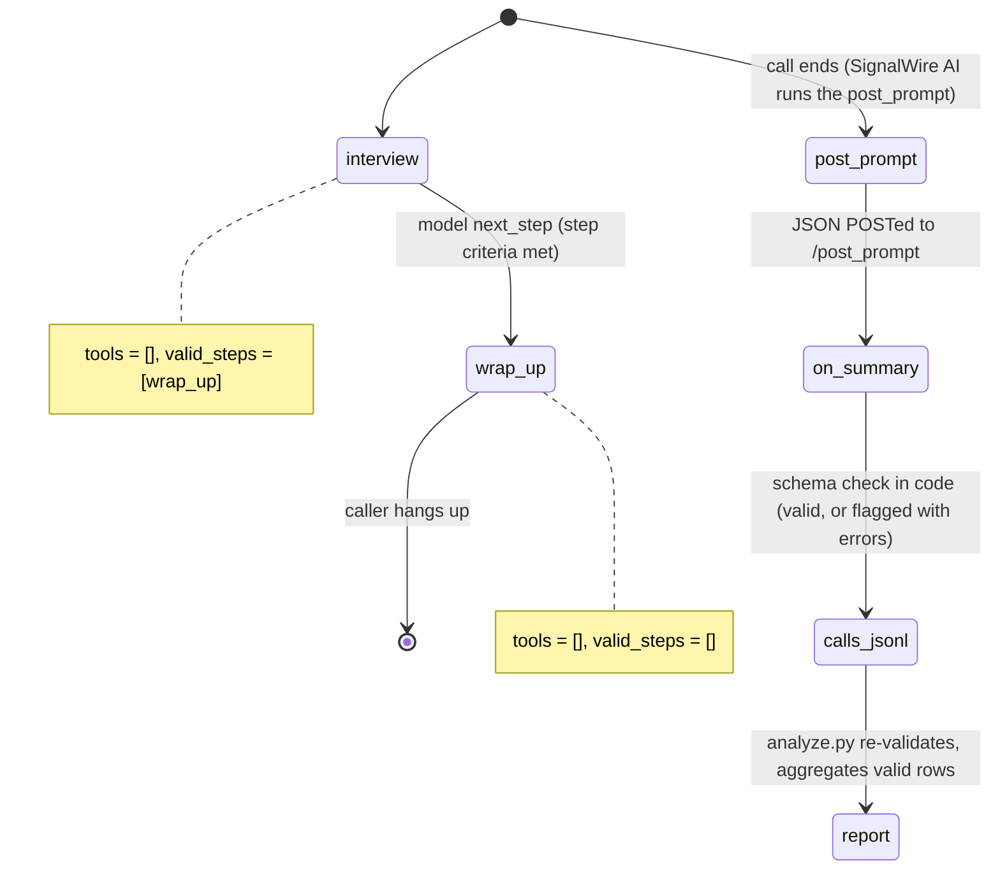

# AI Competitive Win/Loss Analyzer

A prospect gives a short win/loss interview by phone, and the call becomes a validated row in a markdown win/loss report.

## What it does

A prospect who recently chose (or didn't choose) Example CRM calls the interview line. The
agent asks four things, one at a time: did they buy, what mattered most, which other vendors
they looked at, and what concerns they had. Then it thanks them and says goodbye. After the
call, SignalWire's AI turns the conversation into a fixed JSON record (outcome, reasons,
competitor, objections). `python analyze.py --since 7d` rolls those records up into a report
with the win rate, top reasons won and lost, a head-to-head table per competitor, and the most
common objections.

## What it demonstrates

A post-call analysis pipeline built on structured extraction you own, not a summary you hope
is right. The interviewer has no tools (`set_functions([])` on every step), so it can't write
or look anything up. Extraction runs on SignalWire's AI. The post_prompt is generated from the
same JSON Schema (`extraction.py`) that `on_summary` validates against, with the allowed
outcomes and reason categories enumerated from `config.py`. A summary that isn't JSON, has an
unknown outcome, an invented reason category or an extra field is stored with `valid: false`
and its errors. It is not repaired or guessed at. `analyze.py` re-validates every row, lists
bad ones under "Flagged", and counts only valid ones. No outside LLM key is involved.



| Primitive | Where |
|---|---|
| `set_functions([])`, `set_valid_steps` | `app.py`, steps `interview` and `wrap_up` |
| `set_post_prompt` + `set_post_prompt_llm_params` | `app.py`, built from `extraction.POST_PROMPT` |
| `on_summary` | `app.py`, `WinLossAgent.on_summary`, which writes `data/runtime/calls.jsonl` |
| JSON Schema validation (jsonschema-rs, an SDK dependency) | `extraction.py`, `parse()` |
| Aggregation into markdown | `analyze.py` |

## Prerequisites

- Python 3.12 and a SignalWire Space (project ID, API token, Space URL)
- A phone number on the Space (in the demo pool, `TEST_INBOUND` from NUMBERS.md)
- A public URL for your machine (ngrok or similar). The platform POSTs the summary back to it.
- No third-party accounts. Synthetic sample summaries ship in `data/fixtures/calls.jsonl`.

## Setup

```bash
git clone https://github.com/signalwire-demos/ai-recipes
cd ai-recipes/recipes/25-win-loss-analyzer
python3.12 -m venv .venv && source .venv/bin/activate
pip install -r requirements.txt
cp .env.example .env    # fill in the SIGNALWIRE_* keys, PUBLIC_URL and basic auth
```

`SUMMARY_SOURCE` in `.env` picks what `analyze.py` reads. `fixtures` (the default) reads the
bundled synthetic calls, and `local` reads what `on_summary` stored from your real calls.
`signalwire` (pulling summaries over REST) is TODO(blocked: signalwire-sdk 3.7.5 has no
REST endpoint that returns post-prompt summaries), so it exits with that message instead of
guessing.

## Run locally

Try the report first, with no phone:

```bash
python analyze.py --since 7d                 # fixtures: a frozen week, two rows flagged
```

Then take a real interview:

```bash
python app.py                      # serves SWML on :3000
ngrok http 3000                    # in another terminal; put the URL in PUBLIC_URL
```

In the SignalWire Dashboard, set the phone number's call handler to
`https://USER:PASS@<your-tunnel>/` (USER/PASS = SWML_BASIC_AUTH_USER/PASSWORD), then call it.
Play the prospect: "We went with Acme. Mostly price, and you didn't integrate with our ERP."
A few seconds after you hang up, a row lands in `data/runtime/calls.jsonl`. Then run:

```bash
python analyze.py --source local --since 24h --out report.md
```

Without a phone:

```bash
pytest -q
swaig-test app.py --list-tools               # none: the interviewer has no tools
swaig-test app.py --dump-swml --raw | jq '.sections.main[-1].ai.post_prompt'
```

## Deploy

```bash
docker compose up --build          # reads .env, serves on :3000
docker compose run --rm app python analyze.py --since 7d
```

Put it behind any HTTPS host and point the number at `https://USER:PASS@<host>/`.
Serverless: the agent itself is stateless, but `on_summary` appends to a local file. Point it
at a database or object store first.

## What to change first

Open `config.py`: `OUTCOMES`, `REASONS` and `MAX_REASONS` define the extraction schema. Both
the post_prompt and the validator are built from them, so a change shows up in each.
`COMPETITOR_ALIASES` maps what prospects say to the names in the report. To add a report
section, add a block to `report()` in `analyze.py`.
