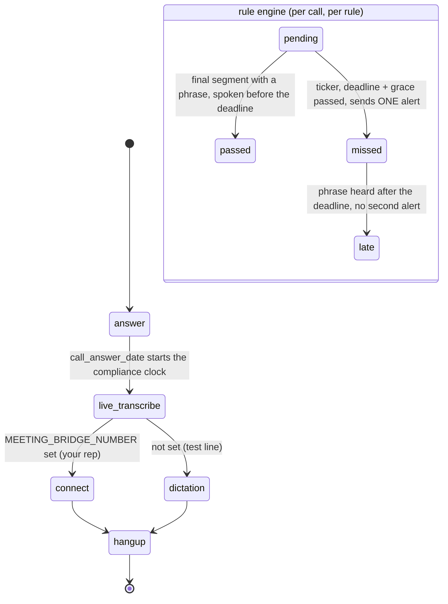

# AI Compliance Call Monitor

While a call is live, the required disclosures are checked as they are spoken, and a supervisor
gets one alert if one is missed.

## What it does

A call comes in on the monitored number and is connected to your rep (`MEETING_BRIDGE_NUMBER`), or
held open as a single-party line for testing. SignalWire transcribes both legs live and POSTs each
result to this app. A rule engine checks that each required phrase in `config.RULES` was said
within its deadline, for example "this call is recorded" within 30 seconds. If the deadline
passes without the phrase, the supervisor gets exactly one alert, by SMS or by webhook (Slack
works). The alert carries the call ID and the deadline. A late disclosure is recorded, but it
never sends a second alert. `GET /calls/<call_id>/compliance` shows each rule as `pending`,
`passed`, `missed` or `late`.

## What it demonstrates

Compliance is enforced by code, not judged by a model. The rules are plain phrase matches on final
transcript segments (`rules.py`). A phrase counts by the time it was spoken (the segment's `ts`),
not by when its webhook arrived. Each call's clock starts when the platform answered the call
(`channel_data.call_answer_date`, carried in every transcript event). Deadlines are checked on a ticker, so a rep who says nothing still
triggers the alert. Each (call, rule) pair settles once, so the supervisor is never paged twice.
The call flow underneath is code too: `live_transcribe` starts right after `answer` and before
`connect`, so the whole disclosure window is transcribed. The SWML has no `ai` verb, and the
transcript goes only to your own authenticated webhook. The transcript pipeline is recipe #21,
copied in so this folder stands alone.



| Primitive | Where |
|---|---|
| `SWMLService` + `live_transcribe` (before `connect`) | `app.py`, `build_swml()` |
| Call clock from the platform's answer time | `adapter.py` (`answered_at`), `rules.py` (`observe`) |
| Every segment to the rules | `app.py`, `MonitoredBroker.publish` |
| Deterministic rules, exactly-once settle, grace period | `rules.py`, `ComplianceMonitor` |
| Deadline ticker | `app.py`, `create_app()` lifespan |
| SMS alert (`client.messages.create`) or webhook | `alerts.py`, `AlertSender.send` |
| Payload adapter (the one place that knows the event shape) | `adapter.py`, `parse_event()` |

### The event payload and what is not confirmed yet

`adapter.py` reads the payload captured from a live call on 2026-10-30 (see #21). There is one
final `utterance` per spoken sentence, with `role` (leg), `content`, and `timestamp` (µs). The
envelope carries `call_answer_date`. Audio played by the SWML is transcribed too, as
`local-caller`. A disclosure you play with `play` (for example, put "This call is recorded." in
`GREETING` in `config.py`) passes the rule on its own. That is the strongest form of compliance,
because no rep can forget it.

- `TODO(blocked: partial events not observed)`. Only final utterances arrived live. Rules use finals
  only, so this doesn't change the rule results.
- SMS alerts were verified live on 2026-10-30, with `SMS_1` on a 10DLC campaign. On a call that
  said "my name is" but never the recording disclosure, exactly one alert was sent and delivered,
  for `recording-disclosure`.
- `TODO(blocked: conference behavior undocumented)`. This is a single-call line, like #21.

## Prerequisites

- Python 3.12 and a SignalWire Space (project ID, API token, Space URL)
- A phone number on the Space (in the demo pool, `TEST_INBOUND` from NUMBERS.md)
- A public URL for your machine (ngrok or similar). The platform POSTs transcript events to it.
- For a real test with a rep: a phone to bridge to (`MEETING_BRIDGE_NUMBER`). Demo-pool `HUMAN_LEG`
  numbers have no one answering, so put a real phone there.
- For SMS alerts: a sender number on an approved 10DLC campaign. Or use a Slack incoming webhook,
  which is optional. No other accounts are needed.

## Setup

```bash
git clone https://github.com/signalwire-demos/ai-recipes
cd ai-recipes/recipes/26-compliance-call-monitor
python3.12 -m venv .venv && source .venv/bin/activate
pip install -r requirements.txt
cp .env.example .env    # fill in the SIGNALWIRE_* keys, PUBLIC_URL and basic auth
```

In `.env`, set `ALERT_TARGET` to the supervisor's phone (`+1...`) or a webhook URL. Leave it blank
to log alerts only. Every alert is also written to `data/runtime/alerts.jsonl`.

## Run locally

```bash
python app.py                      # SWML on POST /, consumer + monitor (:3000)
ngrok http 3000                    # in another terminal; put the URL in PUBLIC_URL
```

In the SignalWire Dashboard, set the phone number's call handler to
`https://USER:PASS@<your-tunnel>/` (USER/PASS = SWML_BASIC_AUTH_USER/PASSWORD), then call it. To
pass, say "My name is Dana" and "this call is recorded" in the first 30 seconds. Stay quiet to
see the alert fire about 33 seconds in (30 s deadline plus 3 s grace).

```bash
curl -s -u USER:PASS localhost:3000/calls                         # call ids
curl -s -u USER:PASS localhost:3000/calls/<call_id>/compliance    # rule status
```

Without a phone, replay the fixture call where the disclosure is never said. Its timestamps are in
the past, so the ticker settles it, and logs the alert, within a second or two. The on-time and
late fixtures are checked by `pytest`, which controls the clock.

```bash
while read -r body; do
  curl -s -u USER:PASS -H 'Content-Type: application/json' -d "$body" localhost:3000/transcript
done < data/fixtures/compliance-missing.jsonl
curl -s -u USER:PASS localhost:3000/calls/c0ffee00-0000-4000-8000-000000000263/compliance
```

```bash
pytest -q
swaig-test app.py --list-tools                 # none: this recipe has no SWAIG tools
swaig-test app.py --dump-swml --raw | jq '.sections.main'
```

## Deploy

```bash
docker compose up --build          # reads .env, serves on :3000
```

Put it behind any HTTPS host, set `PUBLIC_URL` to that host, and point the number at
`https://USER:PASS@<host>/`. Run one instance only, because rule state is in memory. Serverless:
not suited, because the deadline ticker needs a long-running process.

## What to change first

Open `config.py`: `RULES` holds the required phrases, the deadline for each (`within_seconds`) and
which leg must say them. `ALERT_GRACE_SECONDS` sets how long to wait for in-flight transcript events
before declaring a miss. Set `ALERT_TARGET` in `.env` to choose who is alerted and how.
