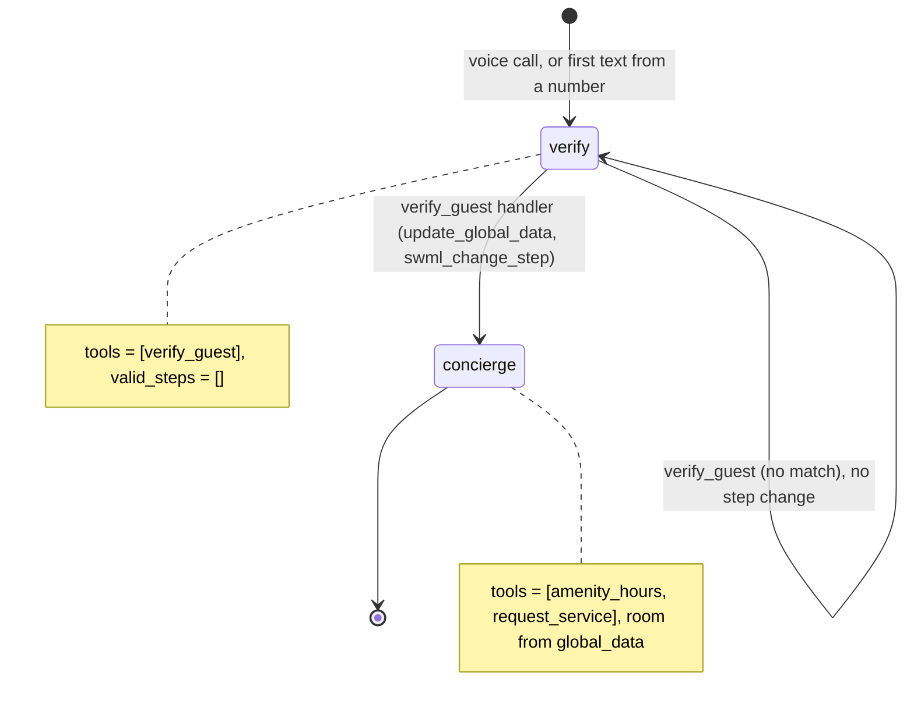
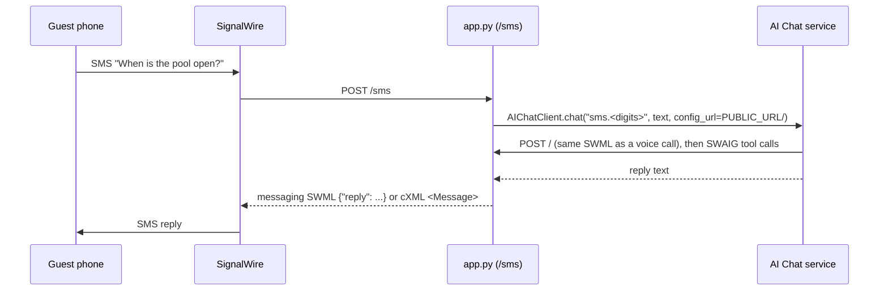

# AI SMS Concierge

A hotel guest calls or texts the same concierge, and gets the same answers and the same rules either way.

## What it does

The concierge asks for the guest's room number and last name, checks them against
`data/guests.json`, then answers amenity questions (pool, gym, breakfast, spa, parking) and
logs service requests (extra towels, housekeeping, late checkout, a wake-up call, the room
service menu) to `data/requests.json`. Guests can call the voice number or text the SMS
number. A texting guest keeps one conversation per phone number, so "and the gym?" an hour
later still knows who they are.

## What it demonstrates

One agent definition serves more than one channel. `concierge.py` holds the whole agent
(prompt, steps, tools) and knows nothing about phones or SMS. A voice call fetches its SWML
from `/`. An inbound text goes to `/sms`, which calls `AIChatClient.chat()` with that same URL
as `config_url`, so the AI Chat service runs the identical SWML. The governance comes with it
on both channels:

- In `verify`, `verify_guest` is the only tool and `valid_steps=[]`. Only its handler opens
  `concierge`, after a room and last name match.
- `request_service` files for the room in `global_data.guest`, set by `verify_guest`. The model
  never passes a room number, so it can't file a request for another room.
- `service` is an enum of `config.SERVICES`, and the handler refuses anything else.





| Primitive | Where |
|---|---|
| `define_contexts` / `set_functions` / `set_valid_steps([])` | `concierge.py`, `HotelConcierge.__init__` |
| `update_global_data` + `swml_change_step` | `concierge.py`, `verify_guest` |
| Room from `global_data`, never from args | `concierge.py`, `request_service` |
| `AIChatClient.chat(conversation_id, message, config_url=...)` | `app.py`, `SmsConcierge.answer` |
| Inbound SMS, both payload formats | `app.py`, `parse_inbound` / `render_reply` |

## Prerequisites

- Python 3.12 and a SignalWire Space (project ID, API token, Space URL). The API token
  needs the **Chat** scope for the AI Chat API, as well as Voice and Messaging.
- A phone number for voice (in the demo pool, `TEST_INBOUND` from NUMBERS.md)
- An SMS-registered number (10DLC campaign or verified toll-free; in the demo pool, `SMS_1`)
- A public URL for your machine (ngrok or similar). The AI Chat service fetches your SWML
  and calls your tools over it, the same as a voice call.
- No third-party accounts. The hotel register and amenities are JSON files under `data/`.

TODO(blocked: needs live verification) SMS into the AI Chat service has not been run on a
live number from the SDK, and `SMS_1` is not on the 10DLC campaign yet (NUMBERS.md). The
handler, both payload formats and the chat call are covered by tests against a fake
`AIChatClient`.

## Setup

```bash
git clone https://github.com/signalwire-demos/ai-recipes
cd ai-recipes/recipes/27-sms-concierge
python3.12 -m venv .venv && source .venv/bin/activate
pip install -r requirements.txt
cp .env.example .env    # fill in the SIGNALWIRE_* keys, PUBLIC_URL and basic auth
```

`PUBLIC_URL` and the basic auth values are required for SMS: the chat `config_url` is built
from them (`https://USER:PASS@<PUBLIC_URL host>/`). Set `CHAT_CONFIG_URL` to override it.
Optional: `SIGNALWIRE_SIGNING_KEY` makes `/sms` and the agent routes reject unsigned requests.

## Run locally

```bash
python app.py                      # SWML on /, SMS webhook on /sms, port 3000
ngrok http 3000                    # in another terminal; put the URL in PUBLIC_URL
```

In the SignalWire Dashboard:

1. **Voice.** Phone Numbers > Purchased > your voice number > Edit Settings. Under Inbound
   Call Settings, assign a SWML webhook at `https://USER:PASS@<your-tunnel>/`
   (USER/PASS = SWML_BASIC_AUTH_USER/PASSWORD) and save.
2. **SMS.** Phone Numbers > Purchased > your SMS number > Edit Settings. Under **Inbound
   Message Settings**, select **+ Assign Resource** and pick one of these:
   - A **SWML Webhook** resource at `https://<your-tunnel>/sms`, used for messaging. This is
     the route in the AI chat docs: SignalWire POSTs JSON `{"message": {"from", "to", "body"}}`
     and sends the `reply` from the messaging SWML the app returns. TODO(blocked: needs live
     verification) SDK 3.7.5 can't create a messaging SWML webhook (`fabric.swml_webhooks.create`
     types `used_for` as `calling` only), so do this step in the Dashboard.
   - A **cXML Webhook** resource at `https://<your-tunnel>/sms`, method POST. SignalWire POSTs
     a form (`From`, `To`, `Body`, `MessageSid`) and sends the `<Message>` from the cXML the
     app returns. From code: `client.phone_numbers.update(number_id,
     message_handler="laml_webhooks", message_request_url=f"{PUBLIC_URL}/sms",
     message_request_method="POST")`.

Call or text: "Room 412, Rivera", then "When is breakfast?" and "Can I get extra towels?".

Without a phone:

```bash
pytest -q
swaig-test app.py --list-tools
swaig-test app.py --dump-swml --raw | jq '.sections.main[-1].ai.prompt.contexts'
swaig-test app.py --exec verify_guest --room 412 --last_name Rivera
swaig-test app.py --custom-data '{"global_data": {"guest": {"room": "412", "name": "Alex Rivera"}}}' \
  --exec request_service --service "extra towels"
```

Test guests: room 412 (Rivera), room 1108 (Chen). With real credentials and `PUBLIC_URL` set,
`curl -s localhost:3000/sms -H 'content-type: application/json' -d
'{"message": {"from": "+15550142", "body": "Room 412, Rivera"}}'` runs a real chat turn.

## Deploy

```bash
docker compose up --build          # reads .env, serves on :3000
```

Put it behind any HTTPS host, point the voice number at `https://USER:PASS@<host>/` and the
SMS number's webhook resource at `https://<host>/sms`. Serverless: not suited as is, because
service requests are appended to a local JSON file. Move `REQUESTS_FILE` to a database first.

## What to change first

Open `config.py`: change `SERVICES` (the tool set: which requests the concierge may log) and
`HOTEL_NAME`, then point `GUESTS_FILE` and `AMENITIES_FILE` at your own data. The agent itself
is in `concierge.py`; anything you change there applies to voice and SMS at once.
