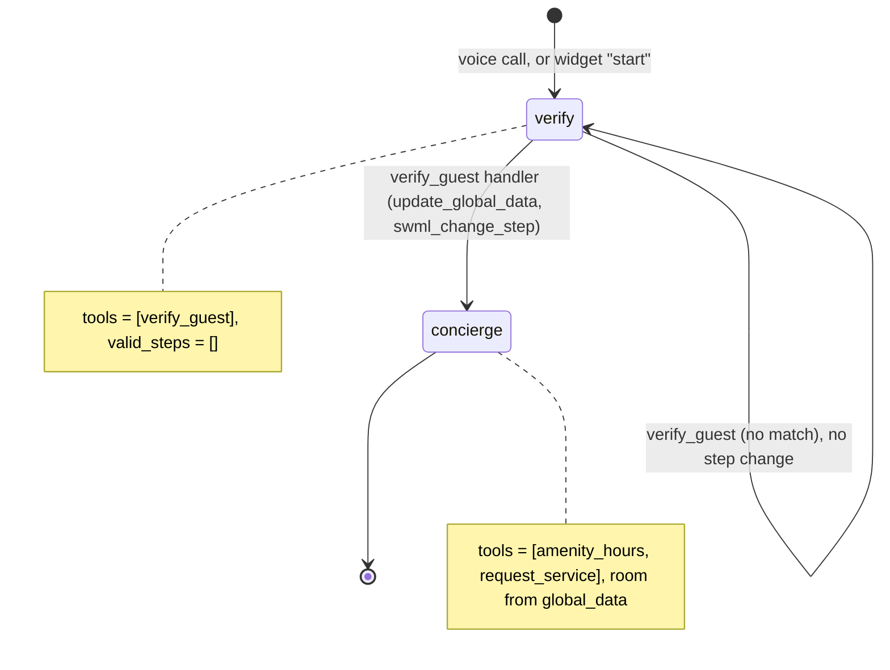
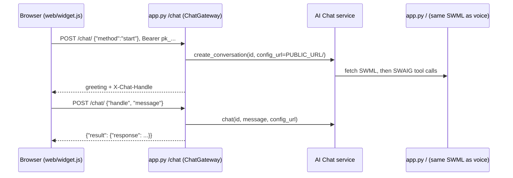

# AI Website Chat Agent

A hotel guest opens the chat bubble on the hotel's website and gets the same concierge, with the same rules, that answers the phone.

## What it does

`web/` is a sample static hotel site with a chat widget in the corner. The widget opens with
the concierge's greeting, asks for the room number and last name, then answers amenity
questions and logs service requests (extra towels, housekeeping, late checkout, a wake-up
call, the room service menu) to `data/requests.json`. A reload resumes the conversation.
Calling the voice number reaches the identical agent.

## What it demonstrates

Channel parity from the browser rather than the phone. `concierge.py` is the whole agent
(prompt, steps, tools), the same file #27 ships, and has no channel code. The voice call fetches
its SWML at `/`. The widget talks to a `ChatGateway` mounted at `/chat`, which passes that same
URL to the AI Chat service as `config_url`, so a web visitor runs the identical steps and tools:

- `verify` exposes only `verify_guest`, with `valid_steps=[]`. Only its handler opens `concierge`.
- `request_service` files for the room in `global_data.guest`. The model never passes a room.
- The browser holds only a publishable key. The gateway keeps the API token, pins `config_url`
  (a page can't point the key at another agent), filters the system prompt and tool traffic
  out of the transcript, and caps new conversations and turns (`config.py`).





| Primitive | Where |
|---|---|
| `define_contexts` / `set_functions` / `set_valid_steps([])` | `concierge.py`, `HotelConcierge.__init__` |
| `update_global_data` + `swml_change_step` | `concierge.py`, `verify_guest` |
| `ChatGateway(config_url=..., key=..., allowed_origins=...)` | `app.py`, `build_gateway` |
| `agent.mount(gateway.router(), prefix="/chat")` | `app.py`, `WebConcierge.__init__` |
| Widget: `start` / `chat` / `log`, `X-Chat-Handle` | `web/widget.js` |

## Prerequisites

- Python 3.12 and a SignalWire Space (project ID, API token, Space URL). The API token
  needs the **Chat** scope for the AI Chat API.
- A phone number for the voice side (in the demo pool, `TEST_INBOUND` from NUMBERS.md)
- A public URL for your machine (ngrok or similar). The AI Chat service fetches your SWML and
  calls your tools over it, so web chat needs the tunnel even when the page is on localhost.
- No third-party accounts. The hotel register and amenities are JSON files under `data/`.

## Setup

```bash
git clone https://github.com/signalwire-demos/ai-recipes
cd ai-recipes/recipes/28-website-chat-agent
python3.12 -m venv .venv && source .venv/bin/activate
pip install -r requirements.txt
cp .env.example .env    # fill in the SIGNALWIRE_* keys, PUBLIC_URL and basic auth
```

`PUBLIC_URL` and the basic auth values are required: the chat `config_url` is built from them
(`https://USER:PASS@<PUBLIC_URL host>/`). Set `SIGNALWIRE_CHAT_GATEWAY_KEY` to a fixed `pk_...`
value and `SIGNALWIRE_CHAT_GATEWAY_SECRET` to a random string, or a restart issues a new key and
invalidates open conversations. Without `SIGNALWIRE_*` credentials the voice agent still runs,
and `/chat` answers 503 with the reason.

## Run locally

```bash
python app.py                      # SWML on /, gateway on /chat, sample site on /site, port 3000
ngrok http 3000                    # in another terminal; put the URL in PUBLIC_URL, restart
```

Open `https://<your-tunnel>/site/` (or `http://localhost:3000/site/`), click the bubble and
type "Room 412, Rivera", then "When is breakfast?" and "Can I get extra towels?". For voice, in
the SignalWire Dashboard set the phone number's call handler to
`https://USER:PASS@<your-tunnel>/` (USER/PASS = SWML_BASIC_AUTH_USER/PASSWORD) and call it.

Without a phone:

```bash
pytest -q                          # includes the widget smoke test against a mock chat endpoint
swaig-test app.py --list-tools
swaig-test app.py --dump-swml --raw | jq '.sections.main[-1].ai.prompt.contexts'
swaig-test app.py --exec verify_guest --room 412 --last_name Rivera
curl -s localhost:3000/site/widget-config.js   # what the page learns: endpoint and publishable key
```

Test guests: room 412 (Rivera), room 1108 (Chen).

Verified live on 2026-10-30: the gateway flow (`start`, then chat turns on the handle) ran
through a tunnel against the AI Chat service, and the agent verified a guest and logged a
request with `channel: text`.

## Deploy

```bash
docker compose up --build          # reads .env, serves on :3000
```

Put it behind any HTTPS host and set `PUBLIC_URL` to it. To embed the widget on your real
site, copy the two `<script>` tags from `web/index.html` with absolute URLs to this app and add
your site's origin to `CHAT_ALLOWED_ORIGINS`. Run one replica, or set
`SIGNALWIRE_CHAT_GATEWAY_SECRET` on all of them (the caps are per process). Serverless: not
suited as is, because requests are appended to a local JSON file.

## What to change first

Open `config.py`: `WIDGET` sets the widget's placement (`position`) and branding (`title`,
`color`), `ALLOWED_ORIGINS` / `CHAT_ALLOWED_ORIGINS` list the sites that may embed it, and
`SERVICES` is the tool set. The agent itself is in `concierge.py`; change it there and voice
and web chat change together.
