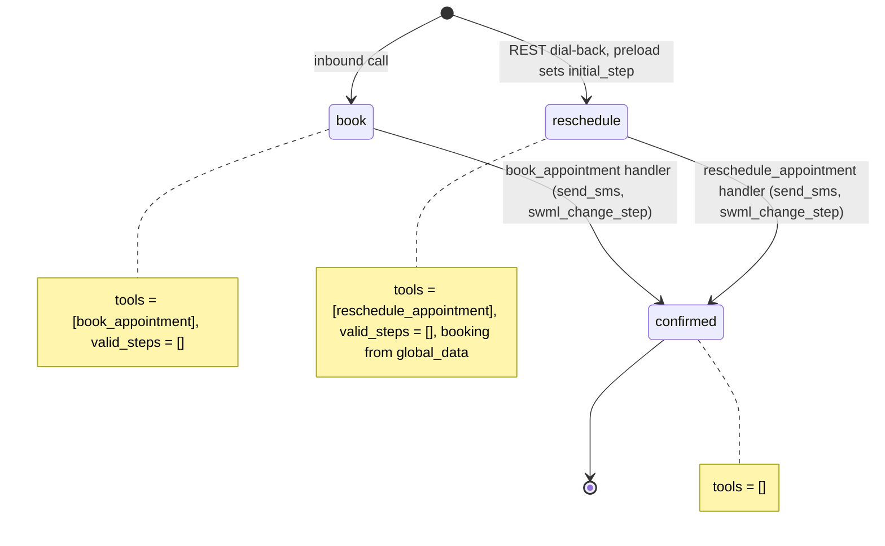
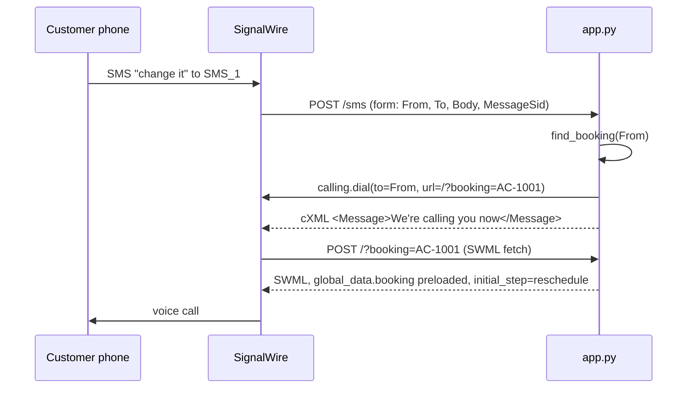

# Appointment Confirmation SMS

A caller books an appointment by phone, gets the details by text, and can reply CHANGE to get a call back that already knows their booking.

## What it does

The agent asks for the caller's name and one of the open slots in `data/slots.json`, saves the
booking to `data/bookings.json`, texts the date, time and confirmation number from the SMS
number, and tells the caller the text is on its way. If the customer later replies "change it"
(or "reschedule", "move", "call"), the `/sms` webhook finds their booking by phone number and
places a REST call back to them. That call opens on the reschedule step with the booking
already loaded, so the agent greets them by name and only asks for the new slot. Any other
reply gets the booking details texted back. A text from the SMS number itself gets no reply,
so the number can't loop on its own answers.

## What it demonstrates

The same booking is presented across voice and SMS, and the memory lives in code, not the model.

- The text is built by the handler from the stored record (`config.SMS_TEMPLATE`). The model
  never writes the date, time or confirmation number, and never picks the destination: the
  `to` number comes from `global_data.caller`, which dynamic config set from the call itself.
- On the dial-back, dynamic config (`preload`) reads `?booking=AC-1001`, loads that record into
  `global_data` and sets `initial_step` to `reschedule`. `reschedule_appointment` takes only a
  date and time; which booking it changes comes from `global_data`, so the model can't move
  someone else's appointment.
- `book` and `reschedule` each expose one tool and `valid_steps=[]`. A new caller has no way
  into `reschedule`, and only handlers reach `confirmed`, which has no tools.





| Primitive | Where |
|---|---|
| `define_contexts` / `set_functions` / `set_valid_steps([])` | `app.py`, `ConfirmationAgent.__init__` |
| `send_sms` + `update_global_data` + `swml_change_step` | `app.py`, `confirm()` (used by both tools) |
| `set_dynamic_config_callback` + `set_initial_step` | `app.py`, `preload()` |
| REST `calling.dial` | `app.py`, `dial_request()` / `dial_back()` |
| Inbound SMS (laml_webhooks form POST, cXML reply) | `app.py`, `sms_router()` and `handle_sms()` |
| `validate_webhook_signature` (optional) | `app.py`, `sms_router()` |

## Prerequisites

- Python 3.12 and a SignalWire Space (project ID, API token, Space URL)
- A phone number for voice (in the demo pool, `TEST_INBOUND` from NUMBERS.md)
- An SMS-registered number for sending and receiving texts (10DLC campaign or verified
  toll-free; in the demo pool, `SMS_1`)
- An outbound-capable number for the call back (in the demo pool, `OUTBOUND_1`)
- A public URL for your machine (ngrok or similar)
- No third-party accounts. The calendar and booking store are JSON files under `data/`.

Texts only deliver from a number on a 10DLC campaign (or verified toll-free). Sending from an
unregistered number fails: in our live test, a text from an unregistered number to `SMS_1` came
back `undelivered` with `rejected_by_receiving_carrier_for_unspecified_reason`.

## Setup

```bash
git clone https://github.com/signalwire-demos/ai-recipes
cd ai-recipes/recipes/29-appointment-confirmation-sms
python3.12 -m venv .venv && source .venv/bin/activate
pip install -r requirements.txt
cp .env.example .env    # fill in the SIGNALWIRE_* keys, PUBLIC_URL and basic auth
```

In `.env`, also set `SMS_1` (the sender, your SMS-registered number) and `OUTBOUND_1` (caller
ID for the call back). Optional: `SIGNALWIRE_SIGNING_KEY` (Dashboard, API page) makes `/sms`
and the agent routes reject requests without a valid `X-SignalWire-Signature`.

`data/bookings.json` ships with one fake booking (`AC-1001` for +1 555-0142). New bookings
are appended to it. Point `BOOKINGS_FILE` elsewhere to keep the repo copy clean.

## Run locally

```bash
python app.py                      # serves SWML on / and the SMS webhook on /sms, port 3000
ngrok http 3000                    # in another terminal; put the URL in PUBLIC_URL
```

In the SignalWire Dashboard:

1. **Voice.** Phone Numbers > Purchased > your voice number > Edit Settings. Under
   Inbound Call Settings, assign a SWML webhook at `https://USER:PASS@<your-tunnel>/`
   (USER/PASS = SWML_BASIC_AUTH_USER/PASSWORD) and save.
2. **SMS.** Inbound messaging on a number is a cXML (LaML) webhook, not a call handler.
   Phone Numbers > Purchased > your SMS number > Edit Settings. Under **Inbound Message
   Settings**, select **+ Assign Resource**, create a **cXML Webhook** with the URL
   `https://<your-tunnel>/sms` and method POST, and save. SignalWire then POSTs a
   form-encoded request (`From`, `To`, `Body`, `MessageSid`, ...) and sends back the
   `<Message>` in the cXML the app returns.

   The same setting from code (the number's `message_handler` is `laml_webhooks`):
   `client.phone_numbers.update(number_id, message_handler="laml_webhooks",
   message_request_url=f"{PUBLIC_URL}/sms", message_request_method="POST")`.

Call the voice number, say "I'm Sam, Wednesday the 4th at 11", and watch for the text. Then
text CHANGE to the SMS number: your phone rings and the agent asks for the new slot.

Without a phone:

```bash
pytest -q
swaig-test app.py --list-tools
swaig-test app.py --dump-swml --raw | jq '.sections.main[-1].ai.prompt.contexts'
swaig-test app.py --dump-swml --raw --query-params '{"booking": "AC-1001"}' | jq '.sections.main[-1].ai.global_data'
swaig-test app.py --custom-data '{"global_data": {"caller": "+15550177"}}' \
  --exec book_appointment --name Sam --date 2026-11-04 --time 11:00
curl -s localhost:3000/sms -d From=%2B15550142 -d To=%2B15550100 -d Body=thanks
```

Open slots: 2026-11-03 at 09:00 (taken by `AC-1001`), 10:30, 14:00; 2026-11-04 at 09:00,
11:00, 15:30; 2026-11-05 at 10:00, 13:00. A `curl` with `Body=change` places a real call to
+1 555-0142, so use your own phone in `data/bookings.json` for that.

## Deploy

```bash
docker compose up --build          # reads .env, serves on :3000
```

Put it behind any HTTPS host, point the voice number at `https://USER:PASS@<host>/` and the
SMS number's cXML Webhook at `https://<host>/sms`. Serverless: not suited as is, because the
booking store is a local JSON file. Swap `load_bookings()`/`save_bookings()` for a database first.

## What to change first

Open `config.py`: edit `SMS_TEMPLATE` (the confirmation text; keep `{date}`, `{time}` and
`{confirmation}`) and `ESCALATE_WORDS` (which replies trigger the call back). Then point
`SLOTS_FILE` and `BOOKINGS_FILE` at your own calendar, or replace the store functions at the
top of `app.py`.
