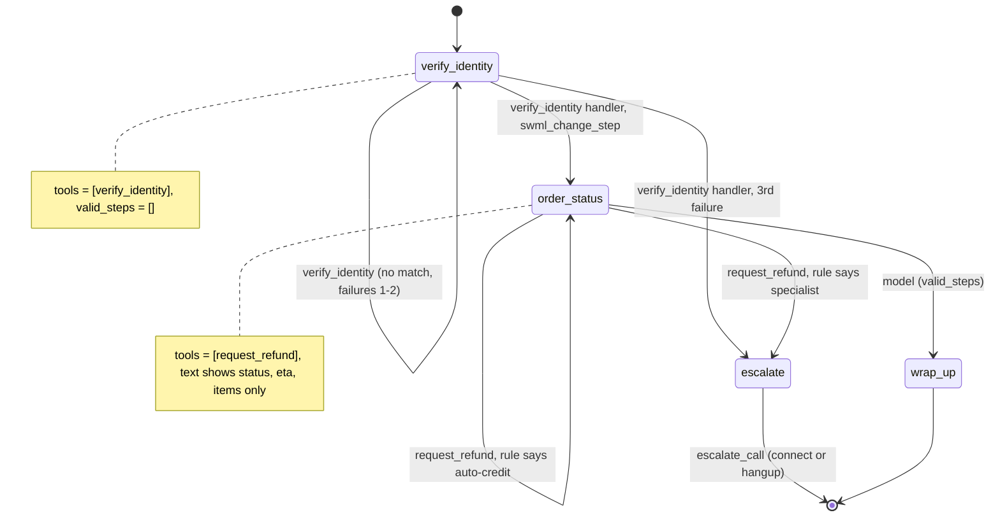

# AI Order Status Line

A caller checks where their order is, and asks for a refund that is either credited on the spot or handed to a specialist.

## What it does

The caller gives an order number and the shipping ZIP code. Once those match an order in the
mock CRM (`data/orders.json`), the agent can tell them the order status, the estimated delivery
and what's in it. If the caller asks for a refund, a server-side rule decides: small orders on
clean accounts get an automatic credit (written to `data/runtime/credits.jsonl`), and everything
else goes to a specialist. Three failed verifications also go to the specialist.

## What it demonstrates

The handler loads the full record, but the model sees only a curated slice (cookbook pattern 3,
verify-then-expand projection). `verify_identity` puts the whole order into `global_data`,
including `risk_flag`, `prior_refunds` and `internal_notes`. `global_data` isn't part of the
model's context on its own: it reaches the model only through `${global_data.*}` in step text,
and the `order_status` step text is built from `config.CURATED_FIELDS` (status, ETA, items).
The refund thresholds live in `config.py` and are read only inside `request_refund`, which tells
the model the outcome ("a credit was issued" or "this needs a specialist") and never the rule.
The model can't leak a flag it never saw, or argue with a limit it doesn't know.

The verification step has the same shape as recipe 08 (copied, not imported): one tool,
`valid_steps=[]`, and the third failure jumps to `escalate`.



| Primitive | Where |
|---|---|
| Full record into `global_data` | `app.py`, `verify_identity` handler |
| Curated `${global_data.order.<field>}` slice | `app.py`, `curated_step_text()`, fields from `config.CURATED_FIELDS` |
| Refund rule, server side only | `app.py`, `refund_decision()`, thresholds in `config.py` |
| `swml_change_step("escalate")` | `app.py`, `request_refund` and `verify_identity` handlers |
| `set_functions` + `set_valid_steps([])` | `app.py`, steps `verify_identity`, `wrap_up`, `escalate` |
| `connect()` or `hangup()` | `app.py`, `escalate_call` handler |

## Prerequisites

- Python 3.12 and a SignalWire Space (project ID, API token, Space URL)
- A phone number on the Space (in the demo pool, the `TEST_INBOUND` role from NUMBERS.md)
- A public URL for your machine (ngrok or similar)
- No third-party accounts. Orders are mocked in `data/orders.json`.
- Optional: a phone that a person answers, for the specialist transfer (`ESCALATION_NUMBER`)

## Setup

```bash
git clone https://github.com/signalwire-demos/ai-recipes
cd ai-recipes/recipes/32-order-status-line
python3.12 -m venv .venv && source .venv/bin/activate
pip install -r requirements.txt
cp .env.example .env    # fill in the SIGNALWIRE_* keys, PUBLIC_URL and basic auth
```

To test the transfer, set `ESCALATION_NUMBER` in `.env` to a real phone you can answer (the
demo pool's `HUMAN_LEG` number has no one on it). Leave it empty and the escalate step says a
specialist will follow up, then hangs up. `FROM_NUMBER` is optional caller ID for that leg.

## Run locally

```bash
python app.py                      # serves SWML on :3000
ngrok http 3000                    # in another terminal; put the URL in PUBLIC_URL
```

In the SignalWire Dashboard, set the phone number's call handler to
`https://USER:PASS@<your-tunnel>/` (USER/PASS = SWML_BASIC_AUTH_USER/PASSWORD), then call it.

Without a phone:

```bash
pytest -q
swaig-test app.py --list-tools
swaig-test app.py --dump-swml --raw | jq '.sections.main[-1].ai.prompt.contexts'
swaig-test app.py --exec verify_identity --order_number 100235 --postal_code 74012
```

Test orders (fake data):

| Order | ZIP | Status | Refund request goes to |
|---|---|---|---|
| 100234 | 74101 | out for delivery | specialist (not refundable yet, over the limit) |
| 100235 | 74012 | delayed | automatic credit |
| 100236 | 74133 | delivered | specialist (risk flag) |

On the call, ask "Where's my order?" then "I'd like a refund". Ask "Is my account flagged?"
and the agent can't say: the flag was never in its context.

## Deploy

```bash
docker compose up --build          # reads .env, serves on :3000
```

Put it behind any HTTPS host and point the number at `https://USER:PASS@<host>/`.
Serverless: the order record travels in `global_data`, so the agent is stateless, but
`crm.issue_credit` appends to a local file. Point `CREDITS_FILE` (or `crm.issue_credit`) at
real storage before deploying to Lambda or Cloud Functions.

## What to change first

Open `config.py`: `CURATED_FIELDS` is the slice of the order the model may see (add or remove
fields there, never `risk_flag`). Then set the refund rule (`AUTO_CREDIT_LIMIT`,
`MAX_PRIOR_REFUNDS`, `REFUNDABLE_STATUSES`) and replace `crm.verify()` with your order system.
