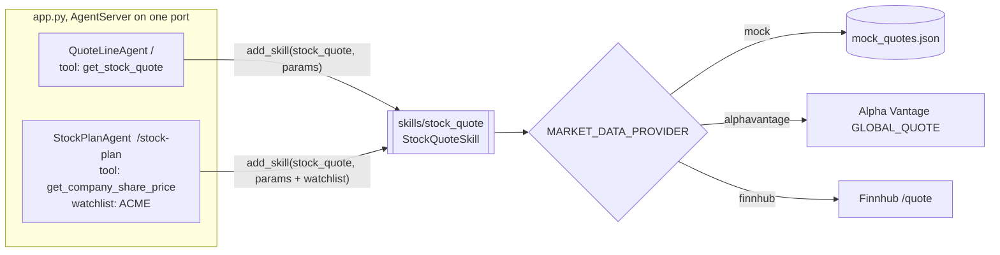

# AI Stock Quote Line

Two phone agents share one reusable `stock_quote` skill, each loading it with its own settings.

## What it does

A caller asks "What's Acme trading at?" and hears the price and today's change in a sentence
that reads well aloud: "Acme Corporation, ticker A C M E, is at 101.25 dollars, up 1.19, or
1.19 percent, today."

One process serves two agents:

| Agent | Route | Loads `stock_quote` with |
|---|---|---|
| `QuoteLineAgent`: a public quote line | `/` | `{"provider": ..., "api_key": ...}`: any ticker, tool `get_stock_quote` |
| `StockPlanAgent`: Acme's employee stock-plan line | `/stock-plan` | the same, plus `tool_name="get_company_share_price"` and `watchlist=["ACME"]` |

By default quotes come from a bundled mock feed (`skills/stock_quote/mock_quotes.json`,
fictional tickers ACME, GLBX, INIT, UMBR, WAYN), so a clean clone needs no market-data
account. Set `MARKET_DATA_PROVIDER=alphavantage` or `finnhub` and `MARKET_DATA_API_KEY` to use
real quotes.

## What it demonstrates

Writing a reusable skill instead of a one-off tool. `skills/stock_quote/skill.py` is a
`SkillBase` subclass. It declares its parameters (`get_parameter_schema`), checks them in
`setup()`, registers its tool, and brings its own prompt section, speech hints and fillers.
An agent gets all of that with one `add_skill("stock_quote", {...})` call.

The skill, not the prompt, holds the rules every agent inherits:

- **The provider and key stay in code.** The skill makes the HTTP call. `api_key` is marked
  `hidden` and never appears in the SWML (a test checks that), so no model or caller can read
  it. A paid provider with no key fails at `add_skill()` time, not halfway through a call.
- **Each agent's scope is a parameter.** The stock-plan line passes `watchlist=["ACME"]`, so
  its handler refuses any other ticker, however the caller asks. It also gets its own tool name
  (`SUPPORTS_MULTIPLE_INSTANCES = True`), so each agent's SWML lists only its own tool.
- **Failures are spoken, not raised.** A bad ticker, an unknown symbol, a rate limit or a
  timeout each come back as a sentence telling the model what to say next.



| Primitive | Where |
|---|---|
| `SkillBase` subclass, `get_parameter_schema`, `setup`, `register_tools` | `skills/stock_quote/skill.py` |
| `add_skill_directory` | `app.py`, module top |
| `add_skill("stock_quote", params)` with different params | `app.py`, both agents |
| `AgentServer` hosting two agents | `app.py`, `__main__` |

## Prerequisites

- Python 3.12 and a SignalWire Space (project ID, API token, Space URL)
- A phone number on the Space (in the demo pool, the `TEST_INBOUND` role from NUMBERS.md)
- A public URL for your machine (ngrok or similar)
- No third-party accounts. Optional: an [Alpha Vantage](https://www.alphavantage.co/support/#api-key)
  or [Finnhub](https://finnhub.io/register) API key for real quotes

## Setup

```bash
git clone https://github.com/signalwire-demos/ai-recipes
cd ai-recipes/recipes/34-stock-quote-line
python3.12 -m venv .venv && source .venv/bin/activate
pip install -r requirements.txt
cp .env.example .env    # fill in the SIGNALWIRE_* keys, PUBLIC_URL and basic auth
```

For real quotes, set `MARKET_DATA_PROVIDER=alphavantage` (or `finnhub`) and
`MARKET_DATA_API_KEY` in `.env`. Alpha Vantage's free tier allows only a few requests per
minute. When it refuses, the caller hears "The quote service isn't answering right now".

## Run locally

```bash
python app.py                      # both agents on :3000, at / and /stock-plan
ngrok http 3000                    # in another terminal; put the URL in PUBLIC_URL
```

In the SignalWire Dashboard, set the number's call handler to `https://USER:PASS@<your-tunnel>/`
for the quote line, or `https://USER:PASS@<your-tunnel>/stock-plan` for the stock-plan line.
Then call it and ask for "Wayne Enterprises, W A Y N". The quote line answers. The stock-plan
line says it only quotes ACME.

Without a phone:

```bash
pytest -q
swaig-test app.py --list-tools                                  # QuoteLineAgent
swaig-test app.py --agent-class StockPlanAgent --list-tools     # same skill, other tool name
swaig-test app.py --exec get_stock_quote --ticker "g l b x"
swaig-test app.py --agent-class StockPlanAgent --exec get_company_share_price --ticker WAYN
```

## Deploy

```bash
docker compose up --build          # reads .env, serves both agents on :3000
```

Put it behind any HTTPS host and point each number at its route. The agents are stateless, so
you can run as many replicas as you like.

## What to change first

Open `config.py`:

- `MARKET_DATA_PROVIDER` / `MARKET_DATA_API_KEY` (set them in `.env`) pick the provider. To add
  one, write a `yourprovider_quote(symbol, params)` function in `skills/stock_quote/skill.py`
  that returns `{symbol, name, price, change, change_pct}` (or `None` for an unknown symbol),
  and add it to `PROVIDERS`.
- `DESK_TICKERS`, `DESK_TOOL_NAME`, `DESK_COMPANY` set the second agent's scope. `skill_params()`
  holds the params both agents start from.

To reuse the skill outside this repo, package it for pip. Copy `skills/stock_quote/` into its
own project, and register it through the SDK's `signalwire.skills` entry point so
`add_skill("stock_quote")` finds it with no `add_skill_directory` call:

```toml
# pyproject.toml
[project]
name = "signalwire-skill-stock-quote"
version = "1.0.0"
dependencies = ["signalwire-sdk>=3.7.5", "requests"]

[project.entry-points."signalwire.skills"]
stock_quote = "stock_quote.skill:StockQuoteSkill"

[tool.setuptools.package-data]
stock_quote = ["mock_quotes.json"]
```
