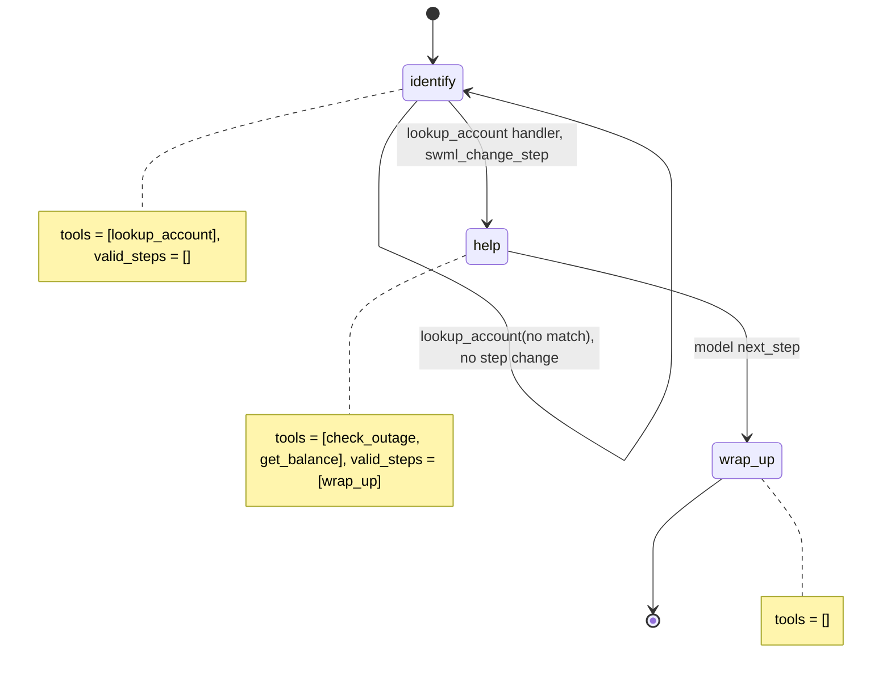

# AI Bilingual Support Line

A caller reaches an internet provider's support line, talks in English or Spanish (and can switch mid-sentence), and gets an outage check or their balance.

## What it does

The agent answers in English and offers Spanish. It asks for the account number and service
ZIP code, verifies them against `data/accounts.json`, greets the caller by first name, and
then checks for an outage at their address or reads the balance due. If the caller switches
to Spanish (or back) at any point, the agent switches with them, in that language's own
voice, without repeating questions. It ends with a goodbye in the caller's current language.

## What it demonstrates

Multilingual is a few lines of configuration, not a second code path. Each language is one
`add_language()` call with its own voice, speech fillers and function fillers, driven by one
entry in `config.LANGUAGES`, plus a per-language `next_step` internal filler. The handlers never
write sentences: `lookup_account`, `check_outage` and `get_balance` return language-neutral
JSON (`{"outage": true, "restore_eta": "2026-10-31T14:00:00-05:00"}`) that the model voices in
whatever language the call is in, so the same handler serves both languages.

The tools are still scoped by step. `identify` exposes only `lookup_account` and has
`valid_steps=[]`, so the account tools don't exist until the handler verifies the caller and
calls `swml_change_step("help")`. The handler copies only `first_name` and `plan` into
`global_data`: the internal risk flag and billing notes never reach the model. `check_outage`
and `get_balance` read the account from `global_data`, never from model arguments.



| Primitive | Where |
|---|---|
| `add_language` (voice + speech/function fillers per language) | `app.py`, `__init__`, one call per `config.LANGUAGES` entry |
| `add_internal_filler("next_step", code, ...)` | `app.py`, `__init__`, per language |
| `set_params({"languages_enabled": True})` | `app.py`, `__init__` |
| Language-neutral JSON tool results | `app.py`, `data()` helper used by every handler |
| `set_functions`, `set_valid_steps([])` | `app.py`, steps `identify`, `help`, `wrap_up` |
| `update_global_data` + `swml_change_step` | `app.py`, `lookup_account` handler |

## Prerequisites

- Python 3.12 and a SignalWire Space (project ID, API token, Space URL)
- A phone number on the Space (in the demo pool, the `TEST_INBOUND` role from NUMBERS.md)
- A public URL for your machine (ngrok or similar)
- No third-party accounts. The voices are Google Cloud voices that SignalWire hosts.

## Setup

```bash
git clone https://github.com/signalwire-demos/ai-recipes
cd ai-recipes/recipes/35-bilingual-support-line
python3.12 -m venv .venv && source .venv/bin/activate
pip install -r requirements.txt
cp .env.example .env    # fill in the SIGNALWIRE_* keys, PUBLIC_URL and basic auth
```

No other setup. The mock accounts and outages are in `data/accounts.json`.

## Run locally

```bash
python app.py                      # serves SWML on :3000
ngrok http 3000                    # in another terminal; put the URL in PUBLIC_URL
```

In the SignalWire Dashboard, set the phone number's call handler to
`https://USER:PASS@<your-tunnel>/` (USER/PASS = SWML_BASIC_AUTH_USER/PASSWORD), then call it.

Without a phone:

```bash
pytest -q
swaig-test app.py --list-tools
swaig-test app.py --dump-swml --raw | jq '.sections.main[-1].ai.languages'
swaig-test app.py --dump-swml --raw | jq '.sections.main[-1].ai.prompt.contexts'
swaig-test app.py --exec lookup_account --account_number 100877 --zip 74103
swaig-test app.py --custom-data '{"global_data": {"account_id": "100877"}}' --exec check_outage
```

On the call, try: "Hi, my account is 100877, ZIP 74103." Then switch: "¿Hay un apagón en mi
zona?" (an outage is mocked for 74103). Then "And what's my balance?" Other mock accounts:
100234 / 74101 (balance due, no outage) and 101555 / 74105.

## Deploy

```bash
docker compose up --build          # reads .env, serves on :3000
```

Put it behind any HTTPS host and point the number at `https://USER:PASS@<host>/`.
Serverless: the agent is stateless (the mock data is read-only), so `agent.run()` works
unchanged on AWS Lambda or Google Cloud Functions (see the SDK's `lambda_agent.py` example).

## What to change first

Open `config.py`. To add a language, append one dict to `LANGUAGES` (name, ASR code, voice,
speech fillers, function fillers, step fillers): that is one more `add_language()` call and
nothing else changes, because no handler holds any text. Pick a voice that speaks the
language. Then point `ACCOUNTS_FILE` at your own data, or replace `load_db()` in `app.py` with
calls to your billing and outage systems. Keep the handlers returning data, not sentences.
