# AI Voice Latency Lab

The same phone agent runs under several model and voice configurations, a harness calls each one with the same scripted caller, and you get a side-by-side latency table built from the platform's own per-turn timings.

## What it does

`app.py` is a small store-hours agent. The caller asks about opening hours, the agent calls
`check_hours` and answers in one sentence. A query parameter (`?config=nano-rime`,
`?config=mini-rime`, ...) picks one entry from `CONFIGS` in `config.py`, which sets the LLM model
and the TTS voice for that call. `run_lab.py` places scripted calls round-robin across the
configurations: TEST_CALLER dials TEST_INBOUND and speaks the same three lines each time. After each
call the platform POSTs its post-prompt report, the app saves it, and the lab turns those reports
into a comparison table (median and 95th percentile per latency segment).

## What it demonstrates

Model choice is a configuration change, not a code change. The dynamic config callback picks a
configuration from a server-side whitelist and changes exactly two things: the LLM model
(`set_prompt_llm_params(model=...)`) and the TTS voice (`add_language(...)`). An unknown
`?config=` gets the default, and a model name in the URL is never used. Everything else (the
prompt, the one step with its one tool `check_hours`, `valid_steps=[]`, the temperature) is
identical. A test diffs the SWML of every configuration against the baseline and fails if
anything other than the model and voice differs, so a comparison can't silently become unfair.
Timings come from the platform's data, never from the model: `on_summary` files each call's
post-prompt payload under the configuration named in `global_data`.

```mermaid
stateDiagram-v2
    [*] --> answer: SWML request ?config=name (whitelisted, else default)
    answer --> answer: check_hours handler, no step change
    answer --> [*]: caller hangs up
    [*] --> post_prompt: platform POSTs the post-prompt report after the call
    post_prompt --> [*]: on_summary saves runs/<config>/<call_id>.json
    note right of answer: tools = [check_hours], valid_steps = []; only model and voice vary
```



| Primitive | Where |
|---|---|
| `set_dynamic_config_callback` + whitelist | `app.py`, `configure()` and `pick_config()` |
| `set_prompt_llm_params(model=..., temperature=...)` | `app.py`, `configure()` |
| `add_language` (the voice under test) | `app.py`, `configure()` |
| `set_post_prompt` + `on_summary` (timing payload capture) | `app.py`, `LatencyLabAgent` |
| `set_functions`, `set_valid_steps([])` | `app.py`, step `answer` |
| Timing parser / report | `lab/timings.py`, `lab/report.py` |
| Scripted caller (caller-side SWML, TEST_CALLER → TEST_INBOUND) | `run_lab.py` → `scripts/smoke_call.py` |

### Measurement method

Where the numbers come from: the post-prompt payload (`raw_call_log`, falling back to `call_log`).
Each `assistant` entry carries `stamps_us` (microsecond wall-clock stamps: `last_word_end`,
`status_pushed`, `request_detect`, `first_token`, `first_utterance`, `first_audio`) and the reported
`eos_to_push_latency`, `latency`, `utterance_latency`, `audio_latency` and `acoustic_latency` fields
(the SDK types them in `signalwire.core.post_prompt_generated`). The REST call log
(`client.logs.voice`) only has call status and duration, so it isn't used for turn timings. The lab
follows the field definitions in
[Conversation analytics: Measure responsiveness](https://signalwire.com/docs/platform/ai/analytics):

| Column | Computed as |
|---|---|
| Mouth-to-ear | `first_audio - last_word_end` (µs → ms) |
| Turn detection | `eos_to_push_latency` (= `status_pushed - last_word_end`) |
| Tools / other | `request_detect - status_pushed`: tool calls and earlier model passes before the request that produced the first audio |
| Model | `latency` (= `first_token - request_detect`) |
| Utterance assembly | `utterance_latency - latency` |
| Audio (TTS) | `audio_latency - utterance_latency` |

The last five columns add up to mouth-to-ear (to within a few ms). On live lab calls, the computed
mouth-to-ear matched the platform's own `acoustic_latency` to within 1 ms, and the reported fields
are milliseconds. `tests/fixtures/live/` keeps two sanitized live payloads that pin this down.

There is one value per caller turn. Entries that share a `last_word_end` anchor (a tool call, the
reply after it, or a re-prompt after a silence timeout) count once, using the earliest
`first_audio`. An entry without both stamps (the greeting, a reply the caller barged over) is
omitted and counted as "untimed", never estimated. Percentiles are nearest-rank (each one is a
value that was actually measured). Calls are interleaved across configurations so that drift over
time hits every configuration equally. The caller is synthetic (`say:` TTS over PSTN), so every
configuration hears identical audio. These are server-side stamps: they don't include the PSTN
transport to and from the caller's handset.

TODO(blocked: align with the public methodology. Nothing yet confirms that this method matches
how SignalWire measures latency publicly, e.g. which anchor, which percentile, or whether
filler audio counts as the response. Until that's confirmed, treat the table as a relative
comparison between configurations, not a publishable figure.)

## Prerequisites

- Python 3.12 and a SignalWire Space (project ID, API token, Space URL)
- Two numbers on the Space: the agent's number and a caller number (in the demo pool,
  `TEST_INBOUND` and `TEST_CALLER` from NUMBERS.md). The lab repoints the agent number's
  handler for each call
- A public URL for your machine (ngrok or similar)
- The models and voices in `CONFIGS` must be enabled on your Space. They're SignalWire-hosted,
  so there are no third-party accounts

## Setup

```bash
git clone https://github.com/signalwire-demos/ai-recipes
cd ai-recipes/recipes/36-voice-latency-lab
python3.12 -m venv .venv && source .venv/bin/activate
pip install -r requirements.txt
cp .env.example .env    # fill in the SIGNALWIRE_* keys, PUBLIC_URL and basic auth
```

Put `TEST_INBOUND` and `TEST_CALLER` (E.164) in the monorepo-root `.env` or in this `.env`.
`run_lab.py` uses `../../scripts/smoke_call.py` from the monorepo to place each call.

## Run locally

```bash
python app.py                      # serves SWML on :3000
ngrok http 3000                    # in another terminal; put the URL in PUBLIC_URL
```

To talk to it yourself, set a number's call handler to
`https://USER:PASS@<your-tunnel>/?config=mini-rime` and call it. To run the lab (the app must
not already be running; `--start` launches it):

```bash
python run_lab.py --start --calls 10                        # every config, 10 calls each
python run_lab.py --start --calls 3 --configs nano-rime,mini-rime
python run_lab.py --report-only                             # rebuild the table from data/runtime/runs
```

In the ai-recipes demo Space, run it inside the shared live-call slot:
`scripts/live_slot.sh 36-voice-latency-lab -- recipes/36-voice-latency-lab/.venv/bin/python recipes/36-voice-latency-lab/run_lab.py --start --calls 10`.
The table prints and is written to `reports/latency-<timestamp>.md`, along with the call SIDs. It
covers that run's calls only. "Calls" reads `received of placed`, so a configuration whose calls
produce no post-prompt report (a voice or model the Space can't open, say) shows up as `0 of N`
instead of dropping out of the table.

Without a phone:

```bash
pytest -q
python run_lab.py --report-only --runs tests/fixtures/runs  # the table from fixture payloads
swaig-test app.py --list-tools
swaig-test app.py --dump-swml --raw --query-params '{"config": "oss120b-rime"}' | jq '.sections.main[-1].ai | {model: .prompt.model, voice: .languages[0].voice}'
swaig-test app.py --exec check_hours --day saturday
```

## Deploy

```bash
docker compose up --build          # reads .env, serves on :3000
```

Put it behind any HTTPS host and point the number at `https://USER:PASS@<host>/?config=<name>`.
Run `run_lab.py` (without `--start`) from any machine that has the credentials, and give it the
app's log with the shared smoke script if you want SWML-fetch checks. Serverless isn't a good
fit for the lab: the payloads are written to the local `data/runtime/runs`.

## What to change first

Open `config.py` and edit `CONFIGS`, the configuration matrix: one entry per model and voice
pair to compare (keep the first entry as your baseline). Then set `CALLER_SCRIPT` to the lines
that match your real calls (a tool-heavy turn and a chit-chat turn measure different things),
and `CALLER_PAUSE_SECS` so the agent has time to answer.
