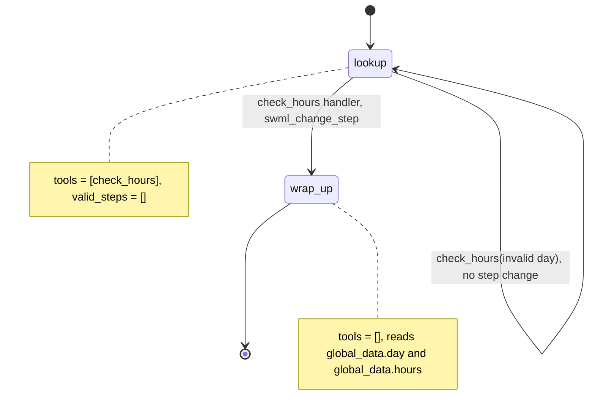

# Recipe Template (Office Hours Line)

A caller asks when the store is open on a given day and hears the hours.

## What it does

The agent asks which day the caller wants to visit, looks the day up in `data/hours.json`,
and reads back the opening hours (or tells them the store is closed). Then it asks if
there is anything else and says goodbye. This folder is the starting point for every
recipe: `scripts/new_recipe.sh <nn-slug>` copies it.

## What it demonstrates

The caller can't skip ahead. The `lookup` step exposes exactly one tool, `check_hours`, and
declares `valid_steps=[]`, so the model has no `next_step` tool and cannot leave the step.
Only the handler moves the call, with `swml_change_step("wrap_up")`, after it has written
the answer into `global_data`. `wrap_up` declares `set_functions([])`, so no tools are
reachable there (steps that omit `set_functions` inherit the previous step's tools).



| Primitive | Where |
|---|---|
| `define_contexts` / `add_step` | `app.py`, `TemplateAgent.__init__` |
| `set_functions`, `set_valid_steps([])` | `app.py`, steps `lookup` and `wrap_up` |
| `update_global_data` + `swml_change_step` | `app.py`, `check_hours` handler |
| `${global_data.*}` in step text | `app.py`, step `wrap_up` |

## Prerequisites

- Python 3.12 and a SignalWire Space (project ID, API token, Space URL)
- A phone number on the Space (in the demo pool, the `TEST_INBOUND` role from NUMBERS.md)
- A public URL for your machine (ngrok or similar)
- No third-party accounts

## Setup

```bash
git clone https://github.com/signalwire-demos/ai-recipes
cd ai-recipes/recipes/_template
python3.12 -m venv .venv && source .venv/bin/activate
pip install -r requirements.txt
cp .env.example .env    # fill in the SIGNALWIRE_* keys, PUBLIC_URL and basic auth
```

## Run locally

```bash
python app.py                      # serves SWML on :3000
ngrok http 3000                    # in another terminal; put the URL in PUBLIC_URL
```

In the SignalWire Dashboard, set the phone number's call handler to
`https://USER:PASS@<your-tunnel>/` (USER/PASS = SWML_BASIC_AUTH_USER/PASSWORD), then call it
and ask "Are you open on Thursday?".

Without a phone:

```bash
pytest -q
swaig-test app.py --list-tools
swaig-test app.py --dump-swml --raw | jq '.sections.main[-1].ai.prompt.contexts'
swaig-test app.py --exec check_hours --day friday
```

## Deploy

```bash
docker compose up --build          # reads .env, serves on :3000
```

Put it behind any HTTPS host and point the number at `https://USER:PASS@<host>/`.
Serverless: `agent.run()` detects AWS Lambda and Google Cloud Functions by their environment,
so this stateless agent can be deployed there unchanged (see the SDK's `lambda_agent.py` example).

## What to change first

Open `config.py`: set `BUSINESS_NAME` and `VOICE`, and point `HOURS_FILE` at your own hours
(or replace `load_hours()` in `app.py` with a call to your calendar).
